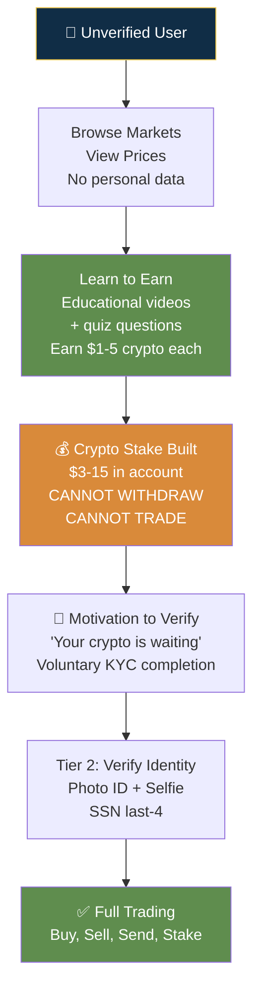

# Coinbase — Fields Collected & Collection Strategy

## Core Insight

**"Build a stake before you verify."** Coinbase's Learn to Earn program lets unverified users earn $1-5 of crypto from educational content. That crypto sits in the account — untouchable until KYC is completed. The user now has skin in the game and voluntarily completes verification to access their assets. This is the single most innovative onboarding hook in fintech.

| Tier | Fields | Gated Access |
|------|--------|-------------|
| **0: Unverified** | Email only | Browse, Learn to Earn ($1-5/task), deposit crypto |
| **1: Basic** | Name, DOB, address, phone | Progress saved |
| **2: Verified** | Photo ID + selfie + SSN last-4 | Trading, fiat, send, staking, Coinbase One |
| **3: Enhanced** | Employment, income, source of funds | Higher limits, wire transfers, OTC, Pro |
| **Institutional** | Entity docs, EIN, UBOs, source of wealth | Coinbase Prime |

---

## Conversion Tactics

| Tactic | Conversion Impact | Risk | Trade-off |
|--------|-------------------|------|-----------|
| **Learn to Earn** | **Very High** — builds stake before KYC ask | Low — crypto can't be withdrawn without KYC | Brilliant: voluntary KYC conversion driven by asset ownership |
| **Debit card instant buy at low limits** | **High** — reduces time to first purchase | Medium — card KYC done by issuer, chargeback risk | Card network KYC + low limits contain risk |
| **Mobile OCR auto-extract ID** | Medium — reduces typing errors | Low | Onfido/Jumio scan → prefill → 70-80% instant pass |
| **Simple BTC buy as first action** | **High** — preset amounts ($25/50/100/200) | Low | Single-screen simplicity = core conversion engine |
| **Confetti on transaction** | Medium — emotional design | None (regulatory scrutiny in MA) | Dopamine hit associating crypto with positive emotion |

---

## Takeaways for QBO

1. **Learn to Earn equivalent:** Free QBO report template, free invoice template, free tax calculator — build assets in QBO before requiring full setup. "Your free invoice template is ready — complete setup to customize."
2. **3-tier progressive KYC.** QBO should offer: unverified (browse dashboard), basic (name/email), verified (SSN for tax features), enhanced (bank connection for payroll).
3. **Mobile OCR for document scanning.** QBO should auto-extract business license/EIN data from mobile camera scan instead of manual entry.

---

## Change Log
| Date | Change |
|------|--------|
| 2026-08-05 | Initial creation — Coinbase fields analysis |
