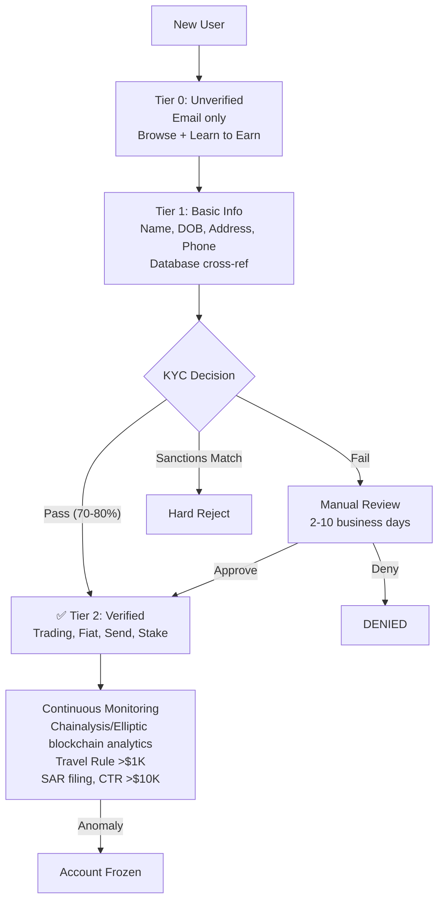

# Coinbase — Risk Decision Process

Coinbase operates as a FinCEN-registered MSB with a conservative compliance posture as a public company. Post-NYDFS 2023 consent order ($100M settlement), Coinbase invested $50M in compliance overhaul.

| Tier | Method | Data Source | SLA |
|------|--------|-------------|-----|
| Unverified | Email only | None | Instant |
| Basic | Name, DOB, address, phone | Credit bureau + public records | Minutes |
| Verified | Photo ID + selfie + SSN | Onfido/Jumio OCR + facial match + database cross-ref | 70-80% instant; rest: 2-10 days manual |
| Enhanced | Employment, income, source of funds | Manual document review | Days |
| Institutional | Entity docs + UBO KYC + source of wealth | Full KYB/EDD | Weeks |

**Key Regulatory Actions:** $100M NYDFS settlement (2023) for AML/KYC failures. $50M compliance investment. FCA £3.5M fine for high-risk customer onboarding. Conservative tilt: when in doubt, freeze and review.

---

## Takeaway for QBO
Coinbase proves that post-enforcement compliance overhaul can work — but the $100M lesson is: build compliance INTO the onboarding flow from day one, not as an afterthought.

## Change Log
| Date | Change |
|------|--------|
| 2026-08-05 | Initial creation |
