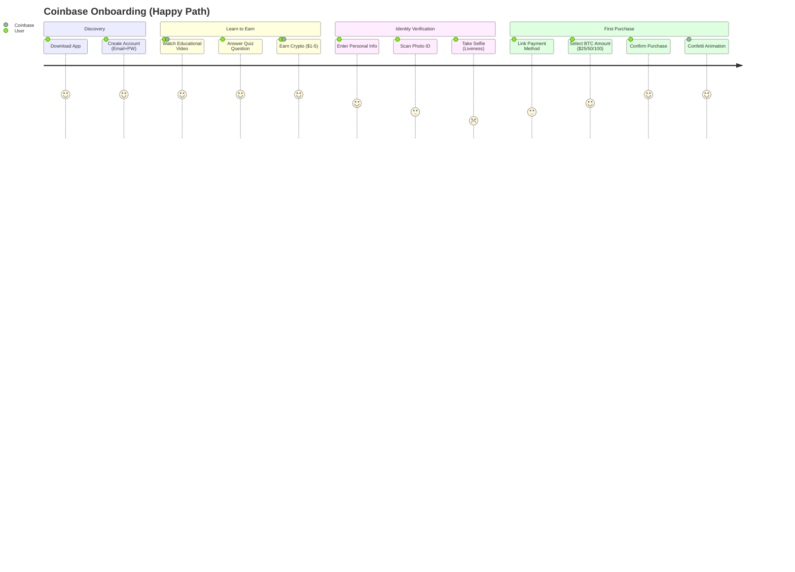

# Coinbase — UI/UX & Agentic Experience

| Attribute | Detail |
|-----------|--------|
| Steps | 21 (from download to first crypto purchase) |
| Time | 8-12 min (happy path); 2-10 days (manual review) |
| Mobile-first | >85% sign-ups on mobile; camera-dependent KYC; Face ID/fingerprint login |
| AI features | Coinbase Assistant chatbot, AI market insights, auto-invest DCA, smart portfolio tracking |

**Notable patterns:** Learn to Earn, simple BTC buy as first action, confetti on completion, bottom-sheet transactions, progressive feature disclosure (Advanced Trade revealed after first buy), Coinbase Wallet as separate "graduation" app.

## Change Log
| Date | Change |
|------|--------|
| 2026-08-05 | Initial creation |
