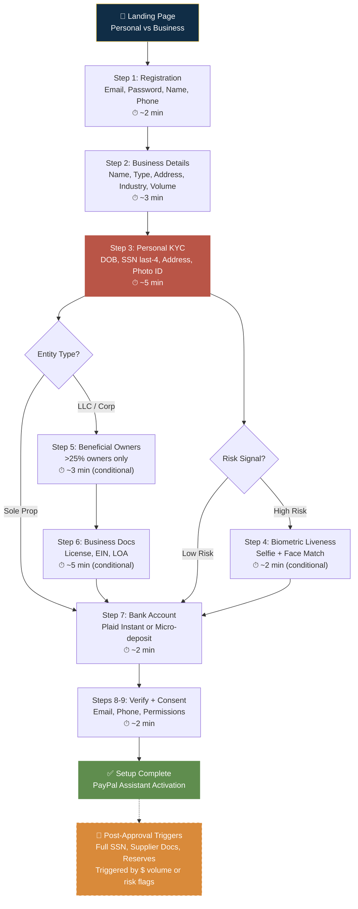
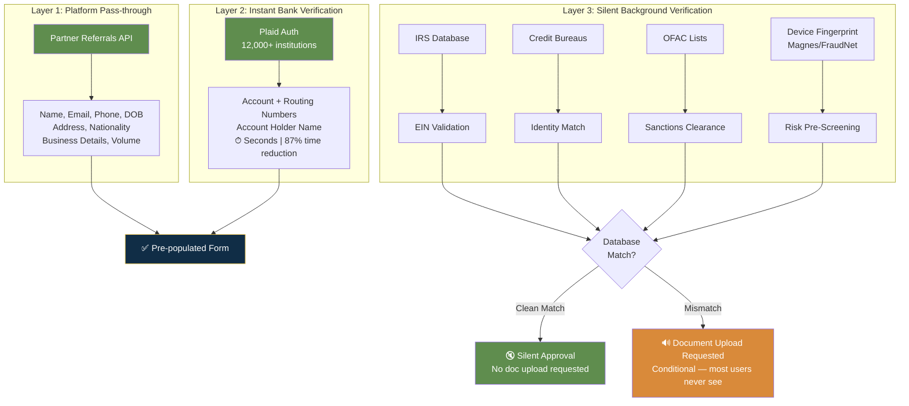

# PayPal — Fields Collected & Collection Strategy

## Collection Strategy Overview

| Attribute | Detail |
|-----------|--------|
| Total steps | 10 (including deferred post-approval step) |
| Total required fields | ~25 upfront; ~35 including conditionally triggered fields |
| Required fields | All legal/business identity fields; SSN last-4; bank account |
| Optional fields | Business website, beneficial owner details (conditional), supplier invoices |
| Estimated completion time | 10-20 min form fill + 2-5 business days for KYC review |
| Pre-fill sources used | Partner Referrals API, Plaid Auth, silent database verification, device fingerprint prescreening |
| Collection pattern | Multi-step wizard with progressive disclosure + post-approval underwriting as safety net |

---

## Core Design Philosophy: Why PayPal collects the way it does

**"Post-approval underwriting"** — signup is fast and mostly automated; deep risk review happens behind the scenes AFTER the merchant starts transacting. This is fundamentally different from banks that front-load all verification before granting any access.

The key trade-off: PayPal accepts some initial fraud exposure in exchange for much higher conversion among legitimate merchants. They can afford this because their **funds control** (holds, reserves, freeze capability) acts as the ultimate backstop — even if a bad actor gets through initial screening, PayPal can freeze their funds for up to 180 days.

### Progressive Disclosure Flow

---

## Step-by-Step Field Breakdown

### Step 1: Initial Account Registration

| Field | Required | Sensitive | Why Collected | Pre-fill Source | Minimization Tactic |
|-------|----------|-----------|---------------|-----------------|---------------------|
| Full legal name | Yes | No | Primary KYC/CIP identity anchor | Partner Referrals API | Only legal rep's name; beneficial owners deferred |
| Email address | Yes | No | Account identifier + verification anchor | Partner Referrals API | Verified via link click; not collected redundantly |
| Password | Yes | Yes | Account security | None (user-created) | No additional security questions at this stage |
| Phone number | Yes | No | 2FA, account recovery, compliance contact | Partner Referrals API | Only one phone required; additional contacts deferred |

### Step 2: Business Details

| Field | Required | Sensitive | Why Collected | Pre-fill Source | Minimization Tactic |
|-------|----------|-----------|---------------|-----------------|---------------------|
| Legal business name | Yes | No | KYB — must match formation docs exactly | Partner Referrals API | Single legal name; DBA optional and deferred |
| Business type / entity structure | Yes | No | Determines downstream document requirements | Partner Referrals API | Simple dropdown; documents requested contextually |
| Business address (physical, no PO Box) | Yes | No | KYB — must match formation/tax/bank records; FinCEN CIP | Partner Referrals API | Proof of address only if mismatch detected |
| Business phone | Yes | No | Customer service contact for merchant accounts | Partner Referrals API | Not separately verified |
| Industry / MCC code | Yes | No | Risk scoring, AUP screening, regulatory categorization | Partner Referrals API | Categorical selection; detailed description deferred |
| Business website URL | No | No | Risk assessment — reviews for prohibited items, legitimacy | Partner Referrals API | Optional at signup; may be requested later |
| Primary currency | Yes | No | Settlement currency, fees, regulatory jurisdiction | Partner Referrals API | Single currency; multi-currency deferred |
| Estimated monthly sales volume | Yes | No | Risk tiering — reserve requirements, underwriting intensity, 1099-K | Partner Referrals API | Range-based estimate, not exact; verified later against actual data |
| Customer service email + phone | Yes | No | Reg. requirement — displayed to buyers on receipts | Partner Referrals API | Can match primary contact |

### Step 3: Personal Identity (Primary Contact)

| Field | Required | Sensitive | Why Collected | Pre-fill Source | Minimization Tactic |
|-------|----------|-----------|---------------|-----------------|---------------------|
| Date of birth | Yes | Yes | KYC/CIP — FinCEN requirement for identity verification | Partner Referrals API | Only primary contact; beneficial owner DOBs conditional |
| SSN / ITIN (last 4 digits) | Yes (US) | Yes | KYC/CIP — IRS taxpayer ID; OFAC screening | Partner Referrals API | **Last 4 digits only at signup** — full SSN deferred to post-approval |
| Home address | Yes | Yes | KYC — must match identity docs; separate from business address | Partner Referrals API | Proof of address only on mismatch |
| Government-issued photo ID | Yes | Yes | KYC/CIP — regulatory requirement for IAL2 identity proofing | Not prefillable | Upload required; biometric liveness deferred to conditional step |
| Nationality | Yes | No | OFAC screening, FATCA, jurisdictional risk | Partner Referrals API | Single selection; dual citizenship not asked unless flagged |

### Step 4: Biometric Identity Verification (Conditional)

| Field | Required | Sensitive | Why Collected | Pre-fill Source | Minimization Tactic |
|-------|----------|-----------|---------------|-----------------|---------------------|
| Facial biometric scan (live selfie) | Conditional | Yes | Anti-fraud — liveness detection prevents static photo/replay attacks | Not prefillable | Only for legal reps + beneficial owners; not all regions; desktop alternative exists |
| Device location / GPS | Conditional | Yes | India regulatory requirement — physical in-country confirmation | Not prefillable | Jurisdiction-specific only; not collected in US/EU |

### Step 5: Beneficial Ownership (Conditional)

| Field | Required | Sensitive | Why Collected | Pre-fill Source | Minimization Tactic |
|-------|----------|-----------|---------------|-----------------|---------------------|
| Beneficial owner name/DOB/address/ID | Conditional | Yes | FinCEN CDD Rule — all individuals with >25% equity + control person | Not prefillable | **Only triggered if multi-owner entity >25% threshold**; sole props skip entirely; collected progressively post-signup |

### Step 6: Business Document Upload (KYB) — Conditional

| Field | Required | Sensitive | Why Collected | Pre-fill Source | Minimization Tactic |
|-------|----------|-----------|---------------|-----------------|---------------------|
| Business license / Certificate of Incorporation | Conditional | No | KYB — proof of legal entity existence | Not prefillable | Varies by entity type + jurisdiction; sole props may only need GST/shop license |
| EIN confirmation letter (IRS CP 575) | Conditional | No | KYB — IRS tax ID verification; cross-ref against submitted EIN | Not prefillable | Only when EIN can't be verified electronically or mismatches |
| Proof of business address | Conditional | No | KYB — when submitted address doesn't match formation docs or 3rd party DB | Not prefillable | Only if address mismatch detected during automated KYB |
| Letter of Authorization (LOA) | Conditional | No | Required when account user is not a director/partner of entity | Not prefillable | Only when signer role ≠ entity records |
| Website screenshots | Conditional | No | Risk underwriting — validates business legitimacy | Not prefillable | Post-approval, not during signup |

### Step 7: Bank Account Linking

| Field | Required | Sensitive | Why Collected | Pre-fill Source | Minimization Tactic |
|-------|----------|-----------|---------------|-----------------|---------------------|
| Bank account + routing number | Yes | Yes | Settlement — account name must match legal business name exactly | **Plaid Auth** — instant bank verification via token-based online banking (12,000+ institutions, 99.9% coverage) | Instant verification avoids 2-3 day micro-deposit wait; bank credentials not stored |
| Bank account holder name | Yes | No | Must match legal business name for KYB + prevent misdirected payouts | Plaid Auth auto-populates | User confirms, doesn't type |

### Steps 8-9: Email/Phone Verification + Permissions

Standard verification steps — email click + SMS code + API permission grants + data sharing consent. Pre-configured by integrating platform. These happen concurrently, not as sequential gates.

### Step 10: Post-Approval / Deferred Triggers

| Field | Required | Sensitive | Why Collected | Pre-fill Source | Minimization Tactic |
|-------|----------|-----------|---------------|-----------------|---------------------|
| Full SSN / ITIN | Conditional | Yes | Triggered by $20K/200-transaction 1099-K threshold or risk flags | Not prefillable | **Deferred** — millions of low-volume merchants never asked |
| Additional identity documents | Conditional | Yes | Triggered by elevated risk scoring | Not prefillable | Risk-based adaptive step-up; low-risk users never see this |
| Supplier invoices / proof of fulfillment | Conditional | No | Post-approval underwriting — validates business model | Not prefillable | Post-approval only; used to lift account limitations |
| Rolling reserve percentage | Conditional | No | 10-30% of transactions held 90-180 days; algorithmically determined | Not prefillable | Applied post-approval; low-risk established merchants may never have reserves |

---

## Pre-fill Strategy Analysis

### Three-Layer Pre-fill Architecture

### Sources Used
|-------|--------|-------------------|----------|------------------------|
| **Layer 1: Platform Pass-through** | Partner Referrals API | Name, email, phone, DOB, address, nationality, business details, volume ranges | High (already validated by platform) | Eliminates duplicate entry entirely for referred signups |
| **Layer 2: Instant Bank Verification** | Plaid Auth | Account/routing numbers, account holder name | Very high (token-based, 99.9% US bank coverage) | 87% time reduction vs manual; +23% conversion lift in A/B tests |
| **Layer 3: Silent Background Verification** | IRS databases, credit bureaus, OFAC lists, device fingerprint | Verification outcome (not field values) | Varies; when passes, no additional docs requested | Eliminates document uploads entirely for clean-match users |

### What PayPal Does NOT Pre-fill (and Why)

| Field | Why NOT Pre-filled | Trade-off Analysis |
|-------|-------------------|-------------------|
| Government photo ID | Cannot pre-fill — document must be captured live for anti-fraud integrity | Accepts friction (47-sec avg dwell before abandonment) because regulatory requirement is non-negotiable |
| Beneficial owner details | Not available from third party at onboarding time; conditional on entity structure | Deferred collection minimizes impact — sole props never see this |
| Business registration docs | Not universally available from a single API; varies by jurisdiction + entity type | Contextual triggering based on entity type + mismatch detection minimizes unnecessary requests |

---

## Minimization Strategy

**Core principle:** "Ask for the right info at the right time" — not "ask for everything upfront."

### Progressive Collection

| Stage | Fields Collected | Trigger |
|-------|-----------------|---------|
| Initial signup | Email, name, password, phone | Universal — hooks engagement |
| Business profile | Business name, type, address, industry, currency, volume estimate | Universal — risk tiering |
| Personal KYC | DOB, SSN last-4, home address, photo ID, nationality | Universal for US (SSN last-4 only) |
| Biometric | Live selfie, GPS (India) | Conditional — high-risk jurisdictions or fraud signals |
| Beneficial owners | Name, DOB, address, ID per owner | Conditional — multi-owner entities only |
| Business docs | License/EIN/address proof/LOA | Conditional — entity type, jurisdiction, mismatch detection |
| Bank linking | Account/routing, holder name | Universal — required for settlement |
| **Post-approval** | Full SSN, additional docs, supplier invoices, reserve % | Triggered by transaction activity or risk flags |

### Key Minimization Tactics

1. **Last-4 SSN at signup → Full SSN only if transaction volume exceeds $20K/200-transaction threshold.** Millions of low-volume merchants never share their full SSN.
2. **Beneficial owner info only if >25% ownership threshold is met.** Sole proprietorships skip entirely.
3. **Silent database verification as first attempt.** Documents only requested when automated checks fail — effectively a "prefill of the verification outcome."
4. **Entity + jurisdiction contextual document requests.** A US sole prop may never upload a business license; an Indian LLP may need partnership deed + PAN + GST.
5. **Post-approval underwriting as the safety net.** Instead of front-loading verification, PayPal lets merchants transact and investigates later if risk signals emerge. Funds can be frozen for 180 days — making this viable.

---

## Conversion Tactics

| Tactic | How It Works | Risk Impact | Conversion Impact | Trade-off Rationale |
|--------|-------------|-------------|-------------------|-------------------|
| **Progressive Disclosure** | Info requested at contextually relevant moments, not front-loaded | Low — info still collected, just deferred | **High** — reduced upfront overwhelm | Net conversion gain from reduced drop-off outweighs partial completions |
| **Instant Bank Verification (Plaid)** | Token-based auth returns account/routing in seconds | Low — token-based; credentials not stored | **High** — +23% conversion vs manual entry | Cost of Plaid integration offset by conversion gain |
| **Partner API Prefill** | Platform passes already-collected data to pre-populate PayPal forms | Low — platform already validated data | **High** — eliminates duplicate entry | Requires platform engineering but dramatically reduces merchant friction |
| **Risk-Based Adaptive Step-ups** | Low-risk users sail through; additional checks only when risk elevated | Medium — some fraud slips through; caught later via fund freeze | **High** — stops fraud without stopping signups | PayPal accepts initial fraud exposure in exchange for higher legitimate merchant conversion |
| **Embedded Onboarding SDK** | PayPal's onboarding renders inside partner platform — no context switch | Low — PayPal still controls verification | **High** — no domain-change anxiety; higher than redirect | US-only availability limits reach |
| **PayPal Assistant** | AI chatbot guides post-signup activation instead of cold dashboard | Low — purely UX enhancement | Medium — increases completion of key setup steps | Benefits compound over lifetime; not dramatic at signup point |
| **Unified Cross-Product Framework** | Data carries forward across products — no re-entry for Express Checkout → Payments Pro | Low — reduces data inconsistency | Medium — systemic benefit | Required significant org alignment; benefits are systemic |
| **Biometric Verification** | Liveness detection matched against government ID | Low — strong anti-fraud | **Low** — 47-sec avg dwell before abandonment | PayPal accepts conversion loss because regulatory + fraud reduction justify it |
| **Hosted Redirect Minibrowser** | Overlay mode instead of full redirect; keeps partner context visible | Low — same PayPal-controlled flow | Medium — better than full redirect | Limited mobile screen real estate for doc upload |
| **Skip and Do Later** | Small link beneath primary CTA to defer steps | Medium — unverified accounts pose compliance risk | Low — poorly executed: ambiguous language, hidden placement | **Good idea, bad execution** — 34% of new user support tickets stem from setup confusion |

---

## Risk-vs-Conversion Trade-off Analysis

**Key question:** For each field/step, could PayPal remove it without creating unacceptable risk?

| Field/Step | If Removed: Risk Increase | If Removed: Conversion Increase | Verdict |
|------------|--------------------------|-------------------------------|---------|
| Photo ID upload | Massive — eliminates core KYC identity proofing | High — removes #1 drop-off point (47-sec dwell) | **Must keep** (regulatory mandate) |
| SSN (last 4) | Medium — weakens identity matching; full SSN deferred anyway | Medium — privacy-sensitive users drop at SSN | **Keep** (IRS mandate; last-4 is already the minimal version) |
| Biometric liveness | Medium — adds fraud layer beyond doc check | High — would eliminate high-friction conditional step | **Conditional is right** — applying to all users would be overkill; current risk-based trigger is correct |
| Beneficial ownership | High (for multi-owner) — regulatory; FinCEN CDD | Low — only affects multi-owner entities | **Keep** (regulatory mandate; triggers conditionally) |
| Business documents | Medium — KYB verification depth reduced | Medium — conditional nature means most don't see it | **Current conditional approach is optimal** |
| Bank account linking | Critical — no settlement capability without it | N/A — merchants need to get paid | **Must keep** — but Plaid instant verification minimizes friction |
| Estimated monthly volume | Low — could infer from actual data later | Low — range-based, not intrusive | **Could remove** — but serves risk tiering purpose and is not high-friction |
| Business website URL | Low — optional already; could remove entirely | Very low — already optional | **Keep or remove** — low impact either way |

---

## Key Design Insights for QBO

1. **"Gates on outflow, not inflow"**: PayPal's single most important design pattern. Let users engage immediately (receive money), gate sensitive actions (withdraw, send) behind verification. QBO equivalent: let users explore dashboard, connect a bank, see reports immediately — gate payroll, tax filing, and money movement behind full verification.

2. **Last-4 SSN only at signup**: PayPal defers full SSN to post-approval, triggered by transaction volume. QBO can do the same — collect just enough for initial identity match, request full SSN only when tax filing or payroll features are activated.

3. **Post-approval underwriting**: The entire field minimization strategy depends on the ability to retroactively enforce (funds freeze, escalation, re-verification). QBO needs a similar safety net — the ability to restrict features or flag accounts after-the-fact if risk signals emerge.

4. **Instant Bank Verification is worth the integration cost.** Plaid's +23% conversion lift over manual micro-deposits applies to QBO's bank connection step too.

5. **Embedded onboarding for ISV partners**: PayPal's SDK lets partners offer PayPal setup without leaving their platform. QBO should offer the same — if a partner (e.g., Shopify, Square) wants to bundle QBO, the onboarding should render inside their UI.

---

## Sources

- [PayPal Seller Onboarding Developer Docs](https://developer.paypal.com/docs/multiparty/seller-onboarding/build-onboarding/)
- [PayPal Partner Referrals API v2](https://developer.paypal.com/docs/api/partner-referrals/v2/)
- [Jessica Chang — Global Merchant Onboarding: Designing a Unified Activation Framework](https://www.jessicalchang.com/merchantonboarding)
- [Plaid Auth Product](https://plaid.com/products/auth/)
- [Plaid Instant Onboarding + Identity Verification](https://plaid.com/use-cases/instant-onboarding-identity-verification/)
- [PayPal KYC (India)](https://www.sandbox.paypal.com/in/webapps/mpp/know-your-customer)
- [Brian Adam Daniels — PayPal Business in a Box Case Study](https://www.brianadamdaniels.com/paypal-business-in-a-box-case-study)
- [SaaS Factor — PayPal Product Design Case Study](https://www.saasfactor.co/case-studies/paypal)

---

## Change Log

| Date | Change |
|------|--------|
| 2026-08-05 | Initial creation — PayPal pilot fields and collection strategy analysis |
