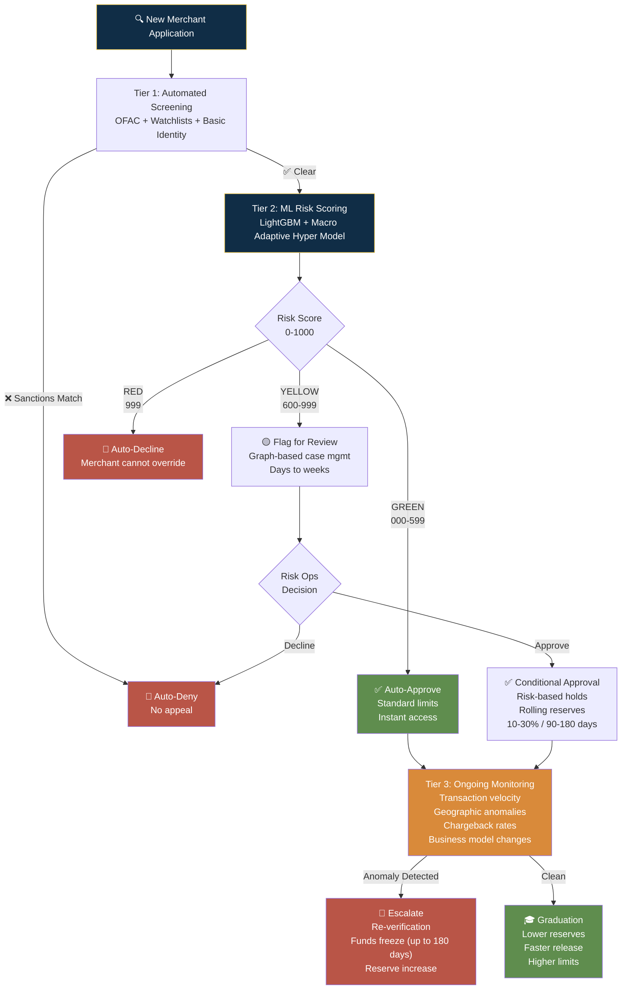
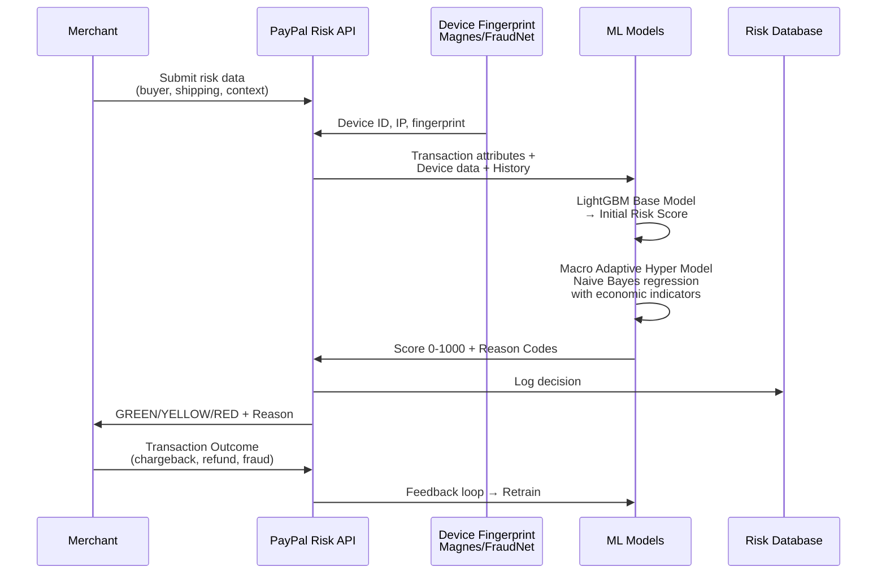
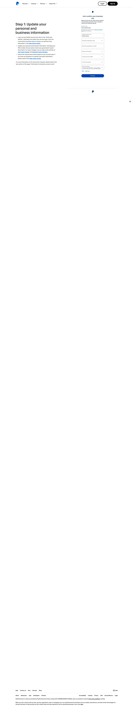

# PayPal — Risk Decision Process

## Risk Philosophy

**Stated approach:** "Protect merchants and consumers through AI-powered risk management while minimizing friction for legitimate users."

**Actual approach (inferred):** PayPal operates a **layered defense-in-depth** model: (1) automated screening catches obvious bad actors, (2) ML-based scoring triages borderline cases, (3) post-approval monitoring catches what slipped through, and (4) fund control (holds, reserves, freezes) is the ultimate backstop. The key insight: **PayPal accepts some initial fraud exposure in exchange for conversion, because their ability to freeze funds retroactively makes "catch later" economically viable.** This is fundamentally different from banks, which must "catch everything upfront" because they can't freeze money that's already been withdrawn.

### Risk Decision Architecture



### Risk Scoring Pipeline (Per-Transaction)



---

## Verification Tiers

### Tier 1: Unverified (Immediate)

| Attribute | Detail |
|-----------|--------|
| Trigger | Basic account creation — email + password |
| Verification methods | Email confirmation, phone verification (optional) |
| Data sources | Email, phone, self-reported name/address |
| Decision logic | Account created immediately with withdrawal limits and longer settlement times (3-5 business days) |
| SLA | Near-instant |
| False positive rate (est.) | N/A — this tier accepts nearly everyone |

### Tier 2: Verified (KYC)

| Attribute | Detail |
|-----------|--------|
| Trigger | User wants to lift withdrawal limits, enable instant transfers, access full services; OR cumulative volume hits ~$500-$2,500 |
| Verification methods | Government photo ID upload, bank account linking + confirmation (micro-deposits or Plaid instant), proof of address, PAN card + video KYC (India) |
| Data sources | ID document OCR/scans, bank account ownership verification, utility/statement records, 1Kosmos BlockID Verify (IAL2), video KYC recording (India) |
| Decision logic | Automated document validation + database cross-referencing. Clear match → verified. Mismatch → manual review or request more docs. |
| SLA | 1-3 business days (standard); 2-3 days after video KYC call (India) |
| False positive rate (est.) | Low — but India video KYC has high false-positive from contractors rejecting laminated/photocopied PAN cards |

### Tier 3: Business / Premier (Underwritten — KYB + Enhanced Due Diligence)

| Attribute | Detail |
|-----------|--------|
| Trigger | Large revenue (tens to hundreds of thousands USD/month), high-risk business category, sudden volume spikes, high chargeback/refund rates |
| Verification methods | Business license/registration papers, accounting records (income statements, balance sheets, cash flow), Article of Incorporation/MoA, partnership deed, LOA, manual review by risk operations team |
| Data sources | Business registration databases, financial statements, transaction history, industry/market data, internal ML risk models |
| Decision logic | LightGBM base model generates initial risk score → Macro Adaptive Hyper Model adjusts using macro-economic factors (inflation, etc.) via Naive Bayes regression → thresholds determine auto-approve / auto-decline / manual review. Manual review uses graph-based case management. |
| SLA | Days to weeks (varies by complexity) |
| False positive rate (est.) | Moderate — 57.3% average reduction in false declines for participating merchants using Fraud Protection Advanced |

---

## KYC / KYB Process



### Individual (KYC)

| Check | Method | Data Source | Required By |
|-------|--------|-------------|-------------|
| Identity | Government-issued photo ID: passport, driver's license, national ID card | Document OCR + database cross-reference | FinCEN CIP (31 CFR Part 1010.100) |
| Address | Utility bill, bank statement, government letter, or driver's license | Document review + database match | FinCEN CIP |
| Date of Birth | Self-reported + cross-referenced with ID document | ID document verification | FinCEN CIP |
| SSN/ITIN | Last 4 at signup; full SSN triggered by 1099-K threshold or risk flags | IRS database cross-reference | IRS; OFAC screening |
| Liveness | Facial biometric scan matched to photo ID (conditional) | Mobile app camera + biometric matching | Anti-fraud (not regulatory) |

### Business (KYB)

| Check | Method | Data Source | Required By |
|-------|--------|-------------|-------------|
| Business registration | Certificate/license upload + database cross-reference | State/country business registries | FinCEN CDD Rule |
| EIN verification | IRS CP 575 letter or electronic verification | IRS database | IRS |
| UBO identification | Name, DOB, address, photo ID for all individuals with >25% ownership + one control person | Self-reported + document verification | FinCEN CDD Rule |
| Business address | Physical address matching formation docs, tax records, bank records | Document review + database match | FinCEN CIP |

---

## Fraud Detection Signals

PayPal's fraud models leverage the **2-Sided Network** (439M+ accounts, 12.8B+ digital identifiers, $1.79T annual payment volume).

| Signal | Weight | Collection Method | Privacy Impact |
|--------|--------|-------------------|---------------|
| **Device fingerprint** | High | Magnes SDK (mobile): device identifiers, OS, model, screen res, behavioral data; FraudNet JS (web): cookies, TCP/IP params, browser fingerprint — persisted across sessions (iOS keychain/Android) | Medium — persistent tracking across sessions |
| **IP geolocation** | High | IP risk scoring (known proxies, Tor exit nodes, high-risk geographies); distance/time between billing, shipping, IP | Low — standard network data |
| **Email/phone reputation** | Medium | Age, domain reputation, prior fraud association across PayPal's network; new vs. established weighting | Low — network-level aggregation |
| **Velocity checks** | High | Transaction frequency spikes >300% daily averages; new recipient patterns; shopping cart abandonment analysis; login pattern anomalies | Low — internal transaction data |
| **Behavioral biometrics** | Medium (emerging) | Typing patterns, mouse movements, navigation behavior | Medium — behavioral tracking |
| **Browser/OS fingerprint** | Medium | Screen resolution, installed fonts, WebGL, canvas fingerprint via FraudNet JS | Medium — browser fingerprinting |
| **MACRO-ECONOMIC adjustment** | Contextual | Inflation indicators, economic conditions — applied as Naive Bayes regression over base risk score | None — macro data, not personal |

### Risk Scoring Pipeline

```
1. PRE-TRANSACTION
   Merchant submits risk data (buyer info, shipping, transaction context)
   → Returns DataCollectionId linked to pay-ins
   → Device fingerprint collected (Magnes/FraudNet)

2. TRANSACTION SCORING
   LightGBM Base Model → Macro Adaptive Hyper Model
   → Output: 0-1000 score + reason codes
   
   GREEN  (000-599): Auto-approve
   YELLOW (600-999): Flag for review (merchant may accept risk)
   RED    (999):     Auto-decline (merchant cannot override)

3. REASON CODES
   HIGH_UNAUTHORIZED_RISK, UNUSUAL_ENTITY_DEVICE_RISK,
   HIGH_VELOCITY, NEGATIVE_HISTORY, HIGH_RISK_CONNECTION,
   LOW_MERCHANDISE_RISK, etc.
```

### Merchant-Controlled Configuration (Fraud Protection Advanced)

- 500+ pre-calculated features to build custom filters
- Block lists, allow lists, review lists (email, address, card number, custom fields)
- Risk tolerance thresholds per filter
- Filter simulation/testing on historical data before deployment
- Customizable user permissions for manual review workflows


---

## Sanctions & Watchlist Screening

| List | Scope | Automation Level |
|------|-------|-----------------|
| OFAC SDN | Global — every account at creation, every transaction, continuous re-screening | Fully automated via API |
| Country-based sanctions | Iran, Syria, Cuba, Crimea/North Korea — BINs from sanctioned regions auto-declined | Fully automated |
| EU Consolidated List | EU merchants and transactions | Automated |
| UN Sanctions | Global | Automated |
| PEP screening | Political figures + family/associates | Automated |
| Adverse media | Negative news monitoring — ongoing | Automated alerts → manual review |

### Penalty Exposure
- Civil: up to $1,423,284 per violation (2025 adjusted rate)
- Criminal: up to $1 million

### Three Types of Account Freezes

| Freeze Type | Trigger | Key Indicator |
|-------------|---------|---------------|
| Platform Internal Risk Control | PayPal's own fraud/risk systems | Notification mentions "risk review" or "suspicious activity" |
| Bank-Level OFAC Interception | Intermediary bank flags transaction | Notification explicitly mentions "OFAC" or "sanctions compliance" |
| SDN Listing (Most Severe) | Merchant appears on OFAC's SDN list | Multiple institutions freeze accounts simultaneously; name on OFAC public SDN list |

---

## Decision Model

### Automated Decision Pipeline

```
DATA COLLECTION
  ├── Pre-transaction risk data (buyer, shipping, context, industry-specific)
  ├── Device fingerprint (Magnes mobile / FraudNet web)
  ├── 3D Secure authentication (where applicable)
  └── AVS/CVV verification (card transactions)

ML RISK SCORING
  ├── LightGBM Base Model: transaction attributes + device data + historical patterns + network signals
  └── Macro Adaptive Hyper Model: Naive Bayes regression using macro-economic factors → scaled risk score

THRESHOLD-BASED ROUTING
  ├── GREEN  (000-599) → Auto-Approve (processed; merchant cannot override)
  ├── YELLOW (600-999) → Manual Review Queue (merchant may accept after review)
  └── RED    (999)     → Auto-Decline (blocked; merchant cannot override)
```

### Onboarding Decision Logic (Account-Level)

```
1. Automated CIP/KYC check
   → Sanctions screening + ID document validation + basic identity verification

2. Risk tier assignment
   ├── LOW risk    → Automated approval with standard limits
   ├── MEDIUM risk → Automated approval with risk-based holds, reserves, or limits
   └── HIGH risk   → Manual underwriting by risk operations team

3. Manual underwriting triggers
   ├── Large revenue (tens to hundreds of thousands USD/month)
   ├── High-risk industry (travel, tickets, supplements, crypto-adjacent)
   ├── Sudden volume spikes (exceeding 300% of daily average)
   └── Excessive chargebacks/refunds

4. Enforcement actions
   ├── Account limitations (restrict sending/withdrawing)
   ├── Risk-based holds (funds held for up to 180 days)
   ├── Rolling reserves (10-30% held for 90-180 days)
   ├── Suspension
   └── Termination
```

### Proven Results

From PayPal internal analysis of 107 high-chargeback merchants:
- **40.8%** average decrease in chargebacks
- **57.3%** average reduction in false declines of legitimate customers

---

## Ongoing Monitoring

PayPal's risk assessment **does not stop after account approval.** It is always-on, AI-powered, and multi-dimensional.

| Monitor | Frequency | Action on Trigger |
|---------|-----------|-------------------|
| Transaction velocity | Continuous, real-time | Flag if >300% daily average spike → manual review |
| Geographic anomaly | Per-transaction | Billing/shipping/IP mismatch → manual review |
| Chargeback/refund rate | Continuous | If crosses internal threshold → reserve applied or account limitation |
| Business model change | Continuous | Mismatch between declared and actual activity → re-verification |
| Periodic KYC refresh | Annually (low-risk), Quarterly (high-risk) | Re-verification triggered |
| PEP status change | Event-driven | Alert → manual review |
| Sanctions list update | Event-driven (as lists change) | Re-screening against new entries |
| Adverse media alert | Event-driven | Alert → manual review |
| Compliance config audit | Quarterly (recommended) | API permission review, OAuth rotation, 2FA enforcement |

### Lifecycle Feedback Loop

Merchants share transaction outcomes (chargebacks, refunds, confirmed fraud) with PayPal → data fed back into model retraining → continuous improvement of fraud detection.

---

## Risk-vs-Conversion Trade-off Analysis

| Risk Decision | False Positive Risk | Conversion Impact | Suggested Improvement |
|---------------|-------------------|-------------------|----------------------|
| **Post-approval underwriting** ("let through now, investigate later") | Medium — fraudsters can extract some value before being caught | Very High — merchants get instant access | PayPal's single best risk decision. QBO should adopt equivalent: let users connect bank, see dashboard, generate reports immediately; gate payroll/tax filing/money movement behind progressive KYC |
| **Last-4 SSN only at signup** | Low — still provides identity matching; full SSN deferred for high-volume/risk | Medium — privacy-sensitive users less likely to drop | Excellent calibration. The right question is not "should we ask for SSN?" but "do we need all 9 digits right now?" |
| **Mobile biometric liveness for all** | Low — good fraud detection | High negative — 47-sec avg dwell before abandonment | Risk-based trigger is correct. Should NOT apply to all users. |
| **Tiered verification triggers at cumulative volumes** | Medium — can catch legitimate growth as "anomalous" | Medium negative — sudden limits/restrictions kill trust | **Threshold opacity is the real problem.** Users don't understand why they're limited. Transparent triggers + grace periods would help. |
| **180-day fund holds** | Low — protects against chargeback liability | Very High negative — destroys small business cash flow | **Controversial but necessary** for PayPal's post-approval model. Caused $6M Hawaii settlement. QBO should limit equivalent holds to 30-60 days max. |
| **Silent database verification before doc requests** | Very Low — reduces unnecessary friction | High — clean-match users never upload documents | **Excellent pattern QBO should adopt.** Check IRS/state databases before asking users to upload documents they've already submitted elsewhere. |

---

## Takeaways for QBO

1. **Post-approval underwriting is the unlock**: PayPal's entire field minimization strategy depends on retroactive enforcement capability. QBO needs: (a) feature-gating that can be applied after-the-fact, (b) the ability to restrict payroll/tax filing/money movement without destroying the entire account experience.

2. **Silent database verification first:** Before asking a QBO user to upload a W-9 or EIN letter, check if the IRS already has it. PayPal's "verify silently, surface documents only on mismatch" saves millions of users from unnecessary friction.

3. **The 0-1000 risk score band model is elegant.** GREEN auto-approve / YELLOW manual review / RED auto-decline with merchant-visible reason codes. QBO could apply this to tax filing eligibility, payroll setup, and credit product offers.

4. **Device fingerprinting is a missing layer for QBO.** PayPal's Magnes/FraudNet SDK persists device identifiers across sessions, catching repeat fraudsters even when they rotate identities. QBO's risk screening has no equivalent.

5. **Macro-economic risk adjustment is forward-thinking.** PayPal's patented Macro Adaptive Hyper Model adjusts risk tolerance based on economic conditions — tightening during recessions, loosening during expansions. QBO's static risk rules have no equivalent dynamism.

---

## Sources

- [PayPal Commerce Platform Seller Onboarding v3](https://developer.paypal.com/limited-release/commerce-platform/v3/seller-onboarding/)
- [PayPal Underwriting Analysis (Globallinks)](https://en.globallinks.asia/blog/paypal-underwriting)
- [PayPal Magnes SDK](https://developer.paypal.com/limited-release/magnes/)
- [PayPal FraudNet JS](https://developer.paypal.com/limited-release/fraudnet/)
- [Payment Assessment API White Paper](https://www.paypalobjects.com/ecm_assets/Payment%20Assessment%20API%20WP-v1-A.pdf)
- [Macro Adaptive Hyper Model Patent (US20250209530A1)](https://www.patents-review.com/a/20250209530-macro-adaptive-hyper-model-underwriting.html)
- [PayPal Fraud Protection Advanced](https://pep.paypal.com/au/enterprise/fraud-protection-advanced)
- [KYC for Payment Service Providers (Checkfile.ai)](https://www.checkfile.ai/en-US/blog/kyc-payment-service-providers-psp-compliance)
- [Why Stripe, Square, and PayPal Reject High-Risk Businesses](https://paymentnerds.com/blog/why-stripe-square-and-paypal-reject-high-risk-businesses/)
- [1Kosmos PayPal Integration](https://www.1kosmos.com/platform/resources/integrations/paypal)

---

## Change Log

| Date | Change |
|------|--------|
| 2026-08-05 | Initial creation — PayPal pilot risk decision process analysis |
