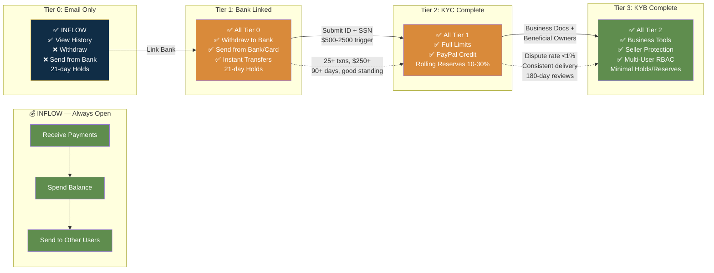
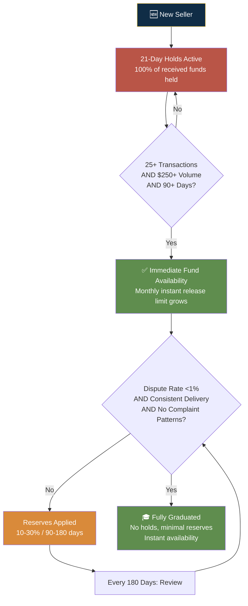

# PayPal — Entitlement Model

## Entitlement Philosophy

**Core principle:** "Gate money OUTFLOW behind verification; allow INFLOW immediately."

This is PayPal's single most important design insight. A fraudster wants to extract money fast. A legitimate merchant wants to start accepting payments now. By gating withdrawal, sending from own funds, and full limits behind progressive verification — while allowing receiving immediately — PayPal aligns its risk controls perfectly with user intent.

### The Progressive Trust Engine



### Fraudster vs Legitimate Merchant — Why This Works

| Intent | Wants To | Blocked By | Effect |
|--------|----------|------------|--------|
| **Fraudster** | Extract money fast (withdraw) | Withdrawal blocked until bank linked + KYC | Blocked where they need access most |
| **Legitimate Merchant** | Accept payments now (receive) | Nothing — receiving is always open | Unblocked where they need value most |

---

## Entitlement Tiers

### Tier 0: Email Confirmed Only (Just Signed Up)

| Attribute | Detail |
|-----------|--------|
| Requirements | Email + password + click verification link. No linked bank, card, or phone. |
| Sending limits | Can only send from existing PayPal balance; sending from own funding sources blocked. ~$4,000 per single transaction cap; some regions ~$2,000 lifetime sending cap. |
| Receiving limits | Can receive money immediately. EU: ~2,500 EUR/year cap. Other regions: may trigger verification demand after small cumulative volumes. |
| Withdrawal limits | **Cannot withdraw at all.** No bank account linked = funds locked inside PayPal wallet. |
| Features unlocked | Receive payments into balance, spend balance online, send balance to other users, view transaction history, dispute filing (limited) |
| Hold periods | **21-day hold on all received payments for new sellers** — effectively a 100% rolling hold. Release criteria: valid tracking shows delivery, or buyer confirms receipt, or 21 days elapse. |
| Reserve requirements | No formal reserve, but 21-day holds act as de facto 100% reserve. |

**Why this works:** The merchant can accept a payment 30 seconds after creating an account — instant engagement won. But PayPal's risk is contained: the money can't leave. This is the elegant tradeoff that makes PayPal's entire onboarding model viable.

### Tier 1: Bank/Card Linked ("Verified")

| Attribute | Detail |
|-----------|--------|
| Requirements | Link and confirm bank account (micro-deposits or Plaid instant) OR link credit/debit card. Largest single jump in capability. |
| Sending limits | Up to $60,000 per transaction (practically capped at $10,000 regulatory). No daily/monthly sending limit. Can now fund sends from bank/card. |
| Receiving limits | Receiving restrictions largely lifted. No fixed caps for verified US accounts. |
| Withdrawal limits | Standard transfer: no strict monthly cap. Instant to bank: $25,000/transaction (hard rail limit). Instant to debit card: $5,000/day, $15,000/month. ATM: ~$400/day. Fees: ~1% instant to bank, ~1.75% instant to debit card. |
| Features unlocked | Withdraw to bank, instant transfers, send from linked funding sources, higher limits, Verified badge, multiple funding sources |
| Hold periods | 21-day hold still applies for new sellers. Release via: tracking showing delivery, service/digital marked "Completed" (7 days), or buyer confirms receipt. |
| Reserve requirements | Not typically subject to formal reserves yet — but payment holds continue. |

**Why this works:** The merchant can now get their money out — the single biggest value unlock. But 21-day holds on new seller payments protect PayPal while the merchant builds history.

### Tier 2: Identity Verified (KYC Complete)

| Attribute | Detail |
|-----------|--------|
| Requirements | Government-issued photo ID, proof of address (within 90 days), SSN/ITIN (US), video KYC (India). Triggered at ~$500-$2,500 cumulative volume or unusual activity. Review: 2-5 business days. |
| Sending limits | Effectively unlimited. Transactions >$10,000 may trigger AML reporting but are not blocked. |
| Receiving limits | No fixed limits. EU caps fully removed. |
| Withdrawal limits | All caps removed except payment rail limits ($25K/transaction instant to bank, $5K/day instant to debit). |
| Features unlocked | Full limits removed, fraud protection + faster disputes, PayPal Credit eligibility (credit check), PayPal Debit/Cash Card eligibility, reduced account limitation risk, AML/KYC compliance |
| Hold periods | 21-day hold may still apply but graduation criteria begin: 25+ transactions, $250+ total volume, 90+ days since first sale → funds typically release immediately. |
| Reserve requirements | **Rolling reserves may be applied**: 10-30% of transactions held for 90-180 days. Minimum reserve targets (e.g., 5% of daily volume until $5,000 accumulated). Jumpstart reserves (one-time lump sum, e.g., $5,000) possible for high-risk. Reviewed every 180 days. |

**Why this works:** Trust is now established at the identity level. But behavior-based risk controls (holds, reserves) continue — graduating from identity-trust to behavior-trust.

### Tier 3: Business Verified (KYB / Enhanced Due Diligence Complete)

| Attribute | Detail |
|-----------|--------|
| Requirements | Business registration docs, EIN letter, business bank account matching legal name, beneficial owner info (>25% ownership), LOA if account holder ≠ director/partner, business description + website. Review: 2-5 business days, longer if complex. |
| Sending limits | Business-level volumes. No caps beyond rail limits. $60,000/single transaction max (regulatory). |
| Receiving limits | Unlimited. Designed for business volumes. |
| Withdrawal limits | Same rail limits as Tier 2. Standard: effectively unlimited. |
| Features unlocked | Full business tools (invoicing, payment buttons, subscriptions), PayPal Checkout, multi-user access (sub-accounts + RBAC), Seller Protection (up to $20,000), Verified Business badge, international payment processing, dispute resolution center, lower risk of freezes/limitations |
| Hold periods | **21-day holds eliminated** for established sellers meeting graduation criteria. Funds available immediately upon receipt. |
| Reserve requirements | Rolling reserves still possible based on risk scoring (industry, chargeback rate, delivery timeframes). Typical: 10% rolling / 90 days. High-risk (travel, tickets, supplements): 20-30% over 180 days, may never be fully removed. Minimum reserve targets may remain ($5,000-$25,000). Reviewed every 180 days; removal based on: dispute rate <1%, consistent delivery, no complaint patterns, stable selling. |

---

## Progressive Access Map

```mermaid
stateDiagram-v2
    [*] --> Tier0_EmailOnly: Sign Up (30 seconds)
    
    state Tier0_EmailOnly {
        [*] --> ReceiveMoney: ✅ Always Open
        ReceiveMoney --> SpendBalance: ✅
        SpendBalance --> SendBalance: ✅
        --
        Withdraw: ❌ Blocked
        SendFromBank: ❌ Blocked
    }
    
    state Tier1_BankLinked {
        [*] --> WithdrawBank: ✅ Unlocked
        WithdrawBank --> InstantTransfer: ✅
        InstantTransfer --> SendFromOwn: ✅
        --
        FullLimits: ❌ Capped
        BusinessTools: ❌
    }
    
    state Tier2_KYCComplete {
        [*] --> FullLimits: ✅ Unlimited
        FullLimits --> CreditEligible: ✅
        CreditEligible --> AMLCompliant: ✅
        --
        BusinessTools: ❌
        SellerProtection: ❌
    }
    
    state Tier3_KYBComplete {
        [*] --> AllFeatures: ✅ Everything
    }
    
    Tier0_EmailOnly --> Tier1_BankLinked: Link Bank Account
    Tier1_BankLinked --> Tier2_KYCComplete: Submit ID + SSN
    Tier2_KYCComplete --> Tier3_KYBComplete: Business Docs + UBOs
    
    note right of Tier0_EmailOnly: 21-day holds on all payments
    note right of Tier1_BankLinked: 21-day holds continue<br/>No formal reserves yet
    note right of Tier2_KYCComplete: Rolling reserves 10-30%<br/>Graduation: 25 txns/$250/90d
    note right of Tier3_KYCComplete: Minimal holds/reserves<br/>Behavior-based only
```

### Graduation Criteria (Behavior-Based Trust)



---

## Gates & Triggers

| Gate | Triggers Escalation | Effect |
|------|--------------------|--------|
| Transaction volume | >$500-$2,500 cumulative (region-dependent) | KYC verification demanded |
| Transaction volume | >$20,000 AND >200 transactions (1099-K threshold) | Full SSN demanded |
| Chargeback rate | Crosses internal threshold (>1% typical) | Rolling reserve applied or increased |
| Account age | <90 days | 21-day holds active; instant release limited |
| Industry category | High-risk (travel, tickets, supplements, crypto-adjacent) | Higher reserves, longer holds, never fully removed |
| Geographic region | Cross-border flows, logins from new countries | Re-verification triggered |
| Volume spike | >300% of daily average | Manual review triggered |

---

## Instant vs Delayed Entitlement

| Action | Immediate | After Tier 1 | After Tier 2 | After Tier 3 |
|--------|-----------|-------------|-------------|-------------|
| Receive payment | ✓ | ✓ | ✓ | ✓ |
| Spend from balance | ✓ | ✓ | ✓ | ✓ |
| Send balance to others | ✓ | ✓ | ✓ | ✓ |
| Withdraw to bank | ✗ | ✓ (2-3 days) | ✓ (instant avail.) | ✓ (instant) |
| Send from bank/card | ✗ | ✓ | ✓ | ✓ |
| Full transaction limits | ✗ | ✗ | ✓ | ✓ |
| Seller Protection | ✗ | ✗ | ✗ | ✓ |
| Multiuser access | ✗ | ✗ | ✗ | ✓ |
| International payments | ✗ | ✗ | ✗ | ✓ |

---

## Risk-vs-Conversion Trade-off Analysis

| Entitlement Decision | Risk if Too Generous | Conversion Loss if Too Restrictive | Verdict |
|----------------------|---------------------|----------------------------------|---------|
| **Immediate receive capability** | Medium — fraudsters can receive stolen funds but can't withdraw | Would be catastrophic — merchants evaluate "can I get paid?" in first 30 seconds | **Brilliant.** The single best risk/conversion tradeoff in fintech onboarding. |
| **21-day new seller holds** | Low if removed — but chargeback window is 120 days | High — cash flow is the #1 pain point for new merchants | **Keep but shorten.** 21 days is reasonable for truly new sellers; graduation criteria should be more aggressive (currently: 25 txns + $250 + 90 days — could be 25 txns + $250 + 45 days) |
| **Rolling reserves (10-30%, 90-180 days)** | Medium if removed for low-risk — some exposure | High — reserves tie up working capital | **Keep but make transparent and data-driven.** Merchants should see their reserve score and know what to improve. Current opacity breeds resentment. |
| **Withdrawal blocked at Tier 0** | Would be extreme — fraudsters could drain funds immediately | N/A — this is the necessary tradeoff for instant receive | **Essential.** Cannot have instant receive without blocked withdrawal. The two are paired. |
| **SSN last-4 only → full SSN deferred** | Low — last-4 provides enough identity match for low-volume | Medium — privacy-sensitive users appreciate minimization | **Excellent.** QBO should adopt exact same pattern: collect minimum for initial service, escalate only when IRS/tax features trigger. |
| **Industry-based permanent reserves** | Medium if removed for borderline industries | Medium — some legitimate merchants in "high-risk" categories are unfairly penalized | **Needs nuance.** Industry is a blunt proxy. Should combine with merchant-specific behavior data to reduce reserves for well-performing merchants in "high-risk" categories. |

---

## Key Design Insights for QBO

1. **Gates on outflow, not inflow**: QBO equivalent — let users connect bank accounts, see auto-categorized transactions, view basic reports immediately. Gate payroll runs, tax filing, and ACH origination behind progressive KYC. The user gets value instantly; the risk is contained where it matters.

2. **Progressive trust graduation based on behavior, not just identity**: PayPal's 25-txn/$250/90-day criteria for lifting holds is data-driven. QBO should have equivalent behavioral graduation for features like payroll limits, invoice factoring, or credit offers.

3. **The 21-day hold is PayPal's secret weapon**: By pairing "instant receive" with "delayed withdraw," they create a time buffer that (a) catches fraud before money exits, (b) allows chargeback windows to close, and (c) rewards good behavior with faster release. QBO equivalent: instant dashboard access + delayed payroll/tax filing until bank account micro-deposits confirm.

4. **Entitlement opacity is PayPal's #1 UX failure**: Users don't understand why their account is limited, why holds are applied, or what they need to do to graduate. QBO should make entitlement criteria VISIBLE — show a progress bar, show the triggers, show the path to unlock.

5. **Industry-based permanent reserves are lazy risk management**: QBO should avoid this pattern. Instead, behavior-based scoring (dispute rate, delivery time, customer satisfaction) should determine risk tier — not a static industry label.

---

## Sources

- [PayPal Transfer Limits (SyncTrack)](https://synctrack.io/blog/paypal-transfer-limit/)
- [PayPal Withdrawal Limits (SyncTrack)](https://synctrack.io/blog/paypal-withdrawal-limit/)
- [PayPal Funds Availability](https://www.paypal.com/au/webapps/mpp/funds-availability)
- [PayPal Account Reserves](https://payments-reports-migration.glb.paypal.com/us/brc/article/account-reserves)
- [PayPal Business Account Verification (Doola)](https://www.doola.com/blog/paypal-business-account-verification-failed-what-now/)
- [New PayPal Account Payments on Hold (PayPal Help)](https://pep.paypal.com/tw/cshelp/article/new-paypal-account-payments-on-hold-and-accessing-your-funds-quicker-help848)
- [What Is Payment Reserve Rollover (Eightx)](https://eightx.co/blog/what-is-payment-reserve-rollover)
- [PayPal Business Account with US LLC Without SSN (BizStartz)](https://bizstartz.com/business-paypal-account-with-us-llc-without-ssn/)

---

## Change Log

| Date | Change |
|------|--------|
| 2026-08-05 | Initial creation — PayPal pilot entitlement model analysis |
