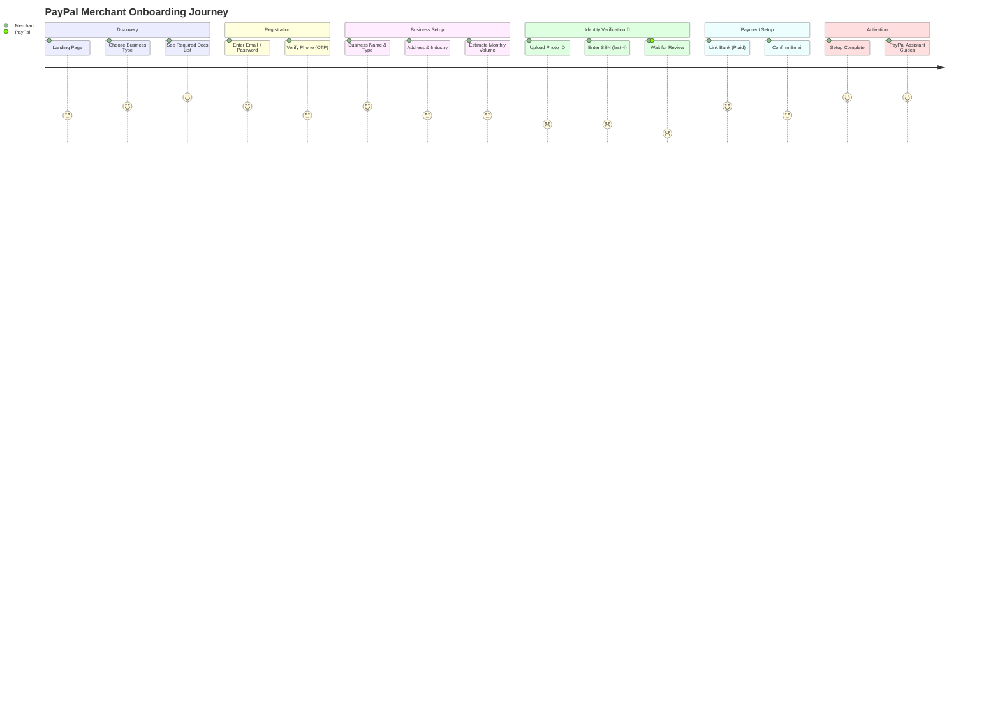
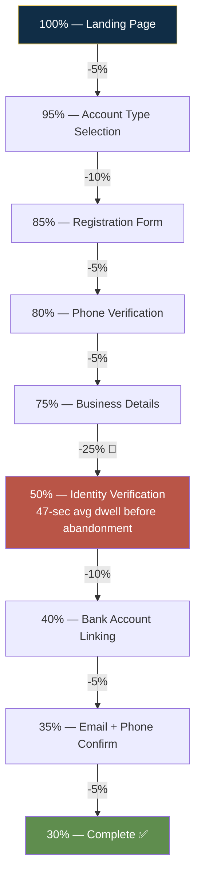
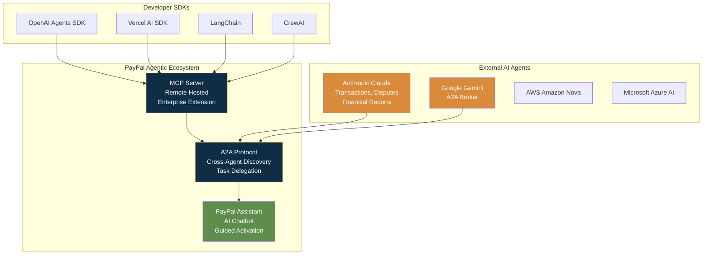
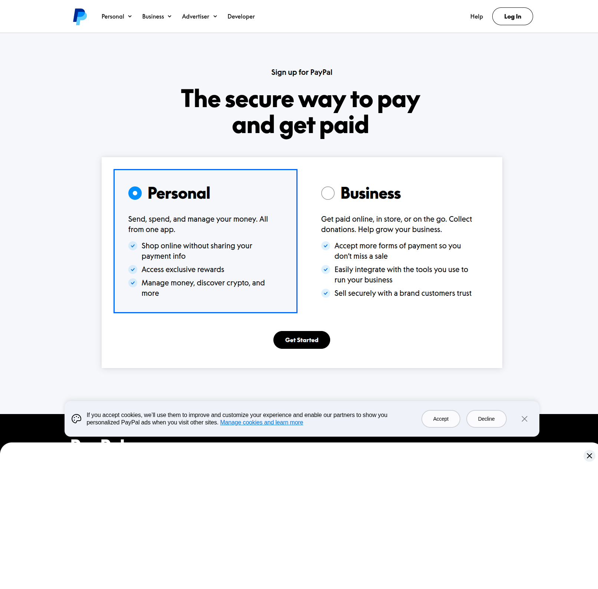
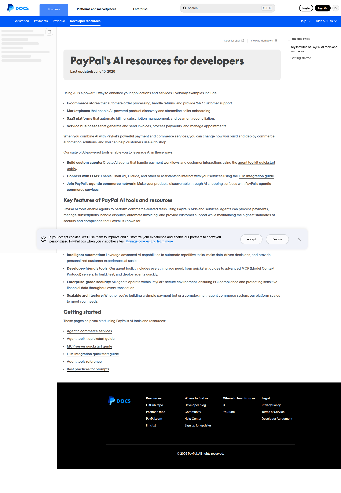
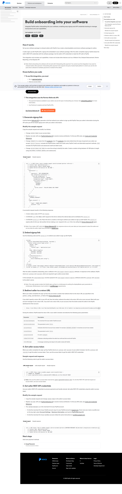

# PayPal — UI/UX Flow & Agentic Experience

## Flow Overview

| Attribute | Detail |
|-----------|--------|
| Total steps | 9 (including conditional + post-approval) |
| Estimated time | 10-20 min form fill + 2-5 business days KYC review |
| Mobile optimized | Partially — 2024 app redesign in progress |
| Completion rate | Desktop: 54% | Mobile: 31% (23pp gap) |
| Abandonment recovery | Save-and-resume, PayPal Assistant guided reactivation |
| Accessibility | No published VPAT; screen reader + keyboard nav support; EAA compliance in progress |
| AI-powered | PayPal Assistant, MCP server, A2A protocol, Agentic Commerce (2026), Smart Receipts, Fastlane, CashPass |

### Complete User Journey

### Funnel Analysis — Where Users Drop Off

### Agentic AI Architecture

---

## Step-by-Step Flow

### Screen 1: Landing & Account Type Selection

**User sees:**  
PayPal.com landing page with Personal vs Business account selection. For Business: benefit statements — "Accept more forms of payment," "Easily integrate with tools," "Sell securely with a trusted brand."

**What happens:**  
Simple binary choice determines downstream flow (different KYC vs KYB requirements).

**Design insight:** The **front-door education screen** — listing required documents, explaining benefits, providing time estimates — was added after UX research found users were "anxious not knowing what information they were going to need to provide." Account growth went from 8% to 10%+ after this single change. **Most onboarding flows skip this step and pay for it in drop-offs.**

---

### Screen 2: Initial Registration (Email + Password)

Minimal capture. Email address → password → basic identity. No overwhelming form at step 1.

---

### Screen 3-4: Progressive Data Collection (Phone + Business/Personal Info)

- Phone number → OTP verification
- Legal name, business name, physical address, business type dropdown (LLC, Corp, Sole Prop, etc.)
- For Business Pro: primary contact (name, DOB, phone), billing info, PayPal Manager login creation

**Notable pattern:** Business type dropdown determines all downstream document requirements. A sole prop sees a different path than a corporation. The user never sees irrelevant fields.

---

### Screen 5-6: Identity Verification (KYC/CIP)

**"Panda Program"** — users photograph ID documents with smartphone camera rather than offline/manual upload. This was PayPal's internal improvement project to reduce the 47-second average dwell time before abandonment at verification.

**User sees:**
- Camera overlay with document alignment guides
- Real-time feedback on glare, focus, edges
- Upload progress indicator
- "Review takes ~2 working days" expectation setting

**What happens:**
- Automated OCR + database cross-reference
- If clear match: verified (1-3 business days)
- If mismatch: manual review → may request additional documents

**India-specific (Video KYC):** Live recorded video call with third-party contractor. Physical PAN card verification, GPS/location confirmation (must be in India). Post-call review: 2-3 days. **Major pain point** — users report repeated loops after minor profile corrections.

---

### Screen 7: Bank Account Linking

**Instant path (Plaid):** Select bank → enter online banking credentials → account/routing numbers returned in seconds. 23% higher conversion vs manual. Covers 99.9% of US banks.

**Manual path (micro-deposits):** Enter account/routing manually → wait 2-3 days for micro-deposits → return to confirm amounts.

---

### Screen 8: Email + Phone Verification

Standard out-of-band verification — email link click + SMS code. These happen concurrently, not sequentially.

---

### Screen 9: Setup Complete → Guided Activation (PayPal Assistant)

**Instead of a cold dashboard**, PayPal Assistant surfaces contextual next steps:
- "Complete your business profile"
- "Connect your first product"
- "Make your first sale"

This **continuous onboarding model** persists into ongoing lifecycle — additional verification, product adoption steps, and growth milestones are surfaced over time.

---

## Friction Point Analysis

| Friction Point | Why It Exists | Severity (1-5) | Mitigation | Could Remove? |
|---------------|---------------|-----------------|------------|--------------|
| **KYC Identity Verification** (47-sec avg dwell before abandonment) | Regulatory (KYC/AML). Non-negotiable. | 5 | Panda Program camera capture; progressive disclosure defers full KYC; Mitek partnership (20% lift in high-value txns) | No — regulatory mandate |
| **Mobile completion gap** (31% vs 54% desktop) | Smaller screens, document capture harder, interruptions more likely | 5 | 2024 app redesign; biometric auth; Fastlane; AI auto-fill | No — but fixable with better mobile UX |
| **Video KYC (India)** | PayPal India's implementation choice. Requires live call, PAN card, GPS, bright setting. Laminated docs rejected. | 5 | Limited. Third-party contractor issues persist. | Possibly — not an RBI mandate; could replace with automated alternatives |
| **Delayed/tiered verification confusion** | Multi-level verification; cumulative thresholds not transparent | 4 | PayPal Assistant guides next steps; unified framework surfaces requirements | No — but transparency can improve |
| **Re-verification & frozen funds** (up to 180 days) | Risk management — volume spikes, cross-border payments, login changes trigger re-verification | 5 | Continuous onboarding surfaces proactively; but policy is fundamental to PayPal's model | No — but 180 days is excessive; 90 days would still cover chargeback windows + dispute periods |
| **Email-to-relogin handoff** | Email verification requires leaving app → inbox → click → re-auth. API integration incomplete. | 3 | Acknowledged as "still disjointed"; deferred to future work | Yes — deep link + auto-auth would solve |
| **Users didn't understand benefits before signing up** | Form-first design asked for info before explaining value | 4 | Front-door education screen added; benefit reassurance at milestones | Fixed |
| **Document rejection & manual review delays** (3-5 business days) | Automated systems can't always confirm identity — glare, mismatched names (sometimes PayPal's fault), unclear scans | 4 | Inline validation; camera guidance overlays; but manual review is a hard stop for edge cases | Partially — better OCR + AI matching could reduce manual review queue |

---

## Agentic / AI-Powered Features

| Feature | Description | How It Helps Conversion | Maturity |
|---------|-------------|------------------------|----------|
| **PayPal Assistant** | AI chatbot in Message Center + Search & Intelligence (US). Searches Help Center, Legal Agreements, product pages. Smart escalation to live agents (6 AM-6 PM PST). | Guides post-signup activation instead of cold dashboard. Surfaces next steps. Increases completion of setup. | Production — but constrained (can't handle credit products, limited to suggesting help articles for sensitive topics) |
| **Agent Toolkit + MCP Server** | Connects AI agents to PayPal services via MCP. Tools for orders, invoices, subscriptions, disputes, shipping. Supports OpenAI, Vercel AI, LangChain, CrewAI. Remote-hosted MCP server. | Enables merchants to handle onboarding-like tasks conversationally via their own AI agents. Removes form UI entirely. | Production — developer-facing |

| **Agent-to-Agent (A2A) Protocol** | Google's protocol for cross-agent discovery + task delegation. Merchant's agent → A2A broker → PayPal agent card → authenticate → MCP processing. | Autonomous AI agents complete onboarding + payment tasks without human interaction. The merchant never sees a PayPal form. | Emerging — Google partnership; production roadmap |
| **Agentic Commerce / "Agent Ready" (2026)** | Merchants accept payments through AI chatbots and AI browsers. Built-in fraud detection, buyer protection, dispute resolution. Partnerships: Anthropic (Claude), Google (Gemini + A2A), AWS (Amazon Nova), Microsoft (Azure AI). | Eliminates traditional onboarding for AI-mediated commerce. "From a checklist to a guided experience" — or to no experience. | Announced — early 2026 launch |
| **Fastlane (One-Click Guest Checkout)** | Recognizes 70% of guest shoppers. ~40% faster than traditional guest checkout. Eliminates usernames, passwords, manual card entry. AI recognition improves over time. | Converts guest checkout users into identified PayPal users. Auto-fill → follow-up → full account conversion with rewards. | Production |
| **Smart Receipts with AI Recommendations** | AI-powered receipts with purchase tracking + personalized product recommendations + cashback offers. 45% of customers open email receipts daily. | Post-purchase re-engagement channel. Keeps users in ecosystem. Surfaces relevant merchant offers. | Production |
| **CashPass (AI-Powered Cashback)** | Personalized cash-back (up to 5%) from major retailers, organized by AI using purchase data. | Incentivizes account creation + continued usage with tangible financial benefits. | Production |

---

## Notable UI Patterns

| Pattern | Where Used | Why Effective |
|---------|-----------|---------------|
| **Persistent progress tracker** | All steps — shows completed, current, remaining. Doubles as navigation. | Creates "sense of accomplishment at each section." Users can jump between steps. |
| **Progressive disclosure** | Throughout — fields surfaced at contextually relevant moments | Reduces cognitive overload and early abandonment |
| **Save-and-resume** | Full flow | Addresses reality of interruptions, especially on mobile |
| **Upfront expectation setting** | Landing/preparation screen before any data collection | Directly addresses #1 user anxiety: "What will I need? How long will this take?" |
| **Unified information carry-forward** | Across all products — data entered once propagates | Eliminates re-entry; reduces data inconsistency |
| **Inline validation + regex error messaging** | Form fields | Prevents submission of invalid data; reduces downstream verification failures |
| **Benefit reassurance at milestones** | Validation/summary screens | Reinforces "what you're getting, why it's valuable, what comes next" |
| **Biometric authentication** | Login, checkout (Face ID, fingerprint passkeys) | Seamless repeated auth; reduces mobile friction |
| **Modal-based setup completion (web)** | Post-signup setup | Keeps users oriented with overlay progress vs full-page navigations |
| **Staged compliance** | Verification based on region + product — not universal | German merchant sees different docs than US; UX pattern consistent |
| **Continuous onboarding model** | PayPal Assistant persists into lifecycle | Onboarding doesn't end at creation — extends into adoption, verification, upsells |

---

## Mobile vs Desktop

| Dimension | Mobile | Desktop |
|-----------|--------|---------|
| Layout | Adaptive (derived from desktop, simplified) | Full-featured |
| Input methods | Touch, camera (doc capture), biometric (Face ID, fingerprint) | Keyboard + mouse, webcam (doc capture) |
| Document upload | Smartphone camera — intuitive but glare/alignment/filesize issues | Webcam or file upload — less intuitive but fewer quality issues |
| Completion rate (est.) | 31% | 54% |
| Key improvements (2024+) | Complete app redesign ("biggest changes in a decade"), Fastlane, AI personalization | Unified cross-product framework |

---

## Drop-off Analysis

| Step | Est. Drop-off % | Primary Reason | Fix Suggestion |
|------|-----------------|---------------|----------------|
| Account type selection | ~5% | User not ready to commit to Business vs Personal | Pre-select based on context (partner referral type) |
| Registration | ~10% | Standard signup friction | Social sign-in for consumers (already exists); partner prefill for business |
| Phone verification | ~5% | OTP delay, wrong number | Auto-detect carrier; WhatsApp/SMS fallback |
| **Identity document upload** | **~25%** | **47-sec avg dwell before abandonment; document not on hand; privacy concern** | Pre-announce required docs; allow upload later with clear deadline; camera guidance improvements |
| Bank linking (manual) | ~15% | 2-3 day micro-deposit wait | Push Plaid instant path harder; show time comparison |
| Email verification | ~3% | Inbox check + relogin friction | Deep link + auto-auth |
| Total funnel | ~50%+ | — | — |

---

## Accessibility & Inclusion

| Consideration | How Addressed | Gaps |
|---------------|---------------|------|
| Screen reader | Descriptive links, alt text for images/interactive elements | No published VPAT; WCAG conformance level unknown |
| Keyboard navigation | Logical focus order, visible focus indicators; StepHeader (Android) + progress tracker (web) support keyboard-only | Unknown coverage depth |
| Visual accessibility | Increased contrast fonts/backgrounds | No formal contrast ratio documentation |
| Language support | 200+ markets, 25+ currencies; regional PayPal sites (US, UK, DE, FR, JP, CN, IN, AU) | Specific language count not publicly documented |
| Error recovery | Inline validation; save-and-resume | Manual review queue is a hard stop with no workaround |
| EAA compliance | Falls within scope (10+ employees, EUR 2M+ turnover in EU) | Unknown compliance status as of June 2025 deadline |

---

## Takeaways for QBO

1. **Front-door expectation setting is the cheapest conversion win PayPal ever made.** Listing required docs + time estimates before asking for anything lifted account growth from 8% to 10%+. QBO should add a preparation screen: "You'll need your business EIN, bank account details, and about 15 minutes."

2. **PayPal Assistant as post-signup guide instead of cold dashboard.** QBO currently drops new users into a complex accounting dashboard. An AI assistant surfacing "3 things to do first" would dramatically reduce the 34% of support tickets stemming from setup confusion.

3. **Progressive disclosure by entity type is brilliant.** Sole prop sees minimal fields; corporation sees full beneficial ownership. QBO's one-size-fits-all onboarding form could be cut by 40% for sole proprietors with this pattern.

4. **Agentic commerce is PayPal's 2-year head start.** QBO needs an MCP server + A2A protocol to stay relevant. When merchants' AI agents can handle bookkeeping setup autonomously, the company without agentic APIs loses.

5. **Mobile completion gap (31% vs 54%) is fixable and worth fixing.** 68% start on mobile. QBO likely has a similar gap. Mobile-first redesign + document camera capture + biometric auth are the proven fix path.

---

### Additional Screenshots

---

## Sources

- [Jessica Chang — Global Merchant Onboarding: Designing a Unified Activation Framework](https://www.jessicalchang.com/merchantonboarding)
- [PayPal Payments Pro Onboarding UX Design Case Study (Jason Cordone)](https://www.cordonedesign.com/product/paypal_pro/prod-paypal-page.html)
- [PayPal Product Design Case Study: UX Optimization for 400M+ Users (SaaS Factor)](https://www.saasfactor.co/case-studies/paypal)
- [Building with Agentic AI (PayPal Community Blog)](https://developer.paypal.com/community/blog/building-with-agentic-ai/)
- [The Future of Commerce: PayPal's Agentic AI](https://developer.paypal.com/community/blog/future-of-commerce/)
- [PayPal AI Tools for Developers](https://developer.paypal.com/ai-tools/get-started)
- [Panda Program: PayPal Identity Verification UX Case Study](https://nandha1986.github.io/Paypal.html)
- [P2P Leader PayPal to Redesign Mobile App (Bank Automation News)](https://bankautomationnews.com/allposts/payments/p2p-leader-paypal-to-redesign-mobile-app/)
- [PayPal Video KYC Horror Stories: Why Indian Freelancers Are Switching (Winvesta)](https://www.winvesta.in/blog/freelancers/paypals-video-kyc-horror-stories-from-indian-freelancers)
- [Harnessing Commerce Agents: Essential Best Practices](https://developer.paypal.com/community/blog/best-practices-commerce-agents/)
- [PayPal Desktop Onboarding Flow (Page Flows)](https://pageflows.com/post/desktop-web/onboarding/paypal/)
- [PayPal Web Completing Account Setup Flow (Mobbin)](https://mobbin.com/explore/flows/e175897a-1f4e-40dd-8e9a-415dca0b9d26)

---

## Change Log

| Date | Change |
|------|--------|
| 2026-08-05 | Initial creation — PayPal pilot UI/UX flow and agentic experience analysis |
