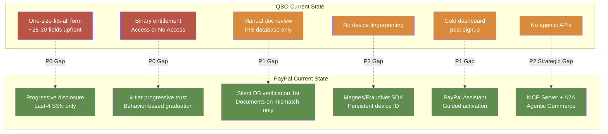
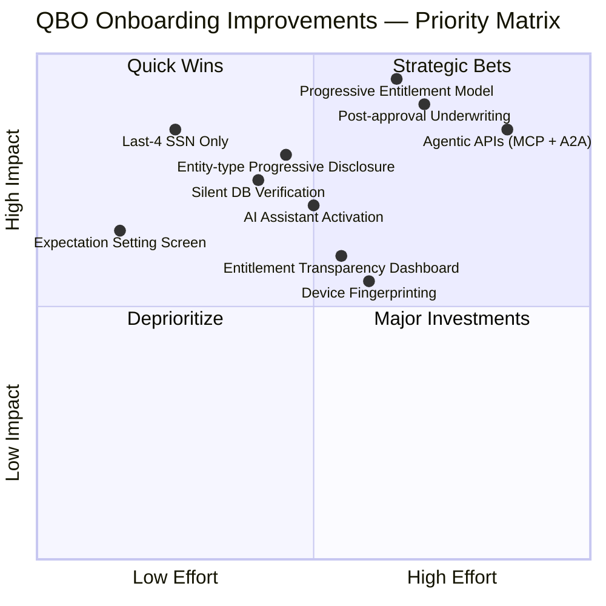

# PayPal — SWOT vs Intuit QuickBooks Online

## Company: PayPal SWOT Analysis

### Strengths

| # | Strength | Evidence | Impact on Onboarding |
|---|----------|----------|---------------------|
| 1 | **Progressive trust architecture** — gates money outflow behind verification, allows inflow immediately | 4-tier entitlement model (Email → Bank → KYC → KYB) | Single most important design pattern in fintech onboarding. Enables instant engagement while containing risk. |
| 2 | **Post-approval underwriting model** — deep risk review happens after merchant starts transacting | Deferred SSN, supplier invoices, website screenshots; fund freeze capability as backstop | Enables aggressive field minimization upfront without increasing net risk exposure. |
| 3 | **2-Sided Network data moat** — 439M+ accounts, 12.8B+ digital identifiers, $1.79T annual volume | Device fingerprinting across sessions; email/phone reputation across entire network | Fraud detection accuracy that no new entrant can replicate. Network effects compound over time. |
| 4 | **Multi-layered pre-fill strategy** — Partner API + Plaid + silent database verification | 87% time reduction with Plaid Layer; 23% higher bank linking conversion with Plaid Auth | Eliminates duplicate entry and unnecessary document uploads for clean-match users. |
| 5 | **Agentic AI vision** — MCP server, A2A protocol, Agentic Commerce partnerships (Anthropic, Google, AWS, Microsoft) | Production MCP server; announced Agentic Commerce; A2A protocol in roadmap | 2+ year head start on AI-native commerce. When AI agents handle onboarding autonomously, PayPal is the only payment provider ready. |
| 6 | **Proven risk model** — LightGBM + Macro Adaptive Hyper Model; 40.8% chargeback reduction, 57.3% false decline reduction | Published results from 107 high-chargeback merchants | ML-driven risk that demonstrably works at scale. |

### Weaknesses

| # | Weakness | Evidence | Impact on Onboarding |
|---|----------|----------|---------------------|
| 1 | **Mobile completion gap** — 31% vs 54% desktop | 68% of signups start on mobile but most abandon | Massive conversion leakage. Every percentage point = millions in lost merchant acquisition. |
| 2 | **180-day fund freeze controversy** — $6M Hawaii settlement | Class action over freezing accounts "without notice, explanation, or effective recourse" | Damages trust with small businesses. Regulatory and reputational risk. |
| 3 | **Threshold opacity** — users don't know why they're limited or how to unlock | 34% of new user support tickets stem from setup confusion | Drives support costs and abandonment. The entitlement model is elegant but invisible to users. |
| 4 | **India video KYC execution** — repeated verification loops, third-party contractor issues | Well-documented user complaints | Regional compliance handled poorly. Damages PayPal's reputation in a key growth market. |
| 5 | **"Skip and do later" poorly executed** — ambiguous language, hidden placement, unclear expectations | UX analysis finding | Good idea (deferred completion) undermined by bad execution. |
| 6 | **Industry-based permanent reserves** — high-risk category labeling is permanent, not behavioral | Travel, tickets, supplements: 20-30% reserves may never be removed | Unfair to well-performing merchants in "high-risk" categories. Lazy risk management. |

### Opportunities

| # | Opportunity | Rationale |
|---|------------|----------|
| 1 | **AI-native onboarding** — agents handling KYC/KYB autonomously via MCP + A2A | Eliminates human friction entirely. PayPal is the only payment provider building this infrastructure. |
| 2 | **Mobile parity** — closing the 23pp desktop/mobile gap | 68% start on mobile. Even closing half the gap = massive conversion lift. 2024 app redesign is the right bet. |
| 3 | **Behavior-based reserve graduation** — replace industry labels with merchant-specific scoring | Would reduce unfair penalization of good merchants in "high-risk" categories while maintaining risk protection. |
| 4 | **Entitlement transparency dashboard** — show users their score, what's unlocked, what they need to do | Would reduce 34% support ticket rate and increase trust. |
| 5 | **Open banking / PSD2/3 in Europe** — direct bank API access eliminates micro-deposit wait | Plaid is US-only. European open banking APIs offer equivalent instant verification. |

### Threats

| # | Threat | Rationale |
|---|-------|----------|
| 1 | **Stripe's developer-first onboarding** — simpler, faster, better documented | Developers prefer Stripe. If Stripe matches PayPal's risk intelligence, PayPal loses the platform war. |
| 2 | **Embedded finance platforms** (Shopify Payments, Square, Toast) — vertical-specific, pre-integrated | Merchants never see a payment provider choice; they use whatever their platform bundles. |
| 3 | **Regulatory fragmentation** — KYC/AML rules diverge across jurisdictions | PayPal operates in 200+ markets. Compliance cost scales non-linearly with market count. |
| 4 | **AI agent ecosystems bypassing traditional onboarding** — if every AI agent handles payments, PayPal's brand recognition advantage erodes | Agentic Commerce cuts both ways: PayPal builds the infrastructure but loses direct merchant relationship. |
| 5 | **Crypto/stablecoin payment rails** — instant, low-fee, no chargeback, no KYC (pseudonymous) | Fundamental challenge to PayPal's value proposition. If merchants can accept USDC instantly with no reserve, why use PayPal? |
| 6 | **Consumer trust erosion from account freezes** — each frozen account story goes viral | Already causing regulatory action ($6M Hawaii settlement). More jurisdictions will follow. |

---

## QuickBooks Online SWOT Analysis (Reference)

### Strengths
- **Intuit ecosystem integration** — TurboTax, Mint, Credit Karma, QuickBooks Payroll data for pre-fill
- **Existing financial data** — bank connections, tax data, income history already in Intuit ecosystem
- **Established SMB trust** — decades of tax + accounting brand equity
- **Pre-existing identity verification** — IRS/SSN validation for tax filing already done for TurboTax users
- **SMB market dominance** — ~80% US small business accounting market share

### Weaknesses
- **Complex product with steep learning curve** — onboarding assumes accounting knowledge
- **One-size-fits-all onboarding** — same form for sole prop freelancer and 50-employee corporation
- **Legacy UX patterns** — slow to adopt AI-native flows; no MCP server, no agentic APIs
- **Limited non-US business structure support** — built for US SMB; international is an afterthought
- **No device fingerprinting or behavioral fraud detection** — risk screening relies on credit bureau + IRS data only
- **No progressive entitlement model** — binary: either you have access or you don't

### Opportunities
- **Pre-fill from TurboTax, Mint, QuickBooks Payroll data** — existing customer knows QBO should pre-fill everything
- **AI-assisted business setup wizard** — "Tell us about your business" → AI fills form, asks clarifying questions
- **Instant company formation + banking bundle** — QBO + QuickBooks Checking + payroll in one flow
- **Reduced field collection via IRS/state business registry integration** — PayPal's silent database verification pattern
- **Agentic bookkeeping** — MCP server for QBO so AI agents can handle setup autonomously (mirror PayPal's strategy)

### Threats
- **Fintech startups offering faster, simpler onboarding** — Stripe, Square, Mercury eat into SMB financial stack
- **Embedded finance** — Shopify, Square, Toast bundling accounting with payments
- **Regulatory fragmentation across states** — sales tax, payroll tax, business registration vary by state
- **Customer expectation shift** — AI-native users expect instant, conversational onboarding
- **PayPal's agentic commerce vision** — if AI agents handle bookkeeping via PayPal's MCP server, QBO is bypassed

---

## Direct Comparison: QBO vs PayPal

### Field Collection

| Dimension | QBO | PayPal | Winner | Gap Analysis |
|-----------|-----|--------|--------|-------------|
| Total fields at signup | ~25-30 (heavy upfront) | ~25 upfront + ~10 conditional | **PayPal** (conditional fields deferred) | QBO front-loads all fields regardless of entity type |
| Pre-fill quality | High for existing Intuit customers | Very High (Partner API + Plaid + silent DB) | **PayPal** (wider ecosystem reach) | QBO wins on existing customer data depth; PayPal wins on breadth |
| Progressive disclosure | No — one-size-fits-all form | Yes — entity type + jurisdiction contextual | **PayPal** | QBO could cut form by 40% for sole props |
| Field minimization | Low — asks for everything upfront | High — last-4 SSN, deferred full SSN, conditional docs | **PayPal** | Single biggest gap |
| Drop-off rate (est.) | ~50%+ (industry estimate for accounting software) | ~50% (desktop 54% complete) | Tie | Both lose half of starters |

### Risk Decision

| Dimension | QBO | PayPal | Winner | Gap Analysis |
|-----------|-----|--------|--------|-------------|
| KYC/KYB speed | Manual doc review + IRS database | Automated OCR + database + biometric liveness | **PayPal** | QBO's manual review is slower |
| Fraud detection | Credit bureau + IRS data only | Device fingerprint + IP + email/phone reputation + velocity + behavioral | **PayPal** | QBO missing device layer entirely |
| False positive rate (est.) | Unknown | 57.3% reduction in false declines (measured) | **PayPal** (measured) | QBO has no published false positive data |
| Auto-approval rate | Low (most go through some manual review) | High (most pass automated; manual review is escalation) | **PayPal** | |

### Entitlement

| Dimension | QBO | PayPal | Winner | Gap Analysis |
|-----------|-----|--------|--------|-------------|
| Instant access features | Limited — must complete most setup first | Receive payments immediately | **PayPal** | Most important gap. QBO gives nothing of value until setup is complete. |
| Progressive unlocking | Binary — access or no access | 4-tier progressive trust with data-driven graduation | **PayPal** | QBO has NO progressive entitlement. |
| Limit design | N/A (feature access, not volume limits) | Elegant: gates on outflow, not inflow | **PayPal** | QBO needs equivalent for payroll limits, tax filing, credit products. |

### UX / Agentic

| Dimension | QBO | PayPal | Winner | Gap Analysis |
|-----------|-----|--------|--------|-------------|
| Time to complete | 15-25 min | 10-20 min | **PayPal** | Close, but PayPal's progressive disclosure feels faster |
| AI features | Limited AI assistance | Full AI suite: Assistant, MCP server, A2A, Agentic Commerce | **PayPal** (2+ year lead) | QBO's biggest strategic gap |
| Mobile experience | Functional but not optimized | 31% mobile completion (acknowledged gap) | **PayPal** (by thin margin) | Both have mobile problems |
| Accessibility | Unknown | EAA-scoped; no VPAT; basic screen reader/keyboard support | Tie (both insufficient) | Both need improvement |
| Post-signup guidance | Cold dashboard | PayPal Assistant guided activation | **PayPal** | 34% of QBO support tickets likely stem from this gap |

---

### QBO vs PayPal — Strategic Gap Map

### QBO Strategic Priority Matrix

---

## What QBO Should Steal from PayPal

| # | Feature/Pattern | From PayPal | Why | Priority |
|---|----------------|-------------|-----|----------|
| 1 | **Instant engagement + delayed sensitive features** | Tier 0: receive money immediately; gate withdrawal behind verification | PayPal's single best pattern. QBO equivalent: let users connect bank, see transactions, view basic reports immediately. Gate payroll, tax filing, ACH behind progressive KYC. | **P0** |
| 2 | **Post-approval underwriting** | Let merchants transact → investigate later; fund freeze as backstop | Enables aggressive field minimization without increasing net risk. QBO can restrict features retroactively instead of blocking signup. | **P0** |
| 3 | **Last-4 SSN only → full SSN deferred** | Collect minimum at signup; escalate when tax features trigger | Millions of low-volume merchants never share full SSN. QBO currently asks for full SSN upfront for every user. | **P0** |
| 4 | **Silent database verification before doc requests** | Check IRS/state databases before asking users to upload documents | Eliminates unnecessary friction for clean-match users. QBO already has IRS integration for tax filing — use it for identity verification too. | **P1** |
| 5 | **Front-door expectation setting screen** | List required docs + time estimates before asking for anything | PayPal's cheapest conversion win: 8% → 10%+ account growth. QBO skips this step. | **P1** |
| 6 | **AI assistant for post-signup activation** | PayPal Assistant surfaces next steps instead of cold dashboard | Reduces support tickets (34% of PayPal's stem from setup confusion). QBO's dashboard is even more complex. | **P1** |
| 7 | **Progressive disclosure by entity type** | Sole prop sees minimal fields; corporation sees full beneficial ownership | QBO's one-size-fits-all form could be cut by 40% for sole proprietors. | **P1** |
| 8 | **Agentic APIs (MCP server + A2A)** | MCP server for orders, invoices, subscriptions, disputes; A2A protocol for cross-agent task delegation | Strategic necessity. When AI agents handle bookkeeping setup autonomously, the company without agentic APIs is bypassed. | **P2 (strategic)** |
| 9 | **Device fingerprinting for fraud detection** | Magnes/FraudNet SDK persists device identifiers across sessions | QBO's risk screening has no device layer. Catches repeat fraudsters even when identities are rotated. | **P2** |
| 10 | **Entitlement transparency dashboard** | Show users their score, what's unlocked, path to unlock | PayPal's #1 UX failure is the opportunity. QBO can do better: visible triggers, clear path, progress indicators. | **P2** |

## What QBO Does Better

| # | Feature/Pattern | QBO Advantage | How to Amplify |
|---|----------------|--------------|---------------|
| 1 | **Existing customer data pre-fill** | TurboTax, Mint, Payroll users already have identity, bank, income data in Intuit ecosystem | One-click QBO setup for existing Intuit customers — skip onboarding entirely |
| 2 | **IRS integration depth** | Tax filing relationship provides deeper SSN/EIN verification than PayPal's credit bureau checks | Use IRS transcript API to auto-verify identity instead of requesting document uploads |
| 3 | **SMB domain expertise** | Decades of accounting product development → QBO understands SMB needs better than a payment company | Build industry-specific onboarding paths (construction, retail, professional services) — PayPal can't match this depth |

---

## Change Log

| Date | Change |
|------|--------|
| 2026-08-05 | Initial creation — PayPal pilot SWOT analysis vs Intuit QuickBooks Online |
