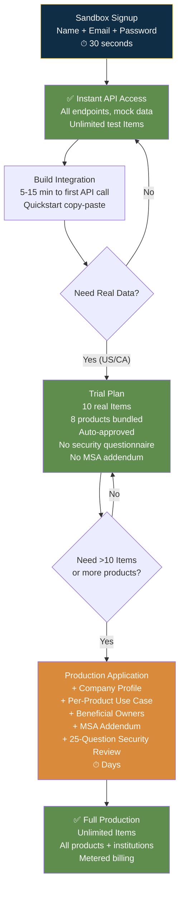

# Plaid — Fields Collected & Collection Strategy

## Collection Strategy Overview

| Attribute | Detail |
|-----------|--------|
| Total possible fields | 26 |
| Fields at signup | **3** (name, email, password) — industry best |
| Fields for Trial Plan | 3 + identity verification (auto-approved) |
| Fields for Production | Signup fields + company profile (7) + production application (6) + legal/security (3) |
| Security questionnaire | 25 questions — only for full Production (skipped in Trial Plan) |
| Estimated time to first API call | 5-15 minutes |
| Pre-fill sources | DNS domain verification (WorkOS); otherwise manual |
| Collection pattern | **Escalating trust model** — minimal at signup, progressive through tiers |

---

## Core Design Philosophy

**"Build first, approve later."** Plaid collects 3 fields at signup and gives instant Sandbox access to all API endpoints. Each tier toward Production collects more fields — but only when the developer needs that access level. The April 2026 Trial Plan is the breakthrough: auto-approved 10-Item real data access with 8 products, skipping the 25-question security questionnaire entirely.

---

## Step-by-Step Field Breakdown

### Step 1: Account Creation (Sandbox — Instant)

| Field | Required | Sensitive | Why | Minimization |
|-------|----------|-----------|-----|-------------|
| Name | Yes | No | Account identity | Minimal — just name |
| Email | Yes | No | Account ID + communication | Business email preferred |
| Password | Yes | Yes | Auth | Standard — no KYC |

### Step 2: Trial Plan (New April 2026 — Auto-Approved)

| Field | Required | Sensitive | Why | Minimization |
|-------|----------|-----------|-----|-------------|
| Identity verification | Yes | Yes | Developer legitimacy | **Auto-approved** — no security questionnaire |
| 8 product bundle | Auto | No | Auth, Transactions, Balance, Identity, Assets, Liabilities, Investments, Statements | Fixed bundle — no per-product justification needed |

### Step 3: Production Application

| Field | Required | Sensitive | Why | Minimization |
|-------|----------|-----------|-----|-------------|
| Company legal name | Yes | No | Legal identity | Solo devs: use own name |
| Company address | Yes | No | Jurisdiction | — |
| Tax ID (EIN) | Yes | Yes | Business legitimacy | Only at production stage |
| Industry | Yes | No | Risk classification | Dropdown, not free-text |
| Use case description | Yes | No | Per-product data access justification | Targeted questions |
| Beneficial owners | Yes | Yes | >25% ownership KYC | Threshold-based |
| Pricing plan | Yes | No | Commercial relationship | Revealed last page |
| Billing info | Yes | Yes | Payment | Only for paid plans |

### Step 4: Legal & Security (Full Production Only)

| Field | Required | Sensitive | Why | Minimization |
|-------|----------|-----------|-----|-------------|
| MSA Addendum | Yes | No | Binding contract for data rights | Legal necessity |
| Security questionnaire | Yes | Yes | **25 questions**: hosting, governance, asset mgmt, vuln mgmt, access controls, MFA, encryption, incident response, network segmentation, training, vendor mgmt, BCP, DR | **Skipped entirely in Trial Plan** — Plaid's biggest minimization breakthrough |

---

## Conversion Tactics

| Tactic | Risk Impact | Conversion Impact | Trade-off |
|--------|-------------|-------------------|-----------|
| **Trial Plan (April 2026)** — 10 real Items, 8 products, auto-approved, no security review | Medium (10-Item cap + fixed product bundle contain risk) | **Very High** — removes biggest friction point | Brilliant: "build first, approve later" for the highest-trust industry |
| **Copy-paste quickstart** — first API call in 5-15 min | Low (Sandbox only) | **Very High** — no coding required to start | Standard for developer platforms |
| **Sandbox MCP Server** — AI generates test data, fires webhooks, searches docs from IDE | Low | **High** — collapses test-data creation to one prompt | Differentiator from Stripe/PayPal |
| **Link Inside Fin/Sierra** — AI agents recover abandoned bank connections mid-conversation | Low | **High** — converts support friction into recovery | Unique agentic pattern |

---

## Takeaways for QBO

1. **3 fields at signup, 26 fields total, 5 tiers between them.** QBO: 25 fields upfront. The gap is the entire philosophy.
2. **Trial Plan is the model QBO should copy.** Auto-approved access with capped scope (10 Items → 10 transactions/reports) as the hook; full verification only when scope exceeds cap.
3. **Per-product use case justification.** QBO should require justification for payroll, tax filing, ACH origination — not ask for everything upfront regardless of intent.
4. **Security questionnaire skipped for low-scope access.** QBO equivalent: no full business verification for basic dashboard + bank connection; escalate for payroll/tax features.

---

## Change Log

| Date | Change |
|------|--------|
| 2026-08-05 | Initial creation — Plaid fields analysis |
