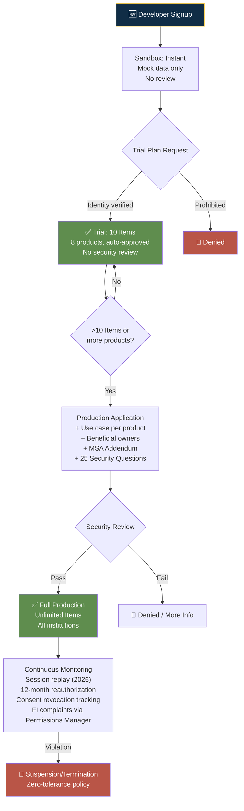

# Plaid — Risk Decision Process

## Risk Philosophy

Plaid's risk model is unique: they don't process payments, they **gate access to consumer banking credentials.** The trust bar is extreme — a bad developer can steal millions of consumers' financial data. Plaid's response: layered trust verification, per-product use case justification, mandatory consent architecture, and 12-month reauthorization cycles.

---

## Verification Tiers

| Tier | Trigger | Review | SLA |
|------|---------|--------|-----|
| **Sandbox** | Signup | None — instant | Immediate |
| **Trial** | Request real data (US/CA) | Identity verification only; auto-approved | Near-instant |
| **Production** | >10 Items or product expansion | Full: business + use case + beneficial owners + MSA + 25 security questions | Days |
| **Custom** | High volume / enterprise | Sales contact + all Production requirements + custom pricing | Weeks |

---

## Unique Risk Mechanisms

| Mechanism | How It Works |
|-----------|-------------|
| **Per-product use case justification** | Each Plaid product (Auth, Transactions, Income, Assets...) requires a separate written use case. Data Transparency Messaging enforces this at API level. |
| **Data minimization enforcement** | API strips data beyond approved scope — even if FI returns more, Plaid withholds it |
| **12-month mandatory reauthorization** | CFPB Section 1033 requires Update Mode every 12 months — periodic trust refresh |
| **Session replay monitoring** (2026) | Developer Dashboard interactions recorded for audit; behavioral signals feed risk models |
| **Financial Institution oversight** | Permissions Manager lets banks see which apps access their customers' data; real-time notifications; direct stop controls |
| **Consumer self-monitoring** | Plaid Portal (my.plaid.com) — consumers see all connected apps, revoke individually |
| **Zero-tolerance enforcement** | Any policy violation → immediate suspension/termination. No graduated warnings. |

---

## Takeaways for QBO

1. **Per-product use case justification is the model.** QBO should require separate justification for payroll, tax filing, ACH origination.
2. **CFPB-mandated 12-month reauthorization creates a built-in trust refresh cycle.** QBO should adopt periodic reauthorization even where not legally required.
3. **Consumer self-monitoring portal.** QBO should offer a dashboard where SMB owners see all connected apps/partners with their data access — and revoke individually.

---

## Change Log

| Date | Change |
|------|--------|
| 2026-08-05 | Initial creation — Plaid risk analysis |
