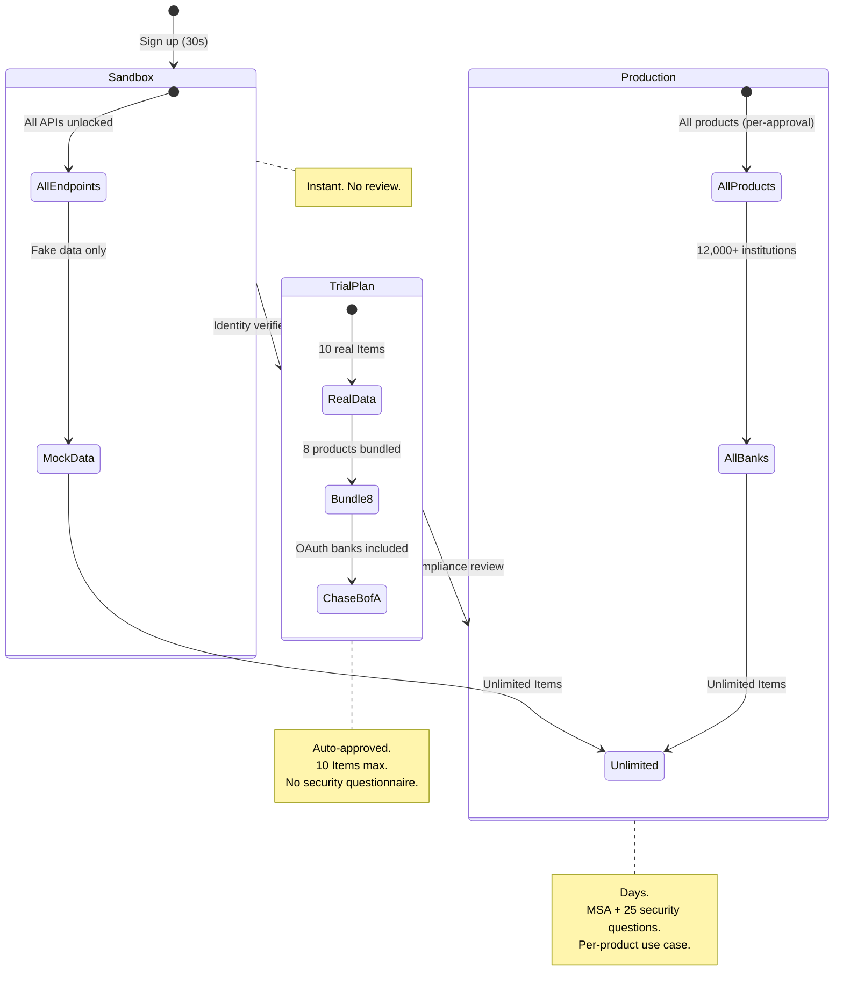

# Plaid — Entitlement Model

## Entitlement Philosophy

**"Progressive data access at both account AND per-Item level."** Plaid's entitlement model is the most granular in fintech. Not just tiers — each product requires separate use case justification. Not just account level — per-Item product gating (auto / update mode / impossible post-creation). Not just developer approval — end-user consent enforced at API level via Data Transparency Messaging.

---

## Tiers

| Tier | Requirements | Limits | Key Features |
|------|-------------|--------|-------------|
| **Sandbox** | Email + password | Mock data only, unlimited Items | All APIs, all institutions visible, higher rate limits |
| **Trial** (April 2026) | Identity verified, US/CA only | **10 real Items**, fixed 8-product bundle | Auth, Transactions, Balance, Identity, Assets, Liabilities, Investments, Statements; most OAuth banks |
| **Legacy Limited** | Closed to new signups | ~200 API calls total | Existing customers only |
| **Full Production** | App + company profile + per-product justification + beneficial owners + MSA + 25 security questions | Unlimited Items, metered billing | All products (per-approval), all institutions, webhooks |
| **Custom/Scale** | Sales contact | $2,000+/month | Premium support, SSO, Transfer, Signal Transaction Scores |

---

## Per-Item Product Gating

| Product Addition | Mechanism |
|-----------------|-----------|
| **Auto** (most products) | Call endpoint if in `additional_consented_products` at Link token creation |
| **Update Mode Required** | Assets, Bank Income, Statements, Signal — user must re-consent via Link |
| **Impossible Post-Creation** | Identity Verification, Payment Initiation — cannot be added to existing Items |

---

## Takeaways for QBO

1. **Per-product + per-consent gating.** QBO should require separate justification for payroll, tax filing, ACH — not one blanket approval.
2. **The Trial Plan is the most important onboarding innovation of 2026.** Auto-approved, capped-scope, real-data access. QBO equivalent: auto-approved dashboard + bank connection (10 transactions max), full verification to exceed cap.
3. **Three-tier product addition (auto / consent / impossible) is elegant.** QBO equivalent: auto-add reports, consent-required for payroll/tax, impossible-post-creation for ACH origination without full KYB.

---

## Change Log

| Date | Change |
|------|--------|
| 2026-08-05 | Initial creation — Plaid entitlement analysis |
