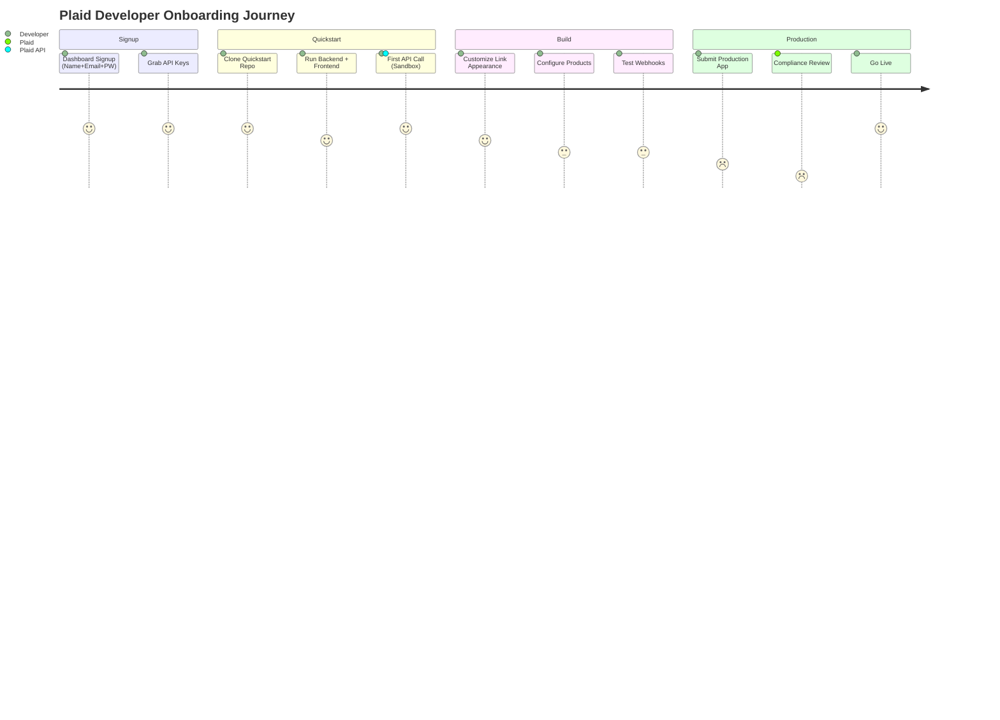

# Plaid — UI/UX Flow & Agentic Experience

## Flow Overview

| Attribute | Detail |
|-----------|--------|
| Total steps | 4 (signup → quickstart → build → production) |
| Time to first API call | 5-15 minutes |
| Mobile | Link: platform-adaptive (Material Design on Android, native iOS, web); Dashboard: desktop web |
| AI-powered | Dashboard MCP Server, Sandbox MCP Server, AI Dev Toolkit, Link Inside Fin, Link Inside Sierra, llms.txt |

---

## Developer Onboarding Flow

---

## Agentic / AI Features

| Feature | Description | Impact |
|---------|-------------|--------|
| **Dashboard MCP Server** | Natural-language queries for API usage, connection diagnostics, Link conversion funnels via Claude/ChatGPT | Eliminates manual dashboard navigation |
| **Sandbox MCP Server** | AI generates test users, sandbox tokens, mock data, fires webhooks — all from Cursor/Claude Code/Windsurf IDE | Collapses test-data creation to one prompt |
| **AI Development Toolkit** | /rules guides for Cursor, Claude Code, Windsurf + MCP server → prompt-to-prototype | First working integration without manual boilerplate |
| **Link Inside Fin AI Agent** | Plaid Link embedded in Fin support chat — AI detects stuck bank connection, surfaces "Connect bank" in-chat | Recovers abandoned onboarding flows |
| **Link Inside Sierra AI Agents** | Link in multi-step agentic workflows — loan underwriting, insurance claims, fraud resolution | Prevents application stalls; turns dead ends into data-gathering |
| **llms.txt + Markdown Docs** | Every docs page has raw markdown version; full llms.txt index for AI coding assistants | Machine-readable API surface for AI agents |

---

## Notable UI Patterns

| Pattern | Why Effective |
|---------|---------------|
| **Copy-paste curl as first principle** | Every endpoint has ready-to-run curl with sandbox URLs |
| **Language-contextual API reference** | Code snippets in chosen language alongside curl — no mental translation |
| **Bifurcated homepage** | "Just Browsing?" for consumers, "Start building" for developers — graceful audience routing |
| **Sandbox credential inlay** | Test credentials (user_good/pass_good/1234) displayed directly in quickstart docs |
| **Returning User Experience (RUX)** | Combined consent+verification in single pane; phone pre-fill → 11% higher returning user conversion |
| **Pre-initialization loading** | Link loaded in background → 5x faster; contextual loading states |
| **Design system coupling bank + platform** | Link matches each bank's visual identity while maintaining Plaid structural frame |

---

## Takeaways for QBO

1. **Copy-paste quickstart should be QBO's developer onboarding model.** ISV partners should go from zero to first API call in <15 minutes.
2. **Sandbox MCP server for AI coding assistants is the new table stakes.** Developers expect to describe integrations in natural language and have AI generate + test the code.
3. **Link Inside [Support Tool] is a brilliant pattern.** Embed QBO Connect inside Intercom/Zendesk — when a user gets stuck connecting their bank, the support AI surfaces the fix in-chat.

---

## Change Log

| Date | Change |
|------|--------|
| 2026-08-05 | Initial creation — Plaid UI/UX analysis |
