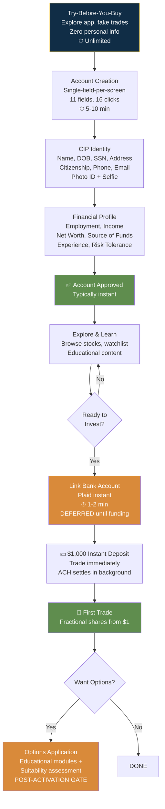

# Robinhood — Fields Collected & Collection Strategy

## Core Design Philosophy

**"Try before you buy. Defer everything. Single field per screen."** 11 federally-mandated CIP fields, one per screen, with plain-language explanations. Bank account linking is DEFERRED until the user wants to fund. Options/crypto/margin gated post-activation. The "try-before-you-buy" sandbox lets users explore the app before entering ANY personal data.

| Attribute | Detail |
|-----------|--------|
| Required fields at signup | **11** (industry best for consumer investing) |
| Single-field-per-screen | Yes — one question per screen, ~16 clicks total |
| Bank link timing | **Deferred** — only when user wants to fund |
| Total onboarding time | 5-10 min form fill + instant approval |
| Pre-fill | Minimal — address autocomplete only. Strategy is DEFERRAL. |

---

## Step 1: Identity Verification (CIP — Federally Mandated)

| Field | Why | Minimization |
|-------|-----|-------------|
| Full legal name | SEC/Treasury CIP rule | Single field per screen |
| Date of birth | CIP; 18+ age check | Native date picker |
| SSN | CIP tax ID; IRS 1099 reporting; FATCA; watchlist screening | Plain-language WHY explanation; encryption trust signals |
| Residential address | CIP; state jurisdiction; no PO Box | Address autocomplete |
| Citizenship/visa | USA PATRIOT Act; OFAC screening | Binary/multiple-choice, not doc upload |
| Phone + email | FINRA contact requirement; 2FA; fraud alerts | Standard |
| Photo ID + biometric selfie | CIP documentary verification; anti-synthetic-identity fraud | In-app camera; no scanned docs |

## Step 2: Financial Profile (FINRA Suitability Rule 2111)

| Field | Why | Minimization |
|-------|-----|-------------|
| Employment + employer | AML source-of-funds; income stability | Pre-defined options; no pay stub upfront |
| Annual income | FINRA suitability; Reg BI | Income ranges, not exact figure |
| Net worth + liquid net worth | FINRA risk capacity; options/margin gates | Broad ranges ($10K-$50K, $50K-$100K) |
| Source of funds | AML detection (salary, savings, inheritance, etc.) | Categorical selection; docs only if AML-flagged |
| Investment experience + risk tolerance + objectives | FINRA suitability + Reg BI | Minimal at onboarding; deeper assessment for options/margin gating |

---

## Conversion Tactics

| Tactic | Risk/Conversion | Trade-off |
|--------|---------------|-----------|
| **Try-before-you-buy sandbox** | Risk: None | Conversion: **Very High** — demonstrates value before asking for data |
| **Single-field-per-screen** | Risk: None | Conversion: **High** — eliminates form anxiety |
| **Deferred bank linking** | Risk: Low | Conversion: **High** — removes biggest drop-off point from signup |
| **$1,000 instant deposit** | Risk: **Medium** — funds advanced before ACH clears | Conversion: **Very High** — 3-5 day wait eliminated |
| **Free stock ($5-$200)** | Risk: Low | Conversion: **High** — psychological ownership + viral referral |
| **Fractional shares ($1 min)** | Risk: None | Conversion: **High** — removes "I can't afford a whole share" barrier |

---

## Takeaways for QBO

1. **11 fields + single-field-per-screen.** QBO: 25-30 fields in a dense form. The gap is the entire UX philosophy.
2. **Bank link DEFERRED, not upfront.** QBO asks for bank connection during signup. Defer it — let users explore the dashboard first.
3. **Try-before-you-buy sandbox.** QBO should let prospects explore a demo company before entering any personal data.
4. **Financial profile as ranges, not exact figures.** QBO asks for exact revenue, exact expenses. Ranges + categorical would reduce drop-off.

---

## Change Log

| Date | Change |
|------|--------|
| 2026-08-05 | Initial creation — Robinhood fields analysis |
