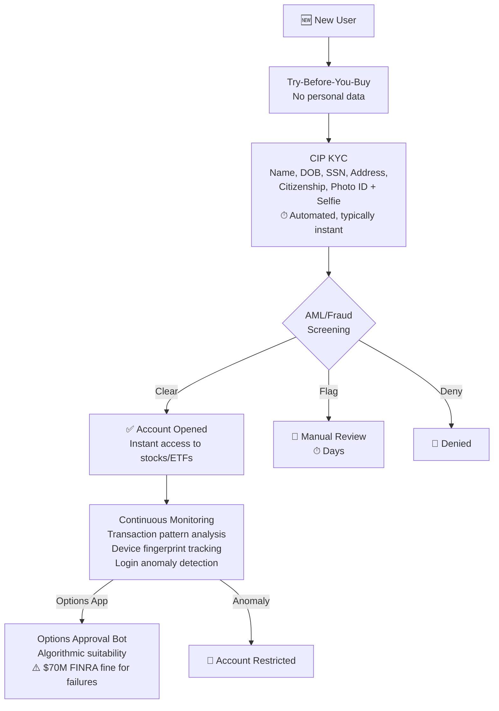

# Robinhood — Risk Decision Process

## Risk Philosophy

**"Approve fast, gate features later."** Robinhood's risk model is built on automated KYC + post-activation gating — not upfront manual underwriting. The $70M FINRA penalty (2021) + $29.5M AML fine (2025) show the danger of optimizing too aggressively for conversion speed over compliance.

| Tier | Trigger | Review | SLA |
|------|---------|--------|-----|
| **Basic Account** | All signups | Automated CIP KYC (SSN, DOB, photo ID, selfie) | Minutes |
| **Options Level 2** | In-app questionnaire | Algorithmic suitability bot ($70M fine for failures) | Typically instant |
| **Options Level 3** | Level 2 + Gold + margin | Additional review | 1-3 business days |
| **Margin** | $2,000 minimum equity | Regulatory (Reg T) + creditworthiness | Enable in settings |
| **Crypto Staking** | Full KYC | Enhanced verification | Days |
| **Crypto Derivatives** | EU-only + full KYC + assessment | Jurisdictional approval | Days |

---

## Notable Regulatory Actions

| Year | Fine | Issue |
|------|------|-------|
| 2021 | **$70M FINRA** | Options bot approved unqualified users; platform outages with no support; misleading customers |
| 2023 | **$10.2M multi-state** | Ongoing compliance deficiencies; system outages; options approval failures |
| 2024 | **$7.5M Massachusetts** | Gamification violations of Fiduciary Rule |
| 2025 | **$29.5M FINRA** | AML/CIP non-compliance; anti-money-laundering program failures |

---

## Takeaways for QBO

1. **Robinhood proves automated KYC works at scale — IF properly calibrated.** The fines came from treating compliance as UX friction to be minimized, not a requirement to be met.
2. **Post-activation gating (options Level 2/3, margin, crypto) is the right model, but needs actual compliance rigor.** QBO should gate payroll/tax filing/ACH behind in-app assessments — but with proper suitability checks.
3. **Instant deposit risk ($1K advanced before ACH clears) is manageable with the right identity signals.** QBO could offer instant transaction import while bank verification completes in background.

---

## Change Log

| Date | Change |
|------|--------|
| 2026-08-05 | Initial creation — Robinhood risk analysis |
