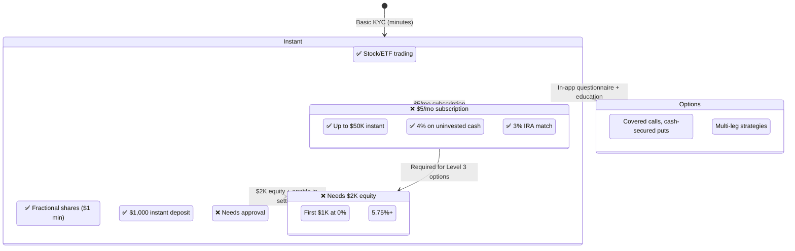

# Robinhood — Entitlement Model

## Entitlement Philosophy

**Layered post-activation gating.** Every user gets stock/ETF trading + $1,000 instant deposit + fractional shares immediately. Advanced features (options Level 2/3, margin, crypto derivatives, Gold subscription) are gated behind post-activation in-app assessments.

| Tier | Requirements | Limits | Key Features |
|------|-------------|--------|-------------|
| **Instant (Default)** | Basic KYC | $1,000 instant deposit | Stocks, ETFs, fractional shares, basic crypto spot |
| **Options Level 2** | In-app questionnaire (experience, income, objectives) | Covered calls, cash-secured puts | Algorithmic approval (typically instant) |
| **Options Level 3** | Margin + Gold + additional review | Multi-leg strategies | 1-3 business days review |
| **Margin** | $2,000 minimum equity | First $1K at 0% interest | Enable in settings; requires Gold for best rates |
| **Robinhood Gold** | $5/month or $50/year | $50K instant deposit | 4% APY cash, 3% IRA match, Level II data, Morningstar |
| **IRA** | Earned income required | $7,000-8,000/year contribution limit | Tax-deferred/tax-free growth; IRA match |
| **Crypto** | Separate enable | Spot: basic KYC; Derivatives: EU-only + full KYC | Staking: full KYC |

---

## Takeaways for QBO

1. **Layered post-activation gating.** Basic QBO (dashboard, reports, bank connection) at signup. Payroll, tax filing, ACH, credit — each requires separate in-app activation with justification.
2. **Gold subscription as upgrade paywall.** QBO equivalent: Premium tier unlocking advanced features at a monthly subscription vs. separate product purchases.
3. **Instant deposit = instant value.** QBO equivalent: instant bank connection (Plaid) with immediate transaction import while full verification runs in background.

---

## Change Log

| Date | Change |
|------|--------|
| 2026-08-05 | Initial creation — Robinhood entitlement analysis |
