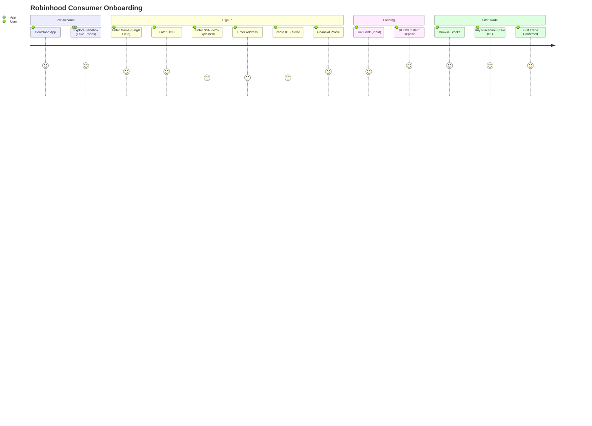

# Robinhood — UI/UX Flow & Agentic Experience

## Flow Overview

| Attribute | Detail |
|-----------|--------|
| Total steps | 5 (sandbox → signup → funding → education → first trade) |
| Time to first trade | Minutes (with instant deposit) |
| Mobile-first | Dark mode #000000, neon green #B7DF2F, 4px grid, Inter font, cards as primary UI |
| Completion | Single-field-per-screen: 11 fields, ~16 clicks |

---

## Onboarding Funnel

---

## Agentic / AI Features

| Feature | Description |
|---------|-------------|
| **Cortex AI (2025)** | AI as UX foundation — not a feature bolted on, but a from-scratch AI-native redesign |
| **Digests** | GenAI stock insights — scans news, analyst reports, technicals, proprietary data → plain-English "why stock moved" summaries. 95% user satisfaction. |
| **AI summaries** | Multi-source synthesis: market data + analyst ratings + aggregated user trading data |
| **Options Approval Bot** | AI-driven algorithmic suitability assessment (⚠️ $70M fine for failures) |

---

## Notable UI Patterns

| Pattern | Why |
|---------|-----|
| **Single-field-per-screen** | Gold standard — one question per screen, plain-language WHY |
| **Dark mode #000000 + neon green #B7DF2F** | Pioneered "dark fintech" aesthetic; industry-wide copy |
| **Cards as primary UI** | Stock holdings expand from origin point on tap |
| **Odometer-effect micro-interactions** | Live price updates with real-time feedback |
| **Biometric-first login** | Fingerprint/facial recognition — no passwords |
| **Skeleton screens** | Structural loading states instead of spinners |
| **Free stock scratch-off** | Lottery-style variable reward; 🎯 dopamine engagement |
| **Swipe-to-dismiss** | Tinder-like card dismissal for news, holdings |

---

## Takeaways for QBO

1. **Single-field-per-screen.** QBO's dense multi-field forms need to be re-architected one question at a time.
2. **Try-before-you-buy = demo company.** QBO should let prospects explore a fully functional demo company with zero personal data required.
3. **Dark mode design system.** QBO should adopt a modern, mobile-first design language.
4. **AI-native redesign (Cortex-model).** QBO's AI features should be the foundation, not add-ons.

---

## Change Log

| Date | Change |
|------|--------|
| 2026-08-05 | Initial creation — Robinhood UI/UX analysis |
