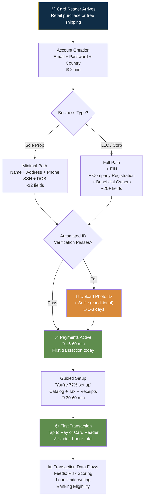

# Square — Fields Collected & Collection Strategy

## Collection Strategy Overview

| Attribute | Detail |
|-----------|--------|
| Total possible fields | 38 (across all entity types, jurisdictions, and products) |
| Typical fields at signup | ~12-15 for US sole proprietor |
| Required fields | Business name, type, address, phone; legal name, SSN, DOB, home address; bank account for deposits |
| Optional fields | EIN (for registered entities), photo ID + selfie (conditional), VAT number (EU/UK), company registration number (non-US) |
| Estimated completion time | 5-10 min account creation + 30-60 min guided setup + first transaction in <1 hour |
| Pre-fill sources | Address auto-complete; transaction-data-driven progressive underwriting |
| Collection pattern | Entity-type branching + "create now, verify later" PayFac model |

---

## Core Design Philosophy

**"The product IS the onboarding."** Square's onboarding is anchored by a physical card reader. Process payments → build transaction history → unlock banking products. Square operates as a Payment Facilitator (PayFac): provisional approval in 15-60 minutes via algorithmic underwriting, full review happens post-transaction.

---

## Step-by-Step Field Breakdown

### Step 1: Account Creation

| Field | Required | Sensitive | Why Collected | Minimization Tactic |
|-------|----------|-----------|---------------|---------------------|
| Email | Yes | No | Account ID + communication | Single field; no username required |
| Password | Yes | Yes | Security | Standard auth |
| Country | Yes | No | Jurisdictional routing | Determines which subsequent fields appear |
| Terms + E-Sign Consent | Yes | No | Legal consent | Bundled — single click covers all agreements |

### Step 2: Business Information

| Field | Required | Sensitive | Why Collected | Minimization Tactic |
|-------|----------|-----------|---------------|---------------------|
| Business name (DBA) | Yes | No | Card network rules | Sole props can use personal name; no registration doc upfront |
| Business type | Yes | No | Determines KYB path | **Gate field** — sole props skip EIN + beneficial owners + articles |
| Physical address | Yes | No | Card network rules + OFAC | Address auto-complete reduces errors |
| Phone | Yes | No | Risk review contact | Single number; no separate lines |
| Est. annual revenue | Yes | No | Risk tiering + loan eligibility | Ranges accepted; no tax returns upfront |
| EIN | Conditional | Yes | IRS + KYB | **Only for registered entities**; sole props use SSN |
| Company registration # | Conditional | No | Government registry | **Jurisdiction-gated** — non-US only |
| VAT number | Conditional | No | Tax compliance | **Jurisdiction-gated** — EU/UK only |

### Step 3: Personal Identity (KYC)

| Field | Required | Sensitive | Why Collected | Minimization Tactic |
|-------|----------|-----------|---------------|---------------------|
| Full legal name | Yes | No | OFAC + public records match | Cross-verified against SSN+DOB+address |
| SSN (full) | Yes (US) | Yes | IRS 1099-K + AML verification | Encrypted; used once then tokenized |
| Date of birth | Yes | Yes | AML/KYC + age verification | Never displayed or shared |
| Home address | Yes | Yes | AML identity match | Only if different from business address |
| Photo ID (DL/passport) | **Conditional** | Yes | Enhanced verification | **Only requested when automated checks fail** |
| Selfie (liveness) | **Conditional** | Yes | Anti-fraud | **Only with photo ID when automated checks fail** |
| Bank account + routing | Yes | Yes | Payout destination | Standard |

---

## Pre-fill Strategy

Square's pre-fill is weaker than PayPal/Stripe (no platform API prefill), but compensates with **transaction-data-driven progressive underwriting:**

| Layer | Source | Effect |
|-------|--------|--------|
| Address auto-complete | Address databases | Reduces typos, follow-up requests |
| SSN+DOB+address cross-reference | Credit bureaus, public records | Verifies identity silently for most — doc upload only on mismatch |
| Transaction data | POS activity | Feeds risk scoring, loan underwriting, banking eligibility |
| Hardware ID | Card reader device fingerprint | Passive verification — device tied to account |

---

## Conversion Tactics

| Tactic | How It Works | Risk Impact | Conversion Impact | Trade-off Rationale |
|--------|-------------|-------------|-------------------|-------------------|
| **Hardware as anchor** | Free/cheap card reader shipped immediately; physical object creates commitment | Low | **Very High** — sunk cost motivation | Unique to Square — PayPal/Stripe can't replicate |
| **Tap to Pay (zero hardware)** | NFC phone-as-terminal; no reader needed | Low | **High** — zero-cost entry | Removes last barrier to first transaction |
| **Entity-type branching** | Sole props skip EIN, beneficial owners, articles of incorporation | Low — SSN still required | **Medium** — significantly shorter form | Regulatory minimum met but not exceeded |
| **Conditional photo ID/selfie** | Only requested when automated SSN+DOB+address fails | Very Low — catches fraud ID attempts | **Medium** — most never see doc upload | Fund freeze + retroactive review contain residual risk |
| **"You're 77% set up" gamification** | Percentage progress bar on Dashboard | None | **Medium** — clear next actions | Gamification works but can frustrate when it stalls |
| **Ecosystem lock-in** | Each product adopted (Checking, Savings, Loans) increases switching cost | None | **Medium** — retention as conversion | Not initial-signup conversion but lifetime value |

---

## Takeaways for QBO

1. **Hardware as onboarding is Square's un-replicable advantage.** QBO can't match the card reader experience, but could create a "QuickBooks Terminal" or "QuickBooks Register" — a physical receipt printer + barcode scanner that triggers setup.
2. **Entity-type branching is table stakes.** Square cuts form length by 50% for sole props. QBO's one-size-fits-all form is this gap exactly.
3. **Conditional photo ID is the right model.** Only request when automated checks fail. QBO should adopt: verify via IRS first, request ID upload only on mismatch.
4. **Ecosystem-driven progressive access is the endgame.** Process payments → unlock banking → unlock lending. QBO equivalent: connect bank → unlock basic reports → unlock payroll → unlock tax filing → unlock credit.

---

## Sources

- [Square Payments Terms](https://squareup.com/us/en/legal/general/square-payment-terms)
- [Square Seller Community](https://www.sellercommunity.com/)
- [Square Developer](https://developer.squareup.com/)

---

## Change Log

| Date | Change |
|------|--------|
| 2026-08-05 | Initial creation — Square fields and collection strategy |
