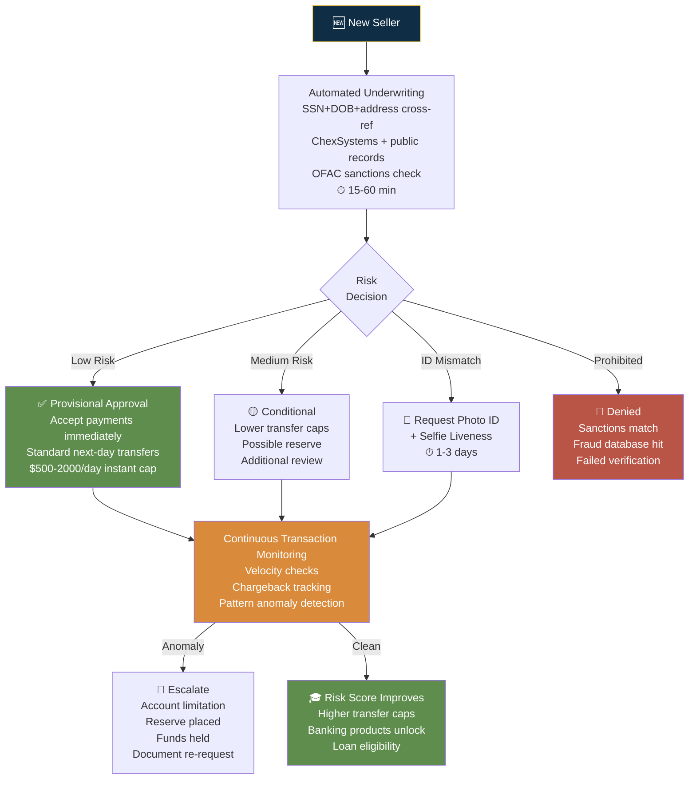

# Square — Risk Decision Process

## Risk Philosophy

**"Approve fast, monitor continuously."** Square operates a PayFac model — provisional approval in 15-60 minutes via automated algorithmic underwriting. Full review happens post-transaction. This is possible because Square controls the entire payment stack (hardware + software + processing), giving them richer risk signals than any pure-online competitor.

---

## Verification Tiers

### Tier 1: Instant / Provisional Activation

| Attribute | Detail |
|-----------|--------|
| Trigger | All new merchant signups |
| Methods | Automated identity: SSN+DOB+address cross-ref against ChexSystems + public records |
| Data sources | SSA, credit bureaus, public records, OFAC SDN |
| Decision logic | Algorithmic — matches pass → provisional approval. Mismatch → photo ID + selfie requested. Match against fraud DB → deny. |
| SLA | 15-60 minutes to provisional approval |

### Tier 2: Enhanced Verification (Conditional)

| Attribute | Detail |
|-----------|--------|
| Trigger | Automated checks cannot confirm identity (mismatch, thin file, fraud flag) |
| Methods | Government photo ID upload + real-time selfie (liveness detection) |
| Data sources | ID document OCR, facial matching, database cross-reference |
| Decision logic | ID matches face + database → approve. Otherwise → manual review. |
| SLA | 1-3 business days |

### Tier 3: Post-Transaction Underwriting (Continuous)

| Attribute | Detail |
|-----------|--------|
| Trigger | Transaction patterns, chargeback rates, dispute activity, volume spikes |
| Methods | Automated monitoring: velocity checks, chargeback ratio tracking, pattern anomaly detection |
| Data sources | Transaction data, chargeback notifications, customer complaints |
| Decision logic | Accounts flagged for review → possible limitation, reserve, or documentation request. Accounts in good standing → transfer caps increase, banking products unlock. |
| SLA | Continuous, real-time |

---

## Unique Risk Signals (Hardware-Enabled)

Square's POS hardware provides risk signals that no online-only competitor has:

| Signal | Source | Risk Value |
|--------|--------|------------|
| Card-present EMV/chip data | Card reader | Lower fraud risk than card-not-present |
| Device fingerprint | Card reader hardware ID tied to account | Passive verification — device movement tracked |
| Location data | POS geolocation | Mismatch between stated business address and actual transaction location triggers review |
| Offline transaction queue | App stores transactions when offline, syncs later | Fraud detection delayed but not lost |
| Receipt customization | Receipt details + tip patterns | Consistent patterns indicate legitimate business |

---

## Fraud Detection

| Signal | Detection Method | Performance |
|--------|-----------------|-------------|
| Card-present fraud | EMV chip authentication significantly reduces counterfeit card risk | Lower fraud rate than online-only |
| Card-not-present fraud | Square Risk Manager with configurable rules | Automated decline + manual review options |
| Account takeover | Login anomaly detection + device fingerprint | |
| Velocity anomalies | Transaction frequency spikes monitoring | Auto-flag |
| Chargeback monitoring | Ratio tracking; accounts exceeding thresholds face action | Reserve or limitation imposed |

---

## Takeaways for QBO

1. **PayFac model enables "approve fast, monitor continuously."** QBO could move to provisional access — let users explore the dashboard while background verification runs.
2. **Hardware-based risk signals are a moat.** Square's card reader provides passive verification that PayPal/Stripe can't match. QBO doesn't need hardware parity, but could use existing Intuit ecosystem signals (TurboTax data, banking connections) as equivalent passive verification.
3. **ChexSystems + public records for identity verification is standard.** QBO should add this layer to its IRS-only verification stack.

---

## Sources

- [Square Risk Manager](https://squareup.com/us/en/risk-manager)
- [Square Payments Terms of Service](https://squareup.com/us/en/legal/general/square-payment-terms)
- [Square Seller Community — Holds & Reserves](https://www.sellercommunity.com/)

---

## Change Log

| Date | Change |
|------|--------|
| 2026-08-05 | Initial creation — Square risk decision process |
