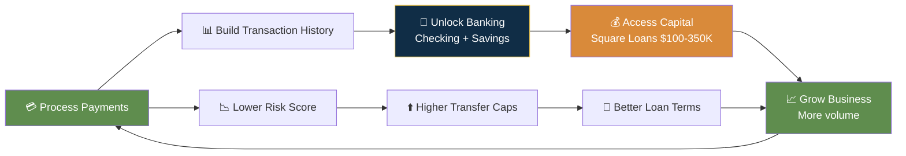

# Square — Entitlement Model

## Entitlement Philosophy

**"The product IS the onboarding."** Square's entitlement model is fundamentally different from PayPal/Stripe. Instead of sequential verification tiers that unlock access, Square's products unlock based on **transaction data generated by using Square.** Process payments → build history → unlock Checking → unlock Savings → unlock Loans. Each product adopted increases switching cost.

```mermaid
stateDiagram-v2
    [*] --> Signup: Create Account
    
    state Signup {
        [*] --> DownloadApp: Get app
        DownloadApp --> FirstPayment: Tap to Pay OR Reader
        --
        Banking: ❌ Not yet
        Loans: ❌ Not yet
    }
    
    state Active {
        [*] --> Checking: Identity verified
        Checking --> Savings: Open (1.00% APY)
        Savings --> HighYield: $10K balance → 3.50% APY
        --
        Loans: ❌ Not yet ($10K annual req)
    }
    
    state Established {
        [*] --> Loans: $10K annual sales + 20+ days
        Loans --> CustomRates: $250K annual sales
    }
    
    Signup --> Active: Identity Verified<br/>⏱ hours to days
    Active --> Established: Processing History<br/>⏱ months
    
    note right of Signup: $500-2000/day instant<br/>Standard next-day free<br/>First transaction in <1hr
    note right of Active: Square Checking + Debit Card<br/>Square Savings 1.00%
    note right of Established: Square Loans $100-350K<br/>3.50% Savings APY<br/>Custom pricing
```

---

## Entitlement Tiers

### Immediate (At Signup)

| Attribute | Detail |
|-----------|--------|
| Requirements | Email + password + basic business info |
| Limits | Instant transfers: $500-2,000/day (risk-based). Standard: next business day. |
| Features unlocked | POS app, Online Store (free tier), Tap to Pay, Invoicing, Basic catalog, Free magstripe reader |
| Hold periods | Initial review possible on first payment |

### Identity Verified (Hours to Days)

| Attribute | Detail |
|-----------|--------|
| Requirements | Full SSN verified, DOB matched, address confirmed. Photo ID + selfie if automated check fails. |
| Limits | Instant transfers up to $2,000-5,000/day (expands with history). Same-day transfer eligibility. |
| Features unlocked | Square Checking + digital debit card, Square Savings (1.00% APY), Square Online Plus ($49/mo), abandoned cart emails |
| Hold periods | Standard next-day. Risk-based reviews possible but less frequent. |

### Established Seller (Months of History)

| Attribute | Detail |
|-----------|--------|
| Requirements | $10,000+ annual Square sales, 20+ days of Square usage in past year, good account standing, 75%+ of any existing loan repaid |
| Limits | Instant transfers: $5,000/day. Loan amounts: $100-$350,000. ATM: $500-3,000/transaction. |
| Features unlocked | Square Loans (flat-fee, repaid as % of daily sales), Square Savings 3.50% APY (at $10K balance), multiple debit cards (up to 5), Square Register hardware, custom processing rates (at $250K annual) |
| Hold periods | No routine holds for established accounts in good standing. Risk-based reserves possible for high-risk categories. |

---

## The Virtuous Cycle



---

## Takeaways for QBO

1. **Ecosystem-driven progressive access is the most defensible entitlement model.** Each Square product adopted increases switching cost. QBO equivalent: connect bank → reports → payroll → tax filing → credit — each builds on the last.
2. **Data-driven loan underwriting based on transaction history is superior to credit bureau scores.** QBO has access to business financial data that Square doesn't — income, expenses, tax history. Use it for lending.
3. **The $10,000 annual / 20+ days criteria creates a natural qualification funnel.** QBO should set equivalent behavioral milestones for unlocking premium features.

---

## Change Log

| Date | Change |
|------|--------|
| 2026-08-05 | Initial creation — Square entitlement model |
