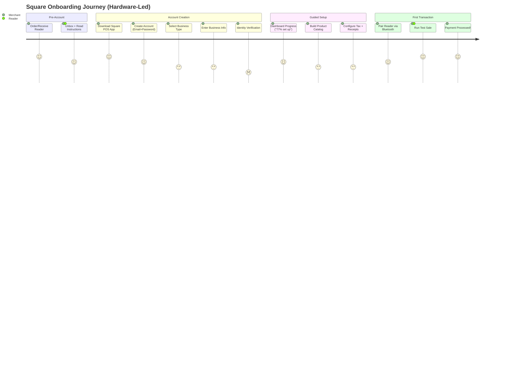
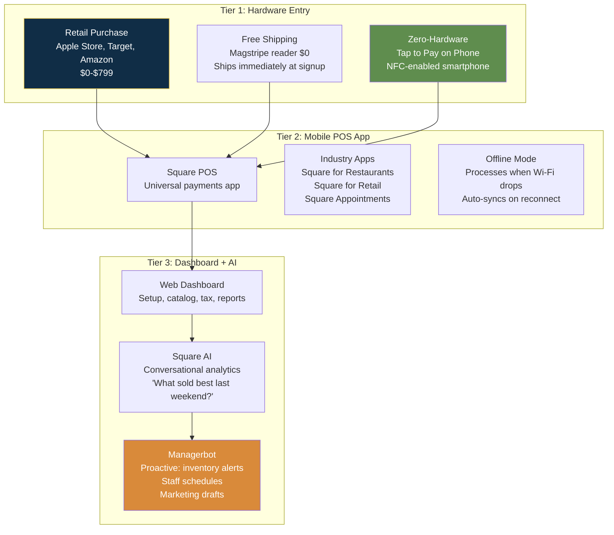

# Square — UI/UX Flow & Agentic Experience

## Flow Overview

| Attribute | Detail |
|-----------|--------|
| Total steps | 7 (from unboxing to first transaction) |
| Estimated time | Under 1 hour to first test sale; 5 business days for full bank verification |
| Mobile optimized | **Mobile-first** — the app IS the POS. 4.8★ App Store (600K reviews), 4.6★ Google Play (250K+) |
| Completion rate | Hardware as anchor significantly reduces digital abandonment |
| AI-powered | Square AI (conversational analytics), Managerbot (proactive AI agent), AI Voice Ordering, AI Inventory, Thrive-Shopify integration |

---

## Hardware-Anchored Onboarding Flow

---

## Three-Tier Architecture

---

## Friction Points

| Friction Point | Why Exists | Severity | Mitigation |
|---------------|------------|----------|------------|
| **Identity verification delays** | KYC/AML compliance; automated checks fail for ~20% | 4 | Conditional doc upload; seller can transact while verification in progress |
| **Setup guide stalling** | "77% set up" can't be dismissed; some tasks lack skip button | 3 | Community workarounds exist; no official fix |
| **No training mode** | Square considers test sale sufficient; sandbox is developer-only | 3 | Advise sellers to test on themselves |
| **Locked into Square Payments** | Hardware + software + processing are bundled | 3 | Competitive in-person rates; free plan |
| **Feature overload for new sellers** | 20+ feature areas in Dashboard without prioritization | 3 | Managerbot proactively surfaces issues |

---

## Agentic / AI Features

| Feature | Description | Conversion Impact |
|---------|-------------|-------------------|
| **Square AI** | Free natural-language analytics: "What sold best last weekend?" Generates charts. | 30-200 hours saved/month for SMBs; reduces blank-spreadsheet intimidation |
| **Managerbot** | Proactive AI agent (open beta 2026): daily sales monitoring, inventory shortage prediction, staff scheduling drafts, marketing drafts, catalog health checks. Every write action requires seller approval. | Fills operations manager gap for free; proposes-you-approve builds trust |
| **AI Voice Ordering** | AI handles phone orders during busy periods; sends menus via text; logs to Kitchen Display System | Captures revenue lost to missed calls with zero staffing cost |
| **AI Inventory + Thrive Integration** | Managerbot tracks sales velocity vs stock; weather/event-aware reorder suggestions; Shopify sync via Thrive partnership | Prevents stockouts; positions Square as inventory source of truth across channels |

---

## Notable UI Patterns

| Pattern | Why Effective |
|---------|---------------|
| **Hardware-as-onboarding-anchor** | Physical reader = sunk cost motivation; unboxing IS part of digital funnel |
| **"You're 77% set up" gamification** | Clear progress + next action; gamifies completion |
| **Industry routing at signup** | "How do you plan to sell?" → restaurant vs retail vs appointment path |
| **Two-panel POS (iPad)** | Left 30% order/check, right 70% menu grid — industry standard, reduces staff training time |
| **Spreadsheet import for catalog** | Acknowledges manual entry pain; pragmatic for migrating sellers |
| **Human-in-the-loop AI** | Managerbot proposes, seller approves — critical trust pattern for AI in fintech |
| **Offline-first operation** | POS works when Wi-Fi drops — real-world design requirement |

---

## Takeaways for QBO

1. **"The product IS the onboarding" is a philosophy QBO can adopt.** Free trial → connect bank → auto-categorize transactions → generate first report → file first tax return. Each step builds on the last; each milestone unlocks the next.
2. **Managerbot's "propose, you approve" pattern is the right AI trust model for accounting.** QBO should adopt: AI drafts journal entries, categorizations, tax filings — human reviews and approves. Never auto-executes.
3. **Industry routing at signup is table stakes.** QBO should ask "What kind of business?" and tailor the entire onboarding path — construction sees job costing, retail sees inventory, professional services sees time tracking.

---

## Change Log

| Date | Change |
|------|--------|
| 2026-08-05 | Initial creation — Square UI/UX and agentic experience |
