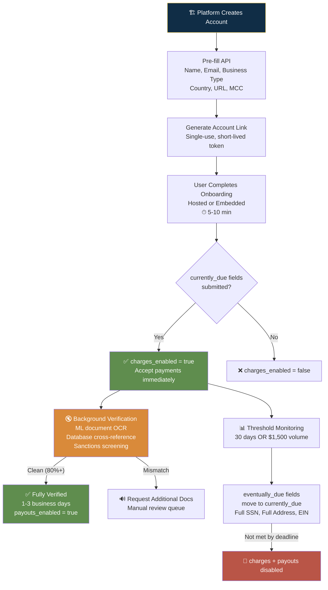
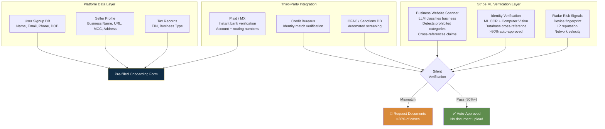

# Stripe — Fields Collected & Collection Strategy

## Collection Strategy Overview

| Attribute | Detail |
|-----------|--------|
| Total possible fields | 62 (across all entity types, jurisdictions, and capabilities) |
| Typical fields at signup | ~15 (for US individual/sole prop with card payments) |
| Required fields | Depends on country + business_type + requested capabilities |
| Optional fields | Annual revenue, worker count, support phone/URL, diversity designations |
| Estimated completion time | 5-10 min (Express hosted); 1-3 business days for full async verification |
| Pre-fill sources used | Platform API prefill, ML-based silent database verification, Radar risk signals |
| Collection pattern | Capability-gated progressive disclosure with `currently_due` / `eventually_due` split |

---

## Core Design Philosophy

**"Ask minimal, verify silently."** Stripe collects the absolute minimum required by regulation, prefills everything the platform already knows, verifies identity and business legitimacy programmatically via ML and database cross-referencing, and only escalates to manual document upload as a last resort. Result: **over 80% of merchants approved instantly without human review.**

---

## Step-by-Step Field Breakdown

### Step 1: Account Creation & Business Type

| Field | Required | Sensitive | Why Collected | Pre-fill Source | Minimization Tactic |
|-------|----------|-----------|---------------|-----------------|---------------------|
| country | Yes | No | Determines regulatory regime — different jurisdiction = different KYC/KYB | Platform (IP, billing address) | Single field gates entire subsequent flow |
| email | No | No | Account identification | Platform user DB | Optional — only if platform needs it |
| business_type | Yes | No | Determines KYC-only (individual) vs KYB+UBO (company) | Platform can infer from user profile | **Gate field** — selecting "individual" avoids all company/UBO fields entirely |
| capabilities.card_payments | Yes | No | Triggers full KYC/KYB requirement set | Platform knows merchant intent | **Capability-gated** — no capability = no verification |
| capabilities.transfers | Yes | No | Required for Connect payouts; triggers bank account collection | Platform knows payout intent | Combined with card_payments |

### Step 2: Business Profile (KYB)

| Field | Required | Sensitive | Why Collected | Pre-fill Source | Minimization Tactic |
|-------|----------|-----------|---------------|-----------------|---------------------|
| business_profile.name | Yes | No | Customer-facing name on statements/receipts; card network requirement | Platform seller profile | Must be recognizable words |
| business_profile.url | Yes | No | **ML-scanned** — Stripe's LLM classifies business, detects prohibited categories, cross-references claims | Platform user profile | If URL insufficient, `product_description` fallback — only one required |
| business_profile.mcc | Yes | No | Merchant Category Code for interchange rates, risk profiling, regulatory reporting | Platform auto-assigns from seller category | Stripe provides MCC lookup tool |
| business_profile.support_address | Yes | No | Card network transparency — customers must be able to contact merchant | Platform user address | Can be same as business address |
| business_profile.annual_revenue | No | No | Risk underwriting — volume expectations, reserve requirements | Platform may have revenue data | Optional — not required for activation |
| business_profile.estimated_worker_count | No | No | Risk assessment — distinguish legitimate business from shell company | N/A | Optional |

### Step 3: Company Details (KYB — Company Entity Only)

| Field | Required | Sensitive | Why Collected | Pre-fill Source | Minimization Tactic |
|-------|----------|-----------|---------------|-----------------|---------------------|
| company.name | Yes | No | Legal business name — must match formation docs | Platform can prefill | Only if business_type=company |
| company.tax_id (EIN) | Yes | Yes | IRS business tax ID — KYB requirement for company entities | Platform may have tax data | Only triggered for company type |
| company.address | Yes | No | Legal business address — must be physical, no PO Box | Platform address data | |
| company.phone | Yes | No | Business phone for verification contact | Platform phone data | |

### Step 4: Representative / Owner KYC

| Field | Required | Sensitive | Why Collected | Pre-fill Source | Minimization Tactic |
|-------|----------|-----------|---------------|-----------------|---------------------|
| representative.first_name / last_name | Yes | No | Identity of person who controls the account | Platform user profile | |
| representative.email | Yes | No | Contact for the representative | Platform user DB | |
| representative.dob | Yes | Yes | KYC/CIP — identity verification | Platform user profile | Individual only — company has separate owner fields |
| representative.ssn_last_4 | Yes (US) | Yes | **Last 4 digits only initially** — full SSN is `eventually_due` | N/A (sensitive) | **Key minimization: full SSN deferred to 30 days or $1,500 trigger** |
| representative.address | Yes | Yes | Personal address of representative | Platform user address | Full address may be `eventually_due` |
| representative.phone | Yes | No | Phone for verification | Platform phone data | |

### Step 5: Owners / UBO (KYB — Only if >25% Ownership)

| Field | Required | Sensitive | Why Collected | Minimization Tactic |
|-------|----------|-----------|---------------|---------------------|
| owner.name | Conditional | No | FinCEN CDD — all individuals with >25% equity + 1 control person | **Only triggered if business_type=company AND ownership >25%** |
| owner.email | Conditional | No | Contact for owner verification | |
| owner.dob | Conditional | Yes | KYC for each UBO | |
| owner.ssn_last_4 | Conditional | Yes | Last 4 for identity match | |
| owner.address | Conditional | Yes | UBO residential address | |

### Step 6: Bank Account for Payouts

| Field | Required | Sensitive | Why Collected | Pre-fill Source | Minimization Tactic |
|-------|----------|-----------|---------------|-----------------|---------------------|
| external_account (routing + account number) | Yes | Yes | Payout destination | Plaid/MX instant bank verification OR manual micro-deposits | Instant verification avoids 2-3 day wait |
| account_holder_name | Yes | No | Must match legal/representative name | Bank API returns this | Auto-populated; user confirms |

### Step 7: Additional Verifications (Conditional — Platform-Triggered)

| Field | Required | Sensitive | Why Collected | Minimization Tactic |
|-------|----------|-----------|---------------|---------------------|
| Government ID + Selfie Liveness | Conditional | Yes | Platform-configured for high-risk categories or compliance obligations | Only triggered by platform configuration — not default |

---

## Pre-fill Strategy

---

## Conversion Tactics

| Tactic | How It Works | Risk Impact | Conversion Impact | Trade-off Rationale |
|--------|-------------|-------------|-------------------|-------------------|
| **Create first, verify later** | Account created instantly; onboarding link works immediately; verification happens async | Medium — fraud can create accounts | **Very High** — zero friction to start | First-payout delay (7-14 days) + rolling reserves contain risk |
| **currently_due vs eventually_due split** | Only collect immediate requirements; defer full SSN, full address, EIN to 30-day/$1,500 trigger | Low — fields still collected | **High** — ~15 fields at signup vs 62 possible | Gated behind transaction thresholds |
| **Pre-fill API + Platform integration** | Platform passes all known data before user sees onboarding; user confirms, doesn't type | Low — platform already validated | **High** — eliminates duplicate entry entirely | Requires platform-side engineering but pays off massively |
| **ML silent verification** | Stripe's ML models verify identity and business legitimacy via OCR + database cross-ref + website scanning; 80%+ auto-approved | Low — ML accuracy exceeds manual | **Very High** — no document upload for most | Investment in ML infrastructure justified by scale |
| **Embedded components (never leave platform)** | Stripe's onboarding renders inside platform UI via React SDK; full brand customization | Low — Stripe controls verification | **High** — no context switch, no trust erosion | Requires Connect integration but delivers conversion |
| **One-action rule** | Every screen has at most one primary CTA; welcome email has single button: "Activate Account Now" | None | Medium — reduces cognitive load | Consistent across all Stripe surfaces |
| **Idempotency as UX pattern** | Every API request idempotent — removes "what if my retry creates a duplicate?" anxiety | None | Medium — developer trust | Developer experience pattern that reduces support tickets |

---

## Takeaways for QBO

1. **capability-gated requirements is the most elegant field minimization pattern in fintech.** QBO should adopt: only trigger tax filing fields when user requests tax filing, only trigger payroll fields when user requests payroll, only trigger ACH fields when user requests ACH. Current QBO collects everything upfront regardless of intent.

2. **currently_due / eventually_due split is a proven model.** QBO equivalent: "Fields needed to explore dashboard" (currently_due) vs "Fields needed for payroll/tax filing" (eventually_due). Defer the latter until the user activates those features.

3. **ML-powered silent verification is the future.** Stripe's 80%+ auto-approval rate comes from ML models that verify silently. QBO already has IRS integration — use it to auto-verify instead of asking users to upload documents.

4. **Pre-fill API is table stakes.** Platforms integrating QBO should be able to pass all known user data before the onboarding form loads. User confirms, doesn't type.

---

## Sources

- [Stripe Connect Accounts](https://docs.stripe.com/connect/accounts)
- [Stripe Required Verification Information](https://docs.stripe.com/connect/required-verification-information)
- [Stripe Connect Onboarding](https://docs.stripe.com/connect/onboarding)
- [Stripe API Reference: Accounts](https://docs.stripe.com/api/accounts)

---

## Change Log

| Date | Change |
|------|--------|
| 2026-08-05 | Initial creation — Stripe fields and collection strategy analysis |
