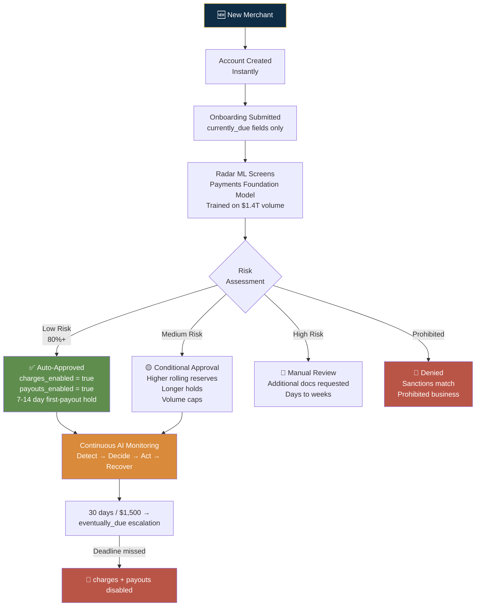
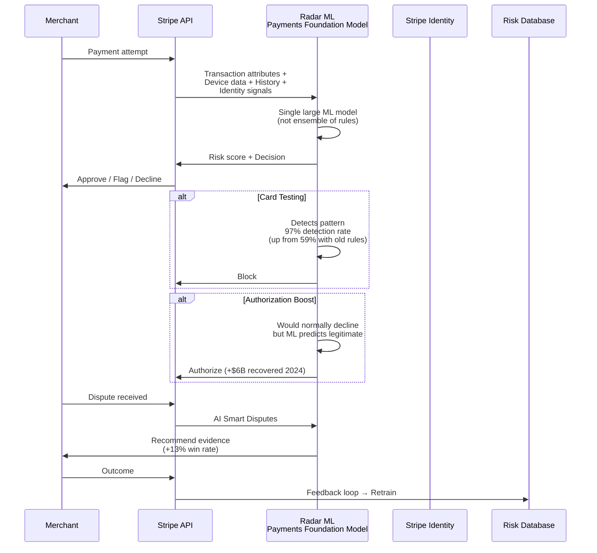

# Stripe — Risk Decision Process

## Risk Philosophy

**"Accept more, block less."** Stripe's risk approach is built on ML models trained on $1.4 trillion in payment volume. The Payments Foundation Model (Radar's core) replaced dozens of hand-built fraud models with one large model. Result: 97% card-testing attack detection (up from 59%), 17% lower dispute rates while industry fraud rose 15%, and $6 billion in wrongly declined payments recovered via Authorization Boost in 2024.

---

## Verification Tiers

### Tier 0: Account Creation (Instant)

| Attribute | Detail |
|-----------|--------|
| Trigger | All new merchant signups |
| Methods | Basic identity collection: name, DOB, address, business name; email + phone verification; business type classification |
| Data sources | Self-reported info; platform-prefilled data |
| Decision logic | Account object created immediately; no verification at this step |
| SLA | Instant |

### Tier 1: Onboarding Submitted (charges_enabled)

| Attribute | Detail |
|-----------|--------|
| Trigger | User completes onboarding flow (currently_due fields submitted) |
| Methods | ML-based identity matching; business website LLM scan + classification; OFAC/sanctions screening; basic bank account validation |
| Data sources | Platform-prefilled data, Stripe Radar ML, OFAC SDN, business URL scan |
| Decision logic | ~80% auto-approved instantly. Auto-decline for sanctions match or prohibited business. Borderline → manual review. |
| SLA | Minutes to hours (automated); 1-3 business days (document verification) |

### Tier 2: Full KYC/KYB (payouts_enabled + no holds)

| Attribute | Detail |
|-----------|--------|
| Trigger | 30 days after first transaction OR $1,500 cumulative volume |
| Methods | Full SSN verification; EIN/TIN cross-reference with IRS; full address verification; UBO identity verification; enhanced sanctions re-screening |
| Data sources | IRS database, credit bureaus, business registries, OFAC |
| Decision logic | All `eventually_due` fields move to `currently_due`. If unmet by deadline → charges + payouts disabled. |
| SLA | 2-5 business days |

### Tier 3: Enhanced Verification (Platform-Triggered)

| Attribute | Detail |
|-----------|--------|
| Trigger | Platform-configured for high-risk sellers; Stripe Identity add-on |
| Methods | Government ID + selfie liveness match; additional business documents; enhanced UBO verification |
| Data sources | Stripe Identity (computer vision + ML matching) |
| Decision logic | Platform can programmatically gate first payout or full access behind this tier |
| SLA | ~90 seconds for user to complete selfie + document scan |

---

## Fraud Detection: Radar ML

### The Payments Foundation Model

### Detection Signals

| Signal | Detection Method | Performance |
|--------|-----------------|-------------|
| Card testing attacks | ML pattern recognition across billions of transactions | 97% detection (up from 59%) |
| Token abuse | Cross-payment-method tracking (cards, bank debits, e-wallets, BNPL, stablecoins) | |
| Account fraud | Identity signals + device fingerprint + behavioral patterns | |
| Free-trial exploitation | Usage pattern analysis | |
| Cross-method fraud | Unified model across all payment methods | |

### Merchant-Adjustable Controls

- Custom Radar rules (per-business ML training)
- Block/allow lists
- Risk threshold configuration
- Manual review queue with evidence

---

## Sanctions & Compliance

| List | Method | Timing |
|------|--------|--------|
| OFAC SDN | Automated API screening | At onboarding + per-transaction + continuous |
| Country sanctions | BIN/IP-based blocking | Real-time |
| EU/UN sanctions | Automated screening | At onboarding |
| PEP screening | Database cross-reference | At onboarding + continuous |
| Business verification | Website LLM scan + product description analysis | At onboarding |

---

## Ongoing Monitoring: Detect → Decide → Act → Recover

| Phase | What Happens | Automation |
|-------|-------------|------------|
| **Detect** | Radar ML continuously scores every transaction; anomaly detection flags unusual patterns | Fully automated |
| **Decide** | Automated policies determine action: monitor, request docs, impose reserve, disable charges, disable payouts | Automated with manual override |
| **Act** | Controls applied programmatically: reserve % increased, payout held, onboarding re-initiated | Automated via API |
| **Recover** | Seller sees clear remediation path via Dashboard or embedded components; submits docs; verification re-runs | Automated re-review + manual for edge cases |

---

## Takeaways for QBO

1. **Radar's Payments Foundation Model proves that single-model > ensemble-of-rules approach works at scale.** QBO's risk scoring (credit bureau + IRS only) needs ML upgrade.
2. **Authorization Boost ($6B recovered) is the risk model's greatest conversion feature.** Catching false declines is as important as catching fraud. QBO's binary approve/deny has no equivalent.
3. **AI Smart Disputes (+13% win rate) turns risk into a retention feature.** Helping merchants win chargebacks increases trust and reduces churn.
4. **Detect → Decide → Act → Recover loop is a great framework for continuous risk management.** QBO needs: auto-detect anomalies, automated action, clear recovery path for merchants.

---

## Sources

- [Stripe Radar](https://stripe.com/radar)
- [Stripe Identity](https://stripe.com/identity)
- [Stripe Sessions 2026](https://stripe.com/sessions)
- [Stripe Fraud Detection Analysis](https://whitesight.net/stripes-fraud-detection-and-prevention-system-is-secretly-its-best-salesman/)

---

## Change Log

| Date | Change |
|------|--------|
| 2026-08-05 | Initial creation — Stripe risk decision process analysis |
