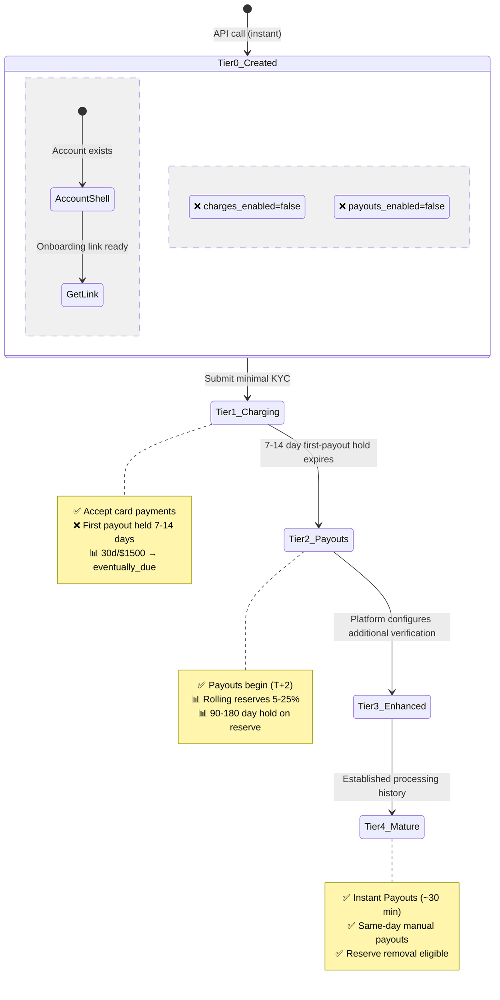
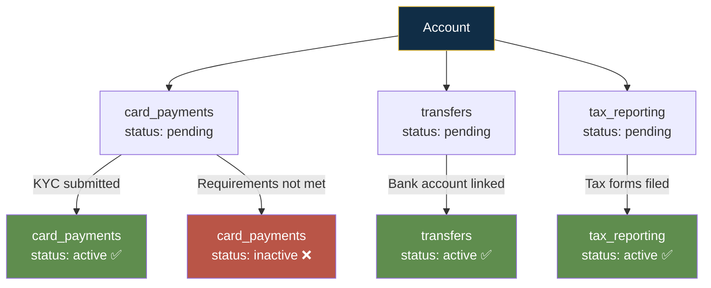

# Stripe — Entitlement Model

## Entitlement Philosophy

**"Create first, verify later."** Stripe's progressive activation is built around capability-based gating — not a monolithic "verified or not" binary. In the v2 API, each capability (`card_payments`, `transfers`, etc.) independently tracks its own verification status. A merchant might have card payments active but transfers still pending. This enables fine-grained progressive activation: unlock what's verified, keep gated what's not.

---

## Entitlement Tiers

### Tier 0: Account Created (No Verification)

| Attribute | Detail |
|-----------|--------|
| Requirements | Email, business_type, country — no identity, no SSN, no bank account |
| Limits | Cannot accept payments. `charges_enabled=false`. `payouts_enabled=false`. Pure account shell. |
| Features unlocked | Account object exists; onboarding link can be generated and shared immediately |
| Hold periods | N/A — no transactions possible |
| Reserve requirements | None at this tier |

### Tier 1: Onboarding Complete — charges_enabled (Minimal KYC Submitted)

| Attribute | Detail |
|-----------|--------|
| Requirements | `currently_due` fields: business name, URL/MCC, representative name/DOB/email, SSN last-4, bank account for payouts |
| Limits | **Can accept card payments immediately.** First payout held 7-14 days (mandatory, risk mitigation). |
| Features unlocked | Accept card payments, Stripe Dashboard, configure products/prices/subscriptions, issue refunds, Radar fraud protection, real-time reporting |
| Hold periods | **First payout: 7-14 days.** Standard settlement: T+2 after initial period. 30-day / $1,500 trigger for `eventually_due` escalation. |
| Reserve requirements | Rolling reserves may be applied: 5-25% of each transaction held 30-180 days |

### Tier 2: Full KYC/KYB Complete — payouts_enabled (All Verification Passed)

| Attribute | Detail |
|-----------|--------|
| Requirements | All `eventually_due` fields submitted: full SSN, full address, EIN verification, UBO details (for company entities) |
| Limits | Full limits. Payouts on standard T+2 schedule. Some payment method limits may still apply regionally. |
| Features unlocked | Regular payouts, full verification badge, reduced reserve requirements over time, eligible for additional capabilities |
| Hold periods | Standard T+2 settlement. Rolling reserves continue at reduced percentage based on clean history. |
| Reserve requirements | 5-25% rolling reserve, reviewed periodically. Reduction based on: low chargeback rate, consistent delivery, stable patterns. |

### Tier 3: Enhanced Verification (Platform-Triggered ID + Selfie)

| Attribute | Detail |
|-----------|--------|
| Requirements | Government-issued photo ID + selfie liveness check via Stripe Identity. Platform-configurable for high-risk categories. |
| Limits | No additional limits — this tier strengthens verification, doesn't increase limits. |
| Features unlocked | Platform can programmatically gate first payout or full marketplace access behind this; access to captured ID images; configurable volume thresholds tied to verification |
| Hold periods | Platform can hold first payout until ID+selfie passes |
| Reserve requirements | Enhanced verification may reduce reserve requirements as a risk-mitigation signal |

### Tier 4: Mature / Low-Risk Account (Established History)

| Attribute | Detail |
|-----------|--------|
| Requirements | 6+ months stable processing, low chargeback rate (<0.3%), consistent volume, all KYC current, no compliance flags |
| Limits | Custom pricing available. Higher ACH limits, same-day manual payout eligibility (up to $1M, 10/day). |
| Features unlocked | Instant Payouts (~30 min, 0.5% fee), accelerated settlement (2-day ACH), custom/negotiated rates, reserve removal eligible, fully flexible payout schedule |
| Hold periods | T+1 to T+2 settlement (fastest). Same-day manual payout eligible. Instant Payouts available (~30 min). No artificial holds beyond settlement time. |
| Reserve requirements | Minimal or zero reserve. Negotiable removal. |

---

## Capability-Based Model (v2 API)

**Key insight:** Each capability independently tracks `pending` → `active` → `inactive`. Different capabilities have different requirement sets. A merchant might have `card_payments=active` but `transfers=pending` if bank account verification hasn't cleared. This is the most granular entitlement model in fintech.

---

## Risk-vs-Conversion Trade-off

| Entitlement Decision | Risk if Too Generous | Conversion Loss if Too Restrictive | Verdict |
|----------------------|---------------------|----------------------------------|---------|
| **Instant charges_enabled** | Medium — fraudsters can process stolen cards | Would be catastrophic — "can I accept payments?" is the #1 question | **Brilliant.** First-payout delay + rolling reserves contain risk retroactively. |
| **7-14 day first-payout delay** | Low if shortened — chargeback window is 120 days | Medium — cash flow is #1 merchant pain point | **Keep but communicate transparently.** The delay is necessary but opacity breeds frustration. |
| **Rolling reserves 5-25%** | Medium if removed for low-risk — exposure | Medium — reserves tie up working capital | **Data-driven graduation is the right model.** Behavior-based reduction over 90-180 days. |
| **30 day / $1,500 eventually_due trigger** | Low — most legitimate merchants pass this naturally | Low — threshold is reasonable | **Good calibration.** Balances "verify later" promise with regulatory reality. |
| **Capability-gated activation** | Very Low — each capability independently verified | Very High — merchant gets exactly what they've earned | **Industry best practice.** Every regulated company should adopt this pattern. |

---

## Takeaways for QBO

1. **Capability-based entitlement is the single best pattern QBO should adopt.** Replace binary "access/no access" with: `dashboard_viewing`, `bank_connections`, `invoice_creation`, `payroll_processing`, `tax_filing` — each independently gated behind its own verification requirements.

2. **First-payout delay as risk backstop enables "create first, verify later."** QBO equivalent: let users connect bank + see transactions immediately, delay payroll runs and ACH origination until identity + bank verification complete.

3. **eventually_due escalation model sets clear expectations.** 30 days or $1,500 — whichever comes first. QBO should set equivalent: "You can use basic features now. Full SSN and EIN required within 30 days or once you try to run payroll."

---

## Sources

- [Stripe Connect Accounts v2](https://docs.stripe.com/connect/accounts-v2)
- [Stripe Payouts](https://docs.stripe.com/payouts)
- [Stripe Additional Verifications](https://docs.stripe.com/connect/additional-verifications)
- [Stripe Reserves](https://directpaynet.com/stripe-reserves-everything-you-need-to-know/)

---

## Change Log

| Date | Change |
|------|--------|
| 2026-08-05 | Initial creation — Stripe entitlement model analysis |
