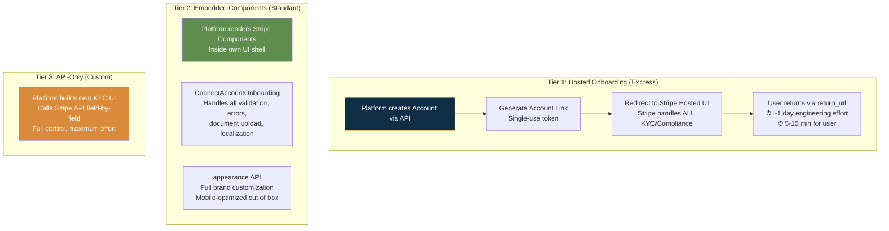
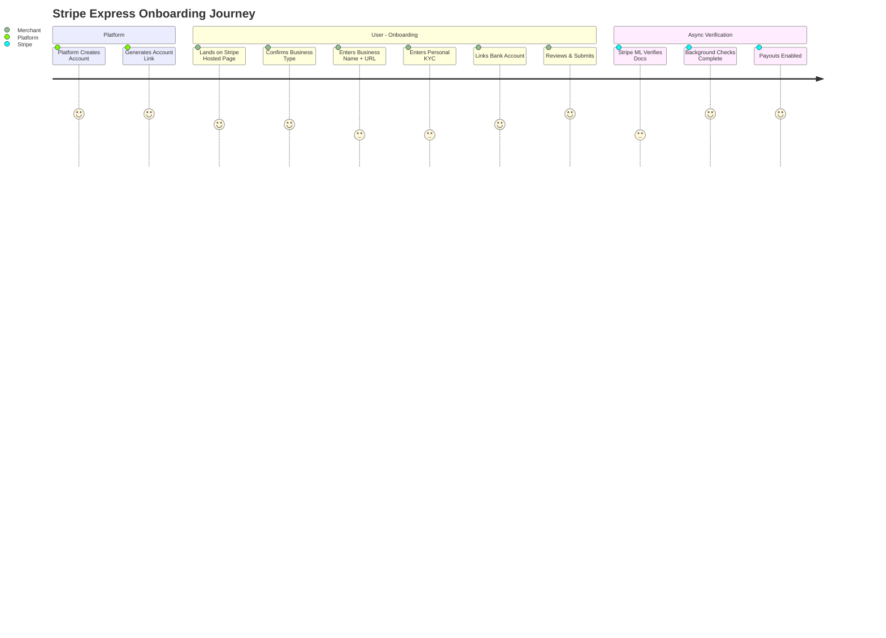
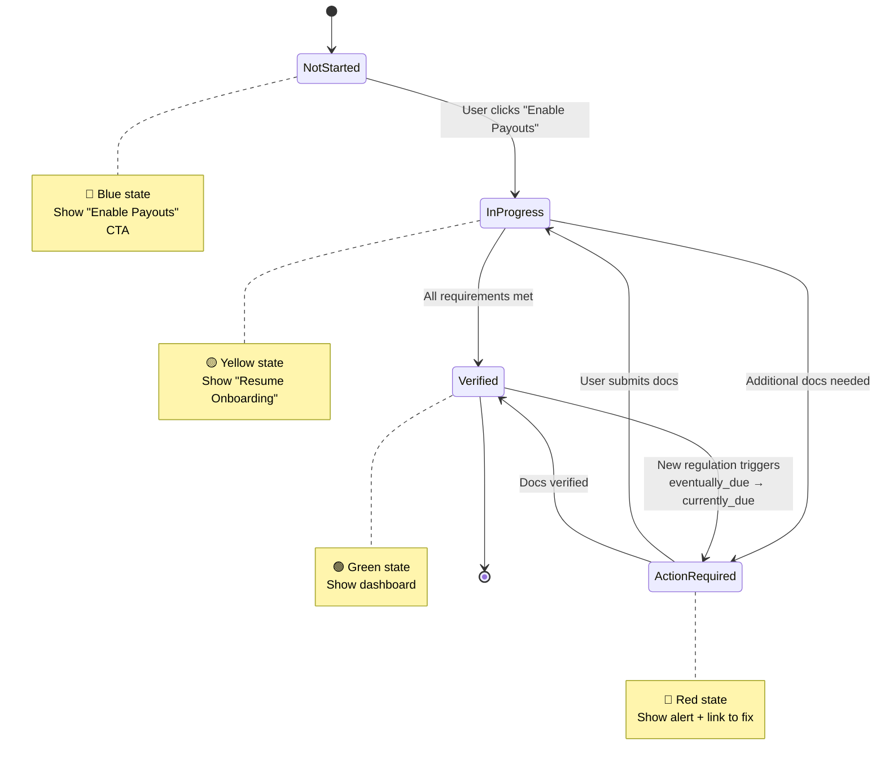

# Stripe — UI/UX Flow & Agentic Experience

## Flow Overview

| Attribute | Detail |
|-----------|--------|
| Total steps | 3-4 (Express hosted); 7 (full breakdown including async verification) |
| Estimated time | 5-10 min form fill; 1-3 business days for full async document verification |
| Mobile optimized | Mobile-first responsive; React Native SDK for AccountOnboarding; native iOS/Android SDKs |
| Completion rate | >80% auto-approved instantly (industry-leading) |
| Abandonment recovery | Notification banner re-surfaces outstanding requirements; status-driven UI states |
| AI-powered | 7 major AI features: Radar ML, Identity, Smart Disputes, Link AI Wallet, MCP Server, Issuing for Agents, Sigma |
| Design system | Sohne typeface, indigo primary, deep navy text, tabular figures for financial data |

---

## Three-Tier Onboarding Architecture

### Embedded Components Catalog

| Component | What It Does |
|-----------|-------------|
| **ConnectAccountOnboarding** | Full KYC/KYB onboarding with progress tracking, validation, document upload |
| **AccountManagement** | Post-onboarding account info editing and verification status display |
| **Payments** | Payment method management and transaction view |
| **Payouts** | Bank account management and payout schedule configuration |
| **NotificationBanner** | Auto-surfaces outstanding requirements with clear remediation CTAs |
| **Documents** | Document upload and verification status for additional requirements |
| **TaxSettings / TaxRegistrations** | Tax form collection and registration management |

---

## Complete User Journey

---

## Status-Driven UI States

---

## Friction Points

| Friction Point | Why Exists | Severity | Mitigation | Could Remove? |
|---------------|------------|----------|------------|--------------|
| **Account Link expiration** | Security-sensitive short-lived tokens; must not be cached | 3 | `refresh_url` auto-generates fresh link on expiration | No — security requirement |
| **Return URL ≠ completion confirmation** | Document verification runs async (1-3 days); user may exit before done | 4 | Always check `charges_enabled` + `payouts_enabled`; webhook `account.updated` is source of truth | No — async verification is fundamental |
| **eventually_due → currently_due escalation** | Regulatory thresholds trigger new requirements at 30 days or $1,500 | 4 | Proactive reminders before deadline; embedded notification banner; re-initiate onboarding flow | No — regulatory mandate |
| **First payout delay (7-14 days)** | Core risk management — catch fraud before money exits system | 3 | Transparent communication about timing; progressive reduction as history builds | No — essential risk backstop |
| **Express KYC data blackout** | Once Account Link created, platform cannot read/update KYC via API | 3 | Use Standard accounts + embedded if you need KYC data access | By design for Express tier |

---

## Agentic / AI-Powered Features

| Feature | Description | Conversion Impact | Maturity |
|---------|-------------|-------------------|----------|
| **Stripe Radar (Payments Foundation Model)** | One large ML model replaced dozens of hand-built fraud rules; trained on $1.4T volume; 97% card-testing detection | Authorization Boost recovered $6B in wrongly declined payments (2024); 17% lower dispute rates | Production |
| **Stripe Identity** | ML-powered KYC: matches government ID to live selfie via computer vision; feeds into Radar for enhanced scoring | ~90 sec completion vs days of manual; fewer false rejections | Production |
| **AI Smart Disputes** | Auto-recommends evidence (tracking numbers, user logs) to improve chargeback win rates | +13% chargeback win rate (companies like Vimeo, Squarespace) | Production |
| **Link AI Wallet + Agentic Commerce** | 250M+ users authorize AI agents to pay via single-use virtual cards; partnerships with Meta, Google, OpenAI, Microsoft | Enables agent-mediated checkout; zero credential exposure | Production (2026 launch) |
| **Stripe MCP Server** | Managed Postgres + MCP exposing Stripe data to AI agents; llms.txt machine-readable docs; stable snake_case naming | Agents autonomously manage payments, billing, refunds with audit trails | Production |
| **Issuing for Agents + Machine Payments Protocol** | Single-use virtual cards scoped to individual AI agents; streaming payments via Tempo (L1 blockchain) + per-token billing | AI-to-AI commerce; any agent pays anywhere cards accepted | Production (2026 launch) |
| **Stripe Sigma** | SQL analytics with AI-assisted query building; third-party tools detect agent-vs-human transaction patterns | Visibility into agent channel as distinct revenue stream | Production |

---

## Notable UI Patterns

| Pattern | Where Used | Why Effective |
|---------|-----------|---------------|
| **Three-panel documentation** | Docs: left nav + center prose + right runnable code | Hover-to-highlight synchronizes prose and code; never leave page |
| **"One-action rule"** | Every screen has at most one primary CTA; welcome email: single "Activate Account Now" button | Eliminates cognitive load; frames setup as 2-minute task |
| **Markdoc authoring** | Docs treated as software — custom components, conditional branching by language/version, build-time validation | Every code sample pre-fills developer's actual test key |
| **Status-driven UI** | Four states with distinct colors: Not Started (blue), In Progress (yellow), Verified (green), Action Required (red) | Users always know exactly what to do next |
| **Idempotency as UX** | Every API request is idempotent by design | Removes "what if my retry creates a duplicate charge?" anxiety |
| **Context-preserving navigation** | Drawer (ContextView) for side-by-side + overlay (FocusView) for focused tasks | Prevents context loss when switching surfaces |
| **Consistent design language** | Same visual system across docs, API reference, dashboard, and brand | Developers move between surfaces dozens of times per session |

---

## Takeaways for QBO

1. **Embedded components + platform prefill is the model to copy.** Let ISV partners embed QBO onboarding inside their own UI with full brand customization. QBO handles compliance + verification; partner handles UX.
2. **"One-action rule" applies everywhere.** QBO's onboarding has too many CTAs per screen. One primary action per step.
3. **Status-driven UI with 4 clear states.** QBO's onboarding status is binary (done/not done). Add: Not Started, In Progress, Verified, Action Required — each with distinct visual treatment.
4. **Agent-ready documentation (llms.txt + MCP).** QBO needs MCP server + machine-readable docs so AI agents can handle bookkeeping setup autonomously.

---

## Sources

- [Stripe Connect Embedded Onboarding](https://docs.stripe.com/connect/embedded-onboarding)
- [Stripe Sessions 2026](https://stripe.com/sessions)
- [Stripe Design System](https://docs.stripe.com/stripe-apps/design)
- [Stripe Developer Experience Analysis](https://www.moesif.com/blog/best-practices/api-product-management/the-stripe-developer-experience-and-docs-teardown/)
- [Stripe vs PayPal 2026 Developer Comparison](https://dev.to/actinode/stripe-vs-paypal-in-2026-a-developers-honest-comparison-4j9m)

---

## Change Log

| Date | Change |
|------|--------|
| 2026-08-05 | Initial creation — Stripe UI/UX and agentic experience analysis |
