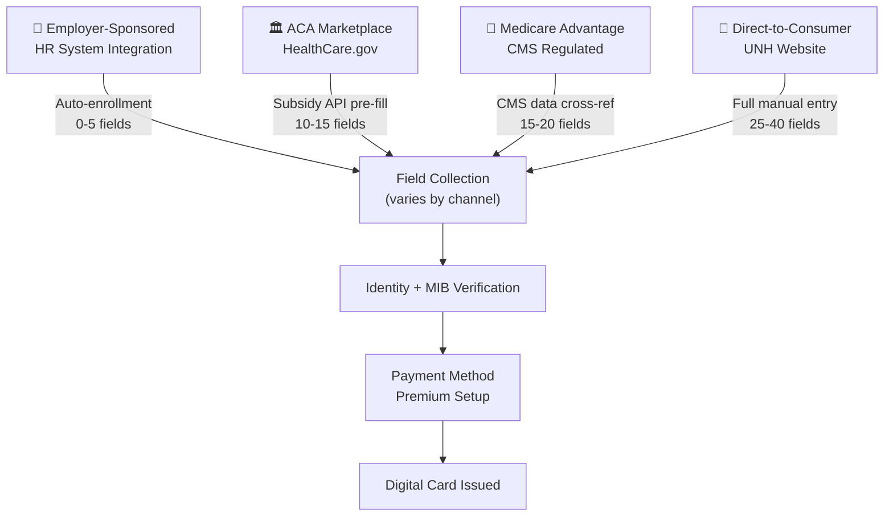

# UnitedHealth Group — Fields Collected & Collection Strategy

## Core Insight

**"Employer auto-enrollment is the zero-friction gold standard. Individual enrollment is a HIPAA compliance form-fest."** The field collection strategy is not one flow — it is four completely different flows depending on acquisition channel, each with different field sets, pre-fill sources, and drop-off profiles.

## Fields by Channel

### Channel 1: Employer-Sponsored (50M+ members — dominant channel)

| Field Group | Fields | Source | Collected By |
|-------------|--------|--------|-------------|
| **Identity** | Name, SSN, DOB | HR/payroll system | Pre-filled — no user entry |
| **Contact** | Address, phone, email | HR system | Pre-filled — user confirms only |
| **Plan Selection** | Group ID, plan tier (bronze/silver/gold/platinum) | Employer benefits portal | Pre-selected — employer-defined options |
| **Dependents** | Spouse name/DOB/SSN, children names/DOBs/SSNs | Declared during open enrollment | HR portal or paper form |
| **PCP Selection** | Primary care physician name, NPI, location | Provider directory lookup | User selects from in-network list |
| **Payment** | Bank account or payroll deduction | Payroll system | Pre-filled — payroll deduction default |

**Total fields: 0-5 user-entered** (nearly everything pre-filled from HR/payroll data).

### Channel 2: ACA Marketplace Exchange (HealthCare.gov)

| Field Group | Fields | Source | Collected By |
|-------------|--------|--------|-------------|
| **Identity** | Name, SSN, DOB | HealthCare.gov API | Pre-filled via federal data hub |
| **Income** | Household income, tax filing status, dependents | IRS data cross-ref via HealthCare.gov | Pre-filled for subsidy calculation |
| **Subsidy** | APTC eligibility, CSR eligibility | HealthCare.gov eligibility engine | Auto-computed |
| **Plan Selection** | Metal tier, plan ID, premium, deductible | Marketplace plan browser | User selects from marketplace options |
| **Contact** | Address, phone, email | HealthCare.gov account | Pre-filled |
| **Payment** | Bank account or credit card for first premium | User entry | Manual entry required |

**Total fields: 10-15 user-entered** (subsidy data pre-filled from federal hub).

### Channel 3: Medicare Advantage (Age 65+ / Disability)

| Field Group | Fields | Source | Collected By |
|-------------|--------|--------|-------------|
| **Identity** | Name, SSN, DOB, Medicare number | CMS/Social Security data | Pre-filled via CMS cross-reference |
| **Eligibility** | Medicare Part A/B effective date, ESRD status | CMS enrollment database | Verified, not collected from user |
| **Health Status** | Medical history questionnaire, current medications, chronic conditions | User self-report | User completes (required for underwriting) |
| **PCP Selection** | Primary care physician, specialists | Provider directory | User selects from Medicare network |
| **Rx Drug List** | Current prescription medications, dosages, pharmacy preference | User self-report | User enters manually |
| **Payment** | Medicare Part B premium deduction from Social Security, Part C/D supplemental premium payment | SSA/CMS | Part B auto-deducted; supplemental via bank/credit card |
| **Dependents** | Medicare is individual; spouse has separate enrollment | N/A | Spouse enrolled separately |

**Total fields: 15-20 user-entered** (Medicare identity pre-filled; health data and preferences are manual).

### Channel 4: Direct-to-Consumer (UNH Website / Broker / Agent)

| Field Group | Fields | Source | Collected By |
|-------------|--------|--------|-------------|
| **Identity** | Full name, SSN, DOB, gender | User entry | Manual — no pre-fill |
| **Contact** | Address, phone, email | User entry | Manual |
| **Household** | Spouse info, children, dependents | User entry | Manual |
| **Health Questionnaire** | Medical history, pre-existing conditions, current medications, tobacco use, height/weight, recent hospitalizations | User self-report | Manual — long form |
| **Plan Selection** | Plan type, deductible, premium, network, prescription coverage, dental/vision add-ons | UNH plan browser | User browses and selects |
| **PCP Selection** | Primary care physician from in-network directory | Provider search tool | User searches and selects |
| **Rx Drug List** | All current prescriptions (name, dosage, frequency), preferred pharmacy | User entry | Manual — detailed |
| **Payment Method** | Bank account, credit card, or invoice for first premium | User entry | Manual |

**Total fields: 25-40 user-entered** (no pre-fill — full manual collection).

---

## Conversion Tactics by Channel

| Channel | Tactics | Conversion Rate (est.) | Key Friction |
|---------|---------|----------------------|-------------|
| **Employer** | Auto-enrollment, payroll deduction, HR benefit fairs, default opt-in with opt-out | **85-95%** (near-automatic) | Almost none — enrollment is the default |
| **Marketplace** | HealthCare.gov guided flow, subsidy calculator (premium tax credits), side-by-side plan comparison, SEP (Special Enrollment Period) triggers | **40-60%** (govt-assisted) | Subsidy sticker shock, plan complexity, income verification gaps |
| **Medicare** | CMS-regulated enrollment periods, AEP (Oct 15-Dec 7), Medicare Plan Finder, SHIP counselors | **50-65%** (high-intent population) | Medical questionnaire length, Part B premium income-related adjustment surprise |
| **Direct** | Plan recommendation quiz, premium calculator, broker/agent assistance, call center support, save-and-resume | **15-30%** (highest drop-off) | Premium sticker shock, medical questionnaire abandonment (30-50+ questions), identity verification friction |

---

## Takeaways for QBO

1. **Channel-specific onboarding is the real pattern.** UNH doesn't have one onboarding — it has four. QBO should consider: self-employed (Schedule C pre-fill from IRS), small business (EIN lookup), accountant-managed (accountant portal pre-population), and enterprise (HR/benefits integration).

2. **Auto-enrollment via third-party integration is the ultimate friction-eliminator.** Employer auto-enrollment at UNH proves that if you can integrate with a trusted data source (HR system), you can reduce user-entered fields to near zero.

3. **Pre-fill from government databases is defensible and effective.** HealthCare.gov API pre-fills income, identity, and subsidy eligibility from IRS/CMS/DHS data. QBO could pre-fill business info from Secretary of State business registries and IRS EIN databases.

4. **The medical questionnaire is the drop-off cliff.** QBO's equivalent is the chart of accounts setup and tax classification wizard — simplify or defer these.

---

## Change Log
| Date | Change |
|------|--------|
| 2026-08-05 | Initial creation — UnitedHealth fields analysis |
