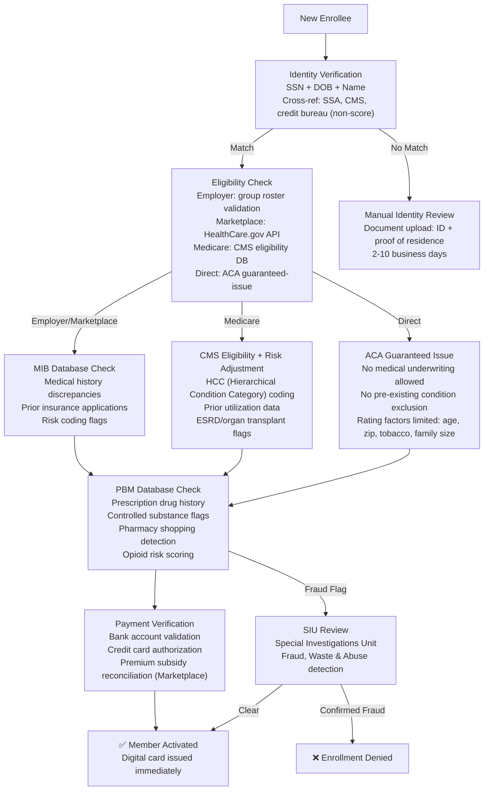

# UnitedHealth Group — Risk Decision Process

## Core Insight

**Healthcare onboarding risk is NOT about creditworthiness — it is about identity verification, medical eligibility, and fraud detection in a $4.3T system with 10%+ estimated fraud/waste/abuse.** Unlike banking (ChexSystems, credit reports), UNH's risk decision process uses MIB (Medical Information Bureau), prescription drug database cross-references (PBMs), SSN-based identity verification, and CMS eligibility data. Medical underwriting for individual plans is now prohibited under the ACA for guaranteed-issue plans, but Medicare Advantage and supplemental plans retain underwriting authority.

## Verification Tiers

| Tier | Method | Data Source | SLA | Applies To |
|------|--------|-------------|-----|------------|
| **Identity** | SSN + DOB + Name cross-reference | SSA Death Master File, credit bureau identity (non-score), CMS Medicare database | Instant (<30s) | All channels |
| **Employer Eligibility** | Group roster validation, employment verification | Employer HR system API, Equifax Work Number | Instant to 24h | Employer-sponsored |
| **Marketplace Eligibility** | APTC/CSR subsidy verification, income attestation | HealthCare.gov Federal Data Services Hub (IRS, DHS, SSA) | Instant | ACA Marketplace |
| **Medicare Eligibility** | Part A/B enrollment verification, ESRD status, risk adjustment data | CMS Enrollment Database, CMS Risk Adjustment Suite | Instant to 48h | Medicare Advantage |
| **Medical History (MIB)** | Prior insurance applications, medical condition codes, lifestyle flags | MIB (Medical Information Bureau) — 230+ member insurers | Instant | All except ACA individual |
| **Rx Drug History** | Prescription fill history, controlled substance monitoring, pharmacy shopping | PBM databases (OptumRx, Express Scripts, CVS Caremark), state PDMPs | Instant | All channels |
| **Payment Validation** | Bank account, credit card, or payroll deduction verification | Banking networks, employer payroll | Instant to 3 business days | All channels |
| **Fraud/Waste/Abuse** | Provider fraud patterns, member identity theft, enrollment fraud | UNH SIU (Special Investigations Unit), CMS FWA database, NCCI edits | Days to weeks (post-enrollment) | All channels |

## What UNH Does NOT Check (vs Banking/Fintech)

| Banking KYC Check | UNH Equivalent | Difference |
|-------------------|----------------|------------|
| **ChexSystems** (banking history) | NOT CHECKED | Healthcare does not use banking history |
| **Credit Report / FICO Score** | NOT CHECKED (ACA prohibits for individual plans) | Medical debt used to affect credit scores; CFPB now limits this |
| **OFAC Sanctions** | OFAC check performed (required for all US entities) | Same requirement; lower false-positive rate in healthcare |
| **PEP Screening** | Not routine for consumers | Relevant only for executives on corporate plans (rare) |
| **Adverse Media** | Not routine for consumers | SIU checks for organized fraud rings |
| **Bank Statement Review** | Not performed | Income verified via tax returns (Marketplace) or employer (group) |
| **Phone/Email Reputation** | Basic validation only | Not a primary fraud vector in healthcare (yet) |

## Key Regulatory Framework: HIPAA vs BSA/AML

| Dimension | Banking (BSA/AML) | Healthcare (HIPAA) |
|-----------|------------------|---------------------|
| **Governing Law** | Bank Secrecy Act, USA PATRIOT Act | HIPAA, HITECH Act, ACA |
| **Primary Concern** | Money laundering, terrorist financing | Patient privacy, medical fraud |
| **Data Sensitivity** | Financial transaction data | PHI (Protected Health Information) — higher sensitivity tier |
| **Identity Verification** | CIP (Customer Identification Program) required | No federal CIP mandate for insurers; state-level requirements vary |
| **Suspicious Activity Reporting** | SARs filed with FinCEN | No SAR equivalent; fraud referred to HHS-OIG, CMS, NBI |
| **Ongoing Monitoring** | Transaction monitoring, CTRs, SARs | Claims analysis, utilization review, FWA detection |
| **Penalties** | Civil + criminal; AML program failures | HIPAA violations: $100-$50,000 per record, up to $1.5M/year; False Claims Act for fraud |

---

## Takeaway for QBO

UNH's risk model flips banking on its head: identity verification matters (SSN/DOB), but the primary risk screening uses medical databases (MIB, PBM, CMS) that have no banking equivalent. The closest parallel for QBO: business verification databases (Secretary of State, IRS EIN registry, Dun & Bradstreet) function similarly to MIB — they cross-reference claims the applicant makes against a central industry database.

---

## Change Log
| Date | Change |
|------|--------|
| 2026-08-05 | Initial creation |
