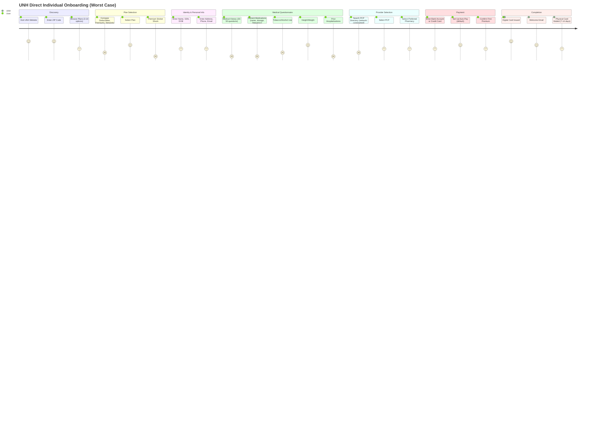

# UnitedHealth Group — UI/UX Flow & Agentic Experience

## Core Insight

**UNH's UX is a tale of two experiences: the employer auto-enrollment flow (best-in-class, sub-5-minute, single-confirmation-screen) vs the individual direct-to-consumer flow (worst-in-class, 30-60 minute, multi-screen medical questionnaire that feels like a tax audit).** The agentic/AI experience is simultaneously the most advanced in healthcare (Optum's AI processes millions of claims daily) and the most controversial (AI-driven prior authorization denials have drawn Congressional hearings).

| Attribute | Employer Channel | Individual/Direct Channel |
|-----------|-----------------|--------------------------|
| Steps | 1-3 (confirm, select PCP, done) | 15-30+ screens |
| Time | <5 minutes | 30-60 minutes |
| Mobile-first | Web-based; HR portal mobile-responsive | UNH app + mobile web; partially optimized |
| Pre-fill | Near 100% from HR data | Near 0% pre-fill |
| Abandonment Rate | <5% | 40-70% (est.) |

## Direct-to-Consumer Flow (The Full Experience)

## Friction Points and Why They Exist

| Friction Point | Why It Exists | Mitigation | Severity |
|----------------|---------------|------------|----------|
| **Premium sticker shock** | ACA metal tiers expose real cost of US healthcare; individual premiums $400-800+/month | Subsidy calculator early in flow; income-based APTC estimate before plan selection | **Critical** — largest single drop-off point |
| **Medical questionnaire** | Required for risk adjustment coding (HCC), Medicare underwriting, and population health management | Progressive disclosure; "skip for now" on non-critical fields; pre-fill from prior insurance records | **High** — 30-50 questions cause abandonment |
| **PCP selection paralysis** | Narrow networks; users must commit to a PCP before seeing any doctor; provider directory is often outdated | "Skip PCP, pick later" option; provider search by location/specialty/ratings; telehealth-first option | **High** — "I don't know who to pick" is a common stall |
| **SSN entry hesitation** | Identity theft fears; users reluctant to enter SSN on web forms | Explain WHY SSN needed (identity verification, CMS matching, 1095-B tax reporting); show security certifications | **Medium** — most complete it but with anxiety |
| **Network uncertainty** | "Will my doctor accept this plan?" is the #1 question; provider directories are notoriously inaccurate | Provider search by name before plan selection; "check my doctor" tool; real-time network validation | **High** — users abandon if they can't confirm their doctor is in-network |
| **Rx formulary unknowns** | "Will my medications be covered?" is the #2 question; formulary lookup is complex | Drug price lookup tool; therapeutic alternatives suggestion; real-time prior auth check for existing Rx | **High** — chronic condition patients cannot proceed without certain coverage |

## Agentic / AI Experience

UNH's Optum division is one of the most aggressive deployers of AI in healthcare. The agentic experience spans both consumer-facing and back-end systems.

### Consumer-Facing AI

| Feature | Description | Maturity | Rating |
|---------|-------------|----------|--------|
| **Symptom Checker** | AI-powered triage: enter symptoms, get likely conditions, care level recommendation (ER/urgent/PCP/self-care) | Deployed at scale | 3/5 — useful but generic; no integration with personal health record |
| **Plan Selection Chatbot** | Q&A bot for plan comparison: "What's my deductible?" "Is my doctor in-network?" "Which plan covers my medications?" | Deployed; variable quality | 2/5 — frequently defers to human agent; limited domain knowledge |
| **Cost Estimator** | Predicts out-of-pocket cost for procedures given plan, deductible status, and network | Rolling out; accuracy improving | 3/5 — good when it works; inaccurate for complex procedures |
| **Virtual Assistant (App)** | In-app assistant for: find a doctor, check claim status, view EOB, request ID card, pay bill | Deployed | 3/5 — functional but not conversational; menu-tree disguised as chatbot |
| **Automated Claims Status** | Real-time claims tracking with AI-generated explanations: what was billed, what insurance paid, what you owe | Rolling out | 4/5 — reduces call center volume significantly |

### Back-End AI (Optum)

| Feature | Description | Controversy Level |
|---------|-------------|-------------------|
| **AI Prior Authorization** | Machine learning models review PA requests, predict approval/denial, auto-process low-risk cases, flag high-risk for human review | **Very High** — Congressional investigation (2024); lawsuits alleging auto-denial without human review |
| **Claims Adjudication AI** | Automated claims processing: coding validation, medical necessity checks, fraud detection, payment determination | High — provider groups allege systematic underpayment |
| **Clinical Decision Support** | AI recommendations to providers: suggested treatments, drug interaction warnings, care gap alerts | Medium — helps providers but seen as insurance company influencing care |
| **Risk Adjustment Coding** | NLP on medical records to identify HCC codes for Medicare risk adjustment; more codes = higher CMS reimbursement | Medium — DOJ investigating "upcoding" practices at multiple insurers including UNH |
| **Fraud, Waste & Abuse Detection** | ML models on claims data to identify billing fraud, medically unnecessary services, kickback patterns | Low — broadly accepted as legitimate use |

### The Optum AI Controversy

In 2023-2024, a Senate subcommittee investigated Medicare Advantage insurers' use of AI for prior authorization. Key findings specific to UNH/Optum:

- Optum's algorithm (used by UNH + sold to other insurers) processes millions of PA requests annually
- Internal documents (unsealed in class-action litigation) suggested an expectation that only 10-20% of denied claims would be appealed — and the algorithm was optimized accordingly
- CMS proposed rule (Dec 2024) requiring that AI-assisted denials include a human clinician review before finalization
- UnitedHealth settled a class-action lawsuit in 2024 regarding systematic AI-driven denial of post-acute care (skilled nursing facility stays) for Medicare Advantage members

The trust deficit this creates is the biggest barrier to UNH's agentic experience: when consumers know the chatbot is made by the same company whose AI denied their grandmother's nursing home stay, the "helpful AI assistant" framing collapses.

---

## Takeaways for QBO

1. **Don't build an AI that gatekeeps what users want.** Optum's AI prior auth debacle is a cautionary tale: when AI's job is to say "no," users will hate it regardless of UX polish. QBO's AI should help users accomplish things, not block them.

2. **The medical questionnaire is the drop-off cliff — QBO's equivalent is the chart of accounts setup.** Progressive disclosure + "skip for now" + smart defaults can reduce abandonment dramatically.

3. **Provider directory = Chart of accounts.** The #1 and #2 drop-off points in healthcare (network uncertainty, Rx formulary unknowns) mirror QBO's onboarding: "which accounting method?" and "which chart of accounts template?" Answer these before asking for commitment.

4. **Digital card = instant dashboard.** UNH's immediate digital card issuance shows the power of instant gratification even when the full product takes weeks to deliver. QBO should grant instant dashboard + basic invoicing on signup.

---

## Change Log
| Date | Change |
|------|--------|
| 2026-08-05 | Initial creation |
